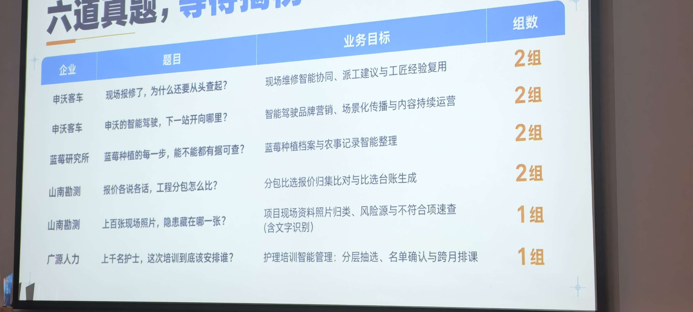
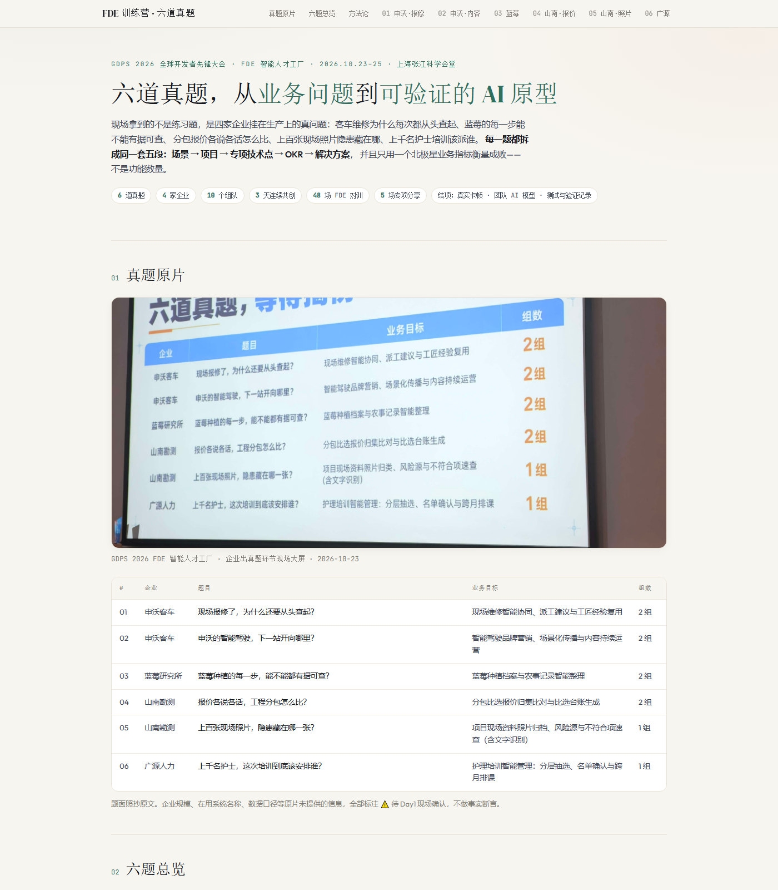

# FDE 训练营

> **GDPS 2026 全球开发者先锋大会暨国际具身智能技能大赛 · FDE 智能人才工厂**
> 2026.10.23–25 · 上海 · 张江科学会堂 · 主题"具身进实景，劳动最光荣"
> 企业出真题 → 团队实战 → 企业验证
> 主办：世界人工智能大会组委会指导，上海市人工智能行业协会、中国电子技术标准化研究院主办，张江集团、陆家嘴集团联合主办
> 详见 [`docs/训练营背景.md`](docs/训练营背景.md)

本仓库做一件事：**把现场拿到的 6 道真实企业真题，逐题拆成可执行的 FDE 作战方案**——场景、项目、专项技术点、OKR、解决方案。

**拆解只有三层，不多不少**（L1 业务问题 → L2 能力缺口 → L3 可复用机制），规则见 [`docs/拆解规范.md`](docs/拆解规范.md)。
**每个 L3 都标了同族复用**——本方案一并能解决哪些相邻问题，这就是"举一反三"的落点。

---

## 一、真题原片



<sub>来源：GPS 2026 FDE 智能人才工厂 · 企业出真题环节现场大屏 · 2026-10-23</sub>

### 原片文字转录

| # | 企业 | 题目 | 业务目标 | 组数 |
|---|------|------|----------|------|
| 01 | 申沃客车 | 现场报修了，为什么还要从头查起？ | 现场维修智能协同、派工建议与工匠经验复用 | 2 组 |
| 02 | 申沃客车 | 申沃的智能驾驶，下一站开向哪里？ | 智能驾驶品牌营销、场景化传播与内容持续运营 | 2 组 |
| 03 | 蓝莓研究所 | 蓝莓种植的每一步，能不能都有据可查？ | 蓝莓种植档案与农事记录智能整理 | 2 组 |
| 04 | 山南勘测 | 报价各说各话，工程分包怎么比？ | 分包比选报价归集比对与比选台账生成 | 2 组 |
| 05 | 山南勘测 | 上百张现场照片，隐患藏在哪一张？ | 项目现场资料照片归档、风险源与不符合项速查（含文字识别） | 1 组 |
| 06 | 广源人力 | 上千名护士，这次培训到底该安排谁？ | 护理培训智能管理：分层抽选、名单确认与跨月排课 | 1 组 |

> 题面照抄原文。企业规模、在用系统名称、数据口径等**照片未提供**的信息一律标 `⚠️ 待 Day1 现场确认`，不臆造。

---

## 二、四家企业是谁（联网核实）

**这一节是全部方案的地基。** 不知道企业真实在做什么，写出来的一定是通用模板。

| 企业 | 真实身份 | 对本题的校准 | 等级 |
|------|---------|-------------|------|
| **申沃客车** | 上海申沃客车有限公司，上汽集团全资客车研发制造企业，2000 年成立，车型 7–27 米覆盖纯电/燃料电池/插混；9 系配 ADAS 智能驾驶辅助系统。2026-06 与享道出行（SAIC 移动出行品牌）签"数字化+智能化"战略合作：车联网平台、**RoboBus 自动驾驶**、AI 大模型，享道输出 Robotaxi 云控架构并**联合构建车辆监控调度平台与乘客预约客户端**，明确"**推动 AI 融入研发、生产、售后全流程**" | 不是"修车厂"，是**车队型运营商的售后**——目标函数是恢复运营。题 02 在业务上等于"**从卖车转向卖运营服务**"。企业已接受 AI，问题不是启蒙而是**闭环补全** | 3（仅供参考） |
| **蓝莓研究所** | **上海市蓝莓研究所**（上海金山区，民办非企业单位，2012 年成立，主管单位上海市绿化和市容管理局），所长陆敏。牵头起草**上海市地方标准《蓝莓栽培技术规范》**；敏蓝"**五个统一**"质量管理体系获第九届金山区区长质量奖；基地有物联网智慧农业肥水一体化自动灌溉；中央财政项目辐射带动 502 亩；田间学校培训 6000 余人次 | **不是种植企业，是技术推广方**——资产是"标准 + 品种 + 技术 + 培训"，服务半径远超自有基地。真问题不是"给自己建档"，而是"**把标准、种苗、技术指导的交付过程沉淀成可复核的数据**" | 1 / 3（仅供参考） |
| **山南勘测** | 上海山南勘测设计有限公司，2003 年成立，浦东金桥，持工程勘察（岩土/工程测量/水文地质）、工程测量、海洋测绘、地基基础检测评估等 **6–7 项甲级资质**；主营勘察/监测/检测/测绘/物探/岩土设计。**上海市经信委"质量标杆"案例——已创新提出「AI（All In，全维度嵌入）工作法」**：嵌入政府、设计院、施工、运管单位，成效为优良率 75%→90%、总工期减少 40%+、节约投资 1.2 亿+ | **已经在做 AI 工作法**。本题真实命题是"**把已有 AI 能力从生产/技术环节接到商业与合规环节**"。且身处政府采购评审专家体系 → 口径与留痕要求极高 | 1 / 3（仅供参考） |
| **广源人力** | 上海广源人力资源有限公司，2003 年成立，由**上海市卫生人才交流服务中心 100% 出资**的国有独资企业；与 **155 家医院**合作、**劳务派遣人员超 2.2 万**（2025 年参保 22341 人、营收 33.65 亿）；主营人才派遣/人事外包/管理咨询/**培训评价**；**2026-02 经上海黄浦区人社局备案为企业职业技能等级评价机构**；2026 年在采购"数字员工服务平台""AI 交互真人数字人" | "上千名护士"是**低估**。培训评价是它的**正式资质业务**。国企 + 卫健系统 → 合规、留痕、可审计要求远高于民企。**方案要定位成接进现有数字化盘子的一个模块，不另起炉灶** | 1 / 3（仅供参考） |

> 来源分级与链接见 [`docs/拆解规范.md`](docs/拆解规范.md) 第五节。等级 3 的来源标「仅供参考」，不单独支撑结论。

---

## 三、六题总览

| # | 题目 | 北极星指标（只设一个） | 护栏指标 | 主技术路线 |
|---|------|----------------------|---------|-----------|
| 01 | 现场报修从头查起 | 首次诊断命中率（历史回测 Top-1） | 二次上门率不高于基线 | 工单本体 · 混合检索 RAG · 故障树推理 · 回写工单 |
| 02 | 智能驾驶下一站开向哪 | 单条内容的有效线索数（可归因） | 人工审核耗时不高于基线 | 多模态素材库 · 品牌知识库 · 内容 Agent 流水线 |
| 03 | 蓝莓每一步有据可查 | 追溯完整度（批次能否回溯全部农事） | 农工本人录入占比不低于 70% | 植株级本体 · 照片语音结构化 · 时序溯源 |
| 04 | 分包报价怎么比 | 比选台账产出耗时 | 越权自动确认数 = 0 | 报价行本体 · OCR/Excel 解析 · 口径归一 · 漏项校验 |
| 05 | 隐患藏在哪张照片 | 隐患线索召回率 | 隐患精确率不低于 70% | 照片去重归集 · 逐类隐患 VLM · 标牌 OCR · 混合检索 |
| 06 | 培训该安排谁 | 排课出单耗时 | 硬约束违反数 = 0 | 资格规则引擎 · CP-SAT 约束求解 · 可解释名单 |

### 三层拆解速查（L1 → L2 → L3）

> 每题 L2 是 3–5 条能力缺口，每个 L2 对应 2–3 条 L3 机制。完整拆解树见各题文档「二、三层拆解树」。

| # | L1 业务问题 | L2 缺口 | L3 机制 | 一并覆盖的同族问题（来自各题「七、举一反三」） |
|---|-------------|--------|---------|------------------------------|
| 01 | 现场报修为什么要从头查起 | 4 | 11 | 售后公告闭环 · 热线话术沉淀 · 三电专项故障库 · 配件预测 · 质量追溯与召回圈定 · 技师带徒认证 · **零代码试点对接** |
| 02 | 智能驾驶下一站开向哪里 | 4 | 12 | 改款参数同步 · 公告二次传播 · B 端运营方案书 · 展会素材会后复用 · 联名传播口径统一 · 多平台排期与预算 |
| 03 | 蓝莓每一步能不能有据可查 | 4 | 13 | 地方标准符合性自查 · 认证抽检与溯源系统对接 · 示范区成效统计 · 社员与培训台账 · 新基地建园指导 · **陆敏想做的 AI 模型的数据底座** |
| 04 | 分包报价各说各话怎么比 | 4 | 12 | 投标符合性自查 · 核价与限价审批 · 多版本方案横向比选 · 资质履约核验 · 内部结算核对 · 审计内控与后评价 |
| 05 | 隐患藏在哪一张照片 | 4 | 13 | 探测成果举证 · 隐蔽工程留证与创优归档 · 工期变更争议举证 · 投标业绩成册 · 深基坑作业安全巡检 · 校准标签到期预警 |
| 06 | 上千护士培训该安排谁 | 5 | 12 | 岗位—资质匹配 · 多院区名额分配 · **考评员排期与考点评审** · 补贴名单筛查报送 · 续聘转正名额 · 公交司机排班 |

> **同族问题的判定标准**（不是"听起来宏大"就算）：同数据形态 + 同痛点 + 不换业务知识即可复用。详见 [`docs/拆解规范.md`](docs/拆解规范.md) 第三节。

**单页总览（路演直接开）**：[overview.html](overview.html) — 六题一页看完，含**三层拆解树**、架构图与 OKR 看板。



---

## 四、方法论基线

六份拆解共用同一套骨架，不重复发明概念。

| 原则 | 落地含义 | 在本仓的体现 |
|------|----------|-------------|
| **Ontology 三步法** | Objects（用业务语言定义实体）→ Links（固化关联，不做查询时 JOIN）→ Actions + Write-back（能反改物理世界） | 每题都有实体表与回写点，只读 demo 不算完成 |
| **Echo + Delta** | Echo 听懂业务、定义问题；Delta 快速写代码、交付结果。缺 Echo 变咨询，缺 Delta 变外包 | 每题都标出谁扮演哪个角色；题 02 是 Echo 主导的题 |
| **锁定 1 个业务指标** | OKR 的 KR 必须挂在业务结果上，不是功能数量 | 每题只设 1 个北极星 + 1 个护栏 |
| **5 天 demo 节点** | 不写长需求文档，每 5 天一次客户可见演示 | 每题给 Day1–Day3 现场节奏（训练营制），并挂到 5 天节点 |
| **碎石路 → 高速公路** | 现场定制要留可复用模板 | 每题标注"哪些部分能沉淀成通用件" |
| **假数据比没数据好** | 先用样本/脱敏数据把链路跑通 | 每题给"抓样本 → 建映射 → 渐进接入"三步 |

---

## 五、训练营节奏（现场日程）

| 日 | 主题 | 关键节点 | 我的产出落点 |
|----|------|----------|-------------|
| **Day 1 · 10/23** | 开题·接榜 | 团队破冰 → FDE 理论①企业诊断与场景披露规则 → 企业真题发布 → 接榜 → FDE 理论②需求拆解与方案设计 → 命题评审 → 首轮方案路演 | 选题定档 + `需求五问法`答案 + 首轮路演稿 |
| **Day 2 · 10/24** | 联盟·共解 | 企业共同组日开场 → 命题分享 → 专项分享 ×2 → 企业需求会诊 → FDE 结营①AI 原型开发与测试 → 原型路演与专家质询 | 可跑原型 + 原型路演 |
| **Day 3 · 10/25** | 登岛·出厂 | FDE 理论③快速验证与现场推广 → 专项分享 → 开发者创意快闪 → 项目验收与结项打卡 | 验证记录 + 结项材料 |

> 官方口径：**3 天连续共创实战 · 48 场 FDE 对训 · 5 场专项分享**；实战收获 = **真实卡顿 · 团队 AI 模型 · 测试与验证记录**。结项交的是「可验证的 AI 原型」，不是 PPT。

---

## 六、仓库结构

```
FDE训练营/
├── README.md                    # 本文件：真题原片 + 企业背景 + 三层速查 + 日程
├── overview.html                # 单页总览（路演用；仅字体走 CDN，其余全内联）
├── docs/
│   ├── 拆解规范.md               # 三层结构定义 + 章节模板 + 举一反三规则 + 来源分级 + 企业背景速查
│   └── 训练营背景.md             # 主办方与训练营模式（专项检索成文）
├── assets/
│   ├── 六道题-寻找问题.jpg        # 真题原片（现场大屏）
│   ├── GPS2026-FDE训练营-现场.jpg # 训练营现场实拍（日程来源）
│   └── overview-preview.png       # overview.html 首屏预览
└── problems/
    ├── 01-申沃客车-现场报修协同.md
    ├── 02-申沃客车-智能驾驶内容工厂.md
    ├── 03-蓝莓研究所-种植档案.md
    ├── 04-山南勘测-分包报价比选.md
    ├── 05-山南勘测-现场照片隐患速查.md
    └── 06-广源人力-护理培训排课.md
```

**每篇题解固定八章**：企业背景与选题校准 → 场景 → 三层拆解树 → 项目定义与范围 → 专项技术点 → OKR → 解决方案与架构 → 举一反三 → 风险兜底与 Day1 必问。

### 怎么用

- **看板**：Logseq / Obsidian 直接打开 `problems/` 下的 Markdown，章节标题天然成为大纲。
- **路演**：浏览器打开 `overview.html`（双击即可；联网时加载 Outfit / DM Serif / JetBrains Mono 字体，断网自动回退系统字体，版面不受影响）。
- **协作**：每题一个文件，互不冲突，可并行分工。

---

## 七、Day1 现场必问清单（六题通用）

| 问题 | 为什么必须问 |
|------|-------------|
| 这个流程现在每天跑多少量？峰值多少？ | 决定 ROI 分母，没有基线就没有 OKR |
| 哪一步最花时间？钱花在哪？ | 锁定真正值得动的那一环 |
| 现在用的系统是什么？数据出得来吗？ | 决定是「做原型」还是「做集成」 |
| 有什么不能动（合规/系统/权限）？ | 砍需求的依据，也是防返工的第一道闸 |
| 验收标准是什么？谁签字？ | 需求五问法的最后一问，没有验收就是没需求 |
| 这件事半年后还会做吗？ | 决定沉淀成通用件还是一次性交付 |
| **你们已经做过什么？哪些做砸了？** | **本题新增**——四家企业里申沃、山南、广源都已在做数字化/AI，问清楚已有能力，本方案才能是"补一环"而不是"从头教" |

---

## 八、变更记录

| 日期 | 内容 |
|------|------|
| 2026-10-23 | 建仓；录入真题原片与六题文字转录；完成 6 篇五段式拆解初稿 |
| 2026-10-23 | **联网核实四家企业真实身份**；改版为**三层拆解**（L1 问题 / L2 缺口 / L3 机制）；每题新增**举一反三**章节与**企业背景校准**；新增 `docs/拆解规范.md` |
