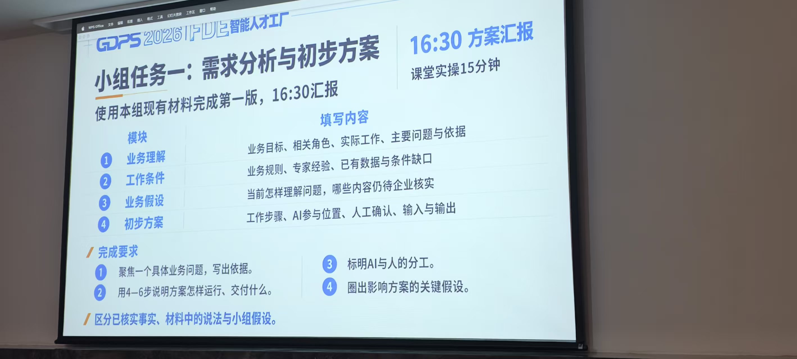

# 上海申沃客车需求分析

建议聚焦：品牌、技术、项目人员按职责审核过宣传表述下次能准确复用，。 以下可直接用于小组汇报。
1．业务理解：谁在做什么，遇到什么问题？
- 业务目标：持续产出面向公交运营商、海外客户、行业伙伴的宣传内容，保证表达有依据。
- 相关角色：品牌人员策划写稿；销售提供客户问题；技术、项目人员核实能力和进展。
暂时无法在飞书文档外展示此内容
- Workflow: 找资料 → 定选题 → 出内容 → 审核 → 保存 → 根据反馈再调整。
- 主要问题：资料分散，每次写稿需要重新查找、核实；以前改过的错误可能再次出现。
- 判断依据：任务书明确描述“重新找资料、核实口径”“修改过的内容不容易复用”；历史草稿把合作写成“已量产运营”。
以上属于材料中的业务描述，尚未通过企业访谈核实实际频次和耗时。任务书

以上属于材料中的业务描述，尚未通过企业访谈核实实际频次和耗时。任务书

角色	业务职责	初步方案中的分工
品牌人员	选题策划、渠道表达、组织审核	主要使用者，选择主题、编辑内容
销售人员	收集客户问题，使用推介材料	提供客户需求，评价内容是否有用
技术人员	解释车型配置与技术能力	确认技术事实及适用范围
项目人员	掌握合作与应用进展	确认项目实际阶段
业务负责人	确定目标与资源优先级	最终负责人及验收方式待确认

2．工作条件：有什么，缺什么？

依据示例：历史草稿声称“运营成本下降30%”，审核要求删除并补充依据；确认口径只支持合作方向及特定车型、项目的事实。历史草稿、确认口径

项目	简单结论
已有资料	产品与新闻摘要、客户问题、图片、历史草稿、审核意见、确认表述、传播反馈
必须遵守的规则	合作不能写成量产；驾驶辅助不能写成无人驾驶；不同车型能力不能混用
需要专家判断	技术人员确认能力与配置，项目人员确认进度与数据，品牌人员确认表达
主要缺口	内部最新进展、成本测算、资料更新责任人，以及实际审核耗时

3．业务假设：我们目前怎样理解，还要核实什么？

小组假设：把可信资料和审核结果集中保存，能减少重复核实。 材料支持这个方向，但效果还需要验证。

需要向企业核实三个关键点：

- 主要耗时确实在找资料和核实吗？ 用最近一篇稿件的处理记录验证。

- 技术、项目人员能定期参与确认吗？ 如果不能，草稿难以变成可复用内容。

- 谁负责更新或作废旧口径？ 如果没人维护，旧内容可能被错误复用。

4．初步方案：用5步跑通一次完整流程

步骤	AI做什么	人做什么	输出
① 整理资料	提取来源、日期、车型和阶段	确认资料可用范围	可查询的资料库
② 匹配问题	为客户问题寻找资料、推荐主题	品牌人员选择主题	4周选题安排
③ 生成草稿	生成各渠道内容，附依据、标出未知项	品牌人员修改	文案初稿
④ 审核保存	展示修改前后差异，保存版本	技术、项目人员确认事实	可复用的确认表述
⑤ 根据反馈调整	汇总新增追问，推荐后续选题	人员确认调整方向	下一轮选题与补资料清单

本轮交付：4周选题安排，以及公众号提纲、官网文案、展会介绍、销售推介；实际发布不在本次范围。交付规则

验证是否有效：找资料和审核的时间是否缩短、同类错误是否减少、已确认表述能否准确复用。第一版先建立这些指标的基线，不预设提升比例。

