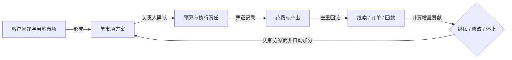

English brief: Review Day 1024's marketing product against the customer request, follow the money, and distinguish demonstrable workflows from unverified business results.

# Day1024 复盘总览：先把钱算清，再谈营销平台

**[判断与建议] 当前最该补的是一份能执行、能核账的单市场试点方案，而不是继续增加菜单和 Agent 岗位。** 客户要求亮点提炼、竞品分析、区域化策略、一线出初稿、负责人校正；现有 `sunwin` 更偏向获客与内容执行演示。[本地证据: `assets/real_request.md:16–30`；`assets/day1024/submit/sunwin.html:575–580,1372–1419`]

## 三分钟看完

| 要回答的问题 | 本轮答案 |
|---|---|
| 钱流向哪里？ | 应分客户市场费、软件自有服务收入、可能的代收代付、软件交付成本四本账。现有材料没有真实付款链。 |
| 实际花了多少钱？ | **未核实**。没有到账单、采购合同、验收和实付；未知不等于零。 |
| 实际挣了多少钱？ | **未核实**。商机、成交、收入、回款、贡献与净利润不能混用。 |
| “每月省30万”可信吗？ | **不能据现有材料成立**。会议转述的30万有不同分母；70%经手额不等于可取消成本，50%返利缺计提基数与凭证。 |
| 哪些东西值得保留？ | 客户问题与证据关联、渠道适配、人工纠正、版本绑定审批的设计。规范写了不代表成品已实现。 |
| 下一步做什么？ | 确认产品与单一市场，访谈当地销售负责人；把预算、责任人、凭证、线索、订单和回款串起来。 |

会议数字来自 AI 纪要与参会人口述，只作待核实线索。[来源: 4-《企业AI营销系统方案讨论》p5、《AI企业落地方案路演评审》p9 51:08；仅供参考]

## 一组教学数字，把三种“钱”分开

> **全部是任意教学假设，不是客户预算、供应商报价、预测或已验证效果。** 90天、单一市场、每笔净收入10万元均未由客户确认；这个单价不是申沃车型价格。计算真源为 `model-inputs.json`，用 `calculate.py` 复算。

- 客户：列示总成本 **8.5万元**；其中假设外付7.3万元、归属人工1.2万元。没有实付凭证，不能当成真实支出或现金节约。
- 客户：假设成交3个新客户，净收入30万元，营销前贡献率25%，贡献7.5万元；扣营销成本后 **少1万元**，ROI **−11.76%**。此处还强假设全部成交都是增量；不等于已回款，也不是企业净利润。
- 软件方：假设自有服务收入1.5万元、直接交付成本1.25万元，留下 **2500元交付贡献**；尚未扣获客、研发、管理和税，不是净利润。
- 同样假设下至少 **4笔**回本；若只有50%成交可算增量，至少 **7笔**。现实必须核验增量与销售周期。

看图：先看客户要做的决定；再看每笔支出能否追到产出；最后由负责人根据证据决定是否继续。图是建议结构，不表示系统已经接通这些环节。

## 四条先改的事

1. **把样例、规则与真实能力分开。** 随机涨分、硬编码曲线、提示“导出成功”都不能证明效果。[本地证据: `submit/sunwin.html:1293–1301,1342–1353,1472–1473,1579–1590`，路径均相对 `assets/day1024/`]
2. **预算、人审、付款分别控制。** 内容审核通过，不等于批准花钱；现有内容签字机制不能冒充财务控制。
3. **策略先回答投入取舍。** 不只列渠道；说明为什么选、费用如何核实、谁执行、何时判断无效。
4. **保留边界，不倒推旧任务全错。** 旧规格本来排除了真实模型和投放；本轮批评的是新需求未闭环与演示承诺过强，不擅自改旧 AC。

## 从哪里打开

1. **交互总览**：[`index.html`](index.html)。可调费用、成交、贡献率、增量份额；默认算例全部标教学假设。
2. **钱的细账**：[`01-钱流向与经营账.md`](01-钱流向与经营账.md)。四账、成本项、收入与回款、三种情景、预算控制与两幅资金/凭证图。
3. **PRD挑刺**：[`02-PRD挑刺与试点重构.md`](02-PRD挑刺与试点重构.md)。需求映射、优先级、已有能力与待确认项。
4. **机制经验**：[`03-营销产品设计与Agent经验.md`](03-营销产品设计与Agent经验.md)。营销、产品、设计、Agent 与可复用 Skill 候选。
5. **有声讲解**：[`video.mp4`](video.mp4)，Edge TTS 中文男声与烧录字幕；另有 [`subtitles.srt`](subtitles.srt)、[`04-视频讲解稿.md`](04-视频讲解稿.md)。
6. **如何核对**：[`05-证据与阅读边界.md`](05-证据与阅读边界.md)、[`06-验证记录.md`](06-验证记录.md)；原文、计算、观察与推断分别记录。

## 阅读边界

本轮只读审计现存材料，不修改原 PRD、源演示、007 规格或 AC；没有调用真实营销数据源、投放平台或客户模型。`real_request.md` 是截图“AI总结”的文字版，不是逐字访谈或客户签字验收单。内部文件锚点只证明文件写了什么；对企业实绩不作事实背书。

交付形式按本轮补充为多报告、Mermaid、HTML和视频；费用、售价、转化、窗口均未猜成客户事实。原清单保留，未提交、推送、发布公网或创建新的 Agent Manager 会话。只在本目录新增报告与生成物；大二进制不入库。具体生成验证结果以 `06-验证记录.md` 为准。

> 免责声明：本输出由 AI 辅助生成，仅用于信息整理与研究参考，不构成专业意见或决策依据。
