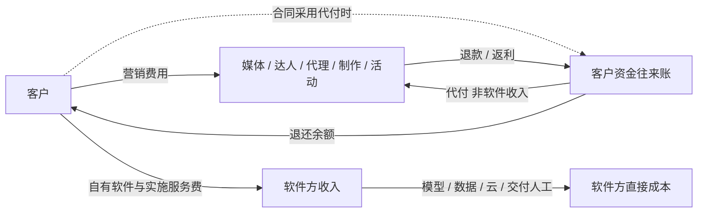
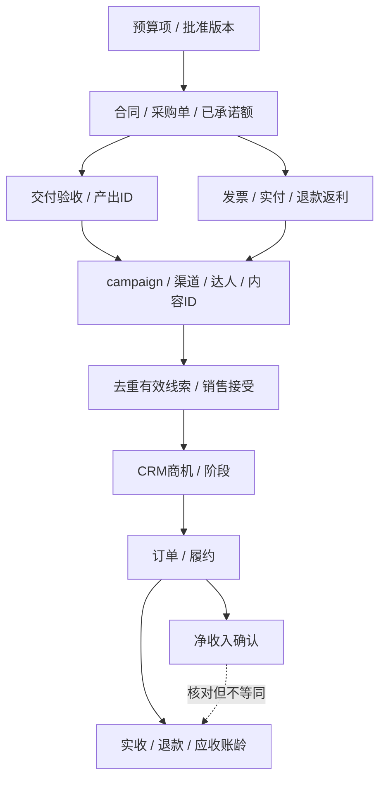

English brief: Audit who pays whom, separate marketing spend from software revenue, and trace budgets through delivery, sales and collections. Use a reproducible teaching scenario without presenting assumptions as customer results.

# 钱流向与经营账

## 结论

现存材料能展示获客与内容运营，但没有交出可核对的经营账。**未提供真实营销账单、软件收费合同、CRM成交和回款凭证，实际花多少、挣多少均无法核实；未知不等于零。**

最直接的口径矛盾：`assets/day1024/submit/sunwin.html:460–462` 展示三类商机2,140万、3,920万、1,180万元，合计7,240万元，海外占54.14%；`submit/sunwin-deck/sunwin-deck.html:220` 却写“商机金额占比30%”。数量占比不能移作金额占比，**商机也不是收入、利润或回款**。这些都只是原型数字，没有真实性背书。[本地证据: 上述文件锚点；计算见 `calculate.py`]

`sunwin-deck.html:405–414` 的“年度预算4.2亿”属于示例公交客户画像，不是本项目营销预算。`sunwin.html:429–430` 说“86个有效商机”，`:1282` 又说“86家成交客户”，两种阶段不能混用。

## 一、30万不能直接省掉

两份旧会议材料的说法不同：

- “代运营一个月花30万，系统可省30万”。[来源: 4-《企业AI营销系统方案讨论》AI纪要，p5；仅供参考]
- “每月30万营销成本，其中七成流向代运营”；另有“平台给代运营约50%回扣”。[来源: 4-《AI企业落地方案路演评审》AI纪要，p9 51:08、p11；仅供参考]

前一句把30万当代运营费，后一句把30万当营销总额。没有账单可以确定哪一个分母成立。即使暂按后一句做算术，30万×70%=21万元，**也只是经手额，不是可取消成本**。“50%”的计提基数、条件、归属和兑现时间不明，本报告不继续乘算。

KOL/KOC和代理经手的钱可能包括媒体采买、制作、发布、授权、执行与净服务费。AI少写几篇稿，不会让媒体采购和真实人工执行自动消失；如果代理还承担垫资、账号运营、选人、验收与效果追踪，替代后这些责任要重新分配。

**可兑现现金节约 = 经凭证确认、确实取消的旧支出 − 新增现金支出。** 释放工时另记为产能，不直接记现金节约；已签长期合同、不可取消支出与转型期双跑不能漏掉。

## 二、四账分开

| 账 | 谁付谁 | 最容易混淆的地方 |
|---|---|---|
| 客户市场费 | 客户→媒体、达人、代理、制作及活动方 | 批准预算不等于消耗，更不等于实付 |
| 软件方自有收入 | 客户→软件方的订阅、实施、用量或运营服务费 | 客户卖产品的收入不是软件方收入 |
| 可能的代收代付 | 仅合同采用时，客户充值→平台→供应商 | 充值、待付余额、媒体代付款不能直接算软件收入 |
| 软件交付成本 | 软件方→模型、数据、云、实施、审核、支持 | 演示没有真实调用，不代表生产交付免费 |

下图是建议账务结构，**不表示当前平台真的经手客户资金**：



返利属于谁、何时抵扣、由谁开票应写进合同。客户已把软件服务费记为成本后，不能再把软件方的模型和人工成本重复计进客户成本。媒体充值与最终净消耗也不能加两次。

## 三、花多少钱、挣多少钱：一组可复算教学情景

> **以下全部为任意教学假设：90天单市场，非客户预算、报价、预测或效果；不建议照数批准支出。** 市场与产品未选定，单笔10万元不是申沃车型报价。时间窗与成交观察应覆盖真实销售周期。

### 3.1 客户花在哪里

| 项目 | 教学情景 / 元 | 核账时应补什么 |
|---|---:|---|
| 媒体净消耗 | 30,000 | 平台消耗、退款、税费及代理结算 |
| 达人制作与发布 | 12,000 | 人选、报价、内容/发布验收、授权 |
| 本地化与其他内容制作 | 8,000 | 翻译、审校、制作与修改范围；与达人费去重 |
| 活动与客户会议 | 5,000 | 场地、邀约、参会与跟进记录 |
| 软件与试点服务 | 15,000 | 服务范围、交付、付款节点、退费条件 |
| 客户直接采购的数据工具 | 3,000 | 授权范围、期限与计费单位 |
| 客户归属人工 | 12,000 | 工时、分摊标准、销售跟进成本 |
| **列示合计** | **85,000** | 实际遗漏费用必须追加，不可宣称完备 |

其中假设外付项合计73,000元，人工分摊12,000元。**这不是实际付款、工资减少或现金节约证据。** 客户直接数据费与软件方自购数据费假设为不同合同；真实采购要去重。

### 3.2 软件方留下多少

软件方假设自有服务收入15,000元；其直接成本为模型500、数据1000、云500、实施工时5000、审核返工工时4000、支持工时1500元，合计12,500元。

**交付贡献 = 15,000 − 12,500 = 2,500元；贡献率16.67%。** 尚未扣软件方销售获客、研发、管理、融资和税，不是净利润，也不保证当期收到了现金。

这揭示一个产品取舍：[判断与建议] 初期不要仅优化 Token。实施、审核、返工与支持同样需要核算；若靠大量定制人工才能成交，可能是在做服务生意，不能用 SaaS 毛利的印象定价。只有真实工时与账单能验证这个判断。

### 3.3 客户卖了三十万，也可能没回本

假设单笔净收入100,000元，已经扣除履约变动成本、但尚未扣营销费的贡献率25%，每笔贡献25,000元。净收入口径暂假设扣退货、统一不含流转税，真实应由财务确认。

三个情景都强假设成交100%为增量；**这不是已验证因果事实**：

| 指标 | 保守 | 基准 | 乐观 |
|---|---:|---:|---:|
| 去重有效线索 | 60 | 100 | 160 |
| 销售接受 | 12 | 25 | 48 |
| 去重新客户成交 | 1 | 3 | 6 |
| 净收入 / 元 | 100,000 | 300,000 | 600,000 |
| 营销前增量贡献 / 元 | 25,000 | 75,000 | 150,000 |
| 扣85,000营销费后 / 元 | −60,000 | −10,000 | 65,000 |
| 营销ROI | −70.59% | −11.76% | 76.47% |

基准列示成本CPL为850元、CAC为28,333.33元；只包括已列费用，遗漏销售薪酬、差旅、佣金等必须补齐，不能说已覆盖企业完整获客成本。营销后贡献仍不是企业净利润。

100%增量假设下回本至少4笔；如果增量份额只有50%，基准ROI为−55.88%，回本至少7笔。归因假设足以改变结论，不能把客户本来就会下的订单全算成AI功劳。

### 3.4 公式和复算

```text
列示营销总成本 = Σ列示项目净额（已经包含归属人工）
已在项目净额中冲减的退款返利，不得再次扣减；原金额与退款另列台账
增量贡献 = 去重新客户数 × 单笔净收入 × 营销前贡献率 × 增量份额
营销后贡献 = 增量贡献 − 营销总成本
营销ROI = 营销后贡献 ÷ 营销总成本
回本成交数 = ceil(营销总成本 ÷ (单笔净收入 × 贡献率 × 增量份额))
```

执行 `python calculate.py`，从 `model-inputs.json` 生成 `model-results.json`；核心使用 Decimal，非模型心算。`index.html` 嵌入同一输入快照，用浏览器确定性计算作敏感性分析；改变输入后须重新生成HTML及视频中的相关情景。

分母为零或输入无效时不显示无限大。成交观察未成熟要写“观察期未结束”，不能把未结单强行计成0；净收入和实际回款分开核对。静态三情景表保留默认输入，不随网页控件改变，页面已注明。

## 四、预算必须能回到凭证，再追到成交和回款



看图：预算先变成承诺，不等付款才占额度；支出接到具体产出；订单接收入和回款两条线。关联证明可追踪，**不自动证明增量因果**。

| 控制阶段 | 必留记录 |
|---|---|
| 批准 | 市场、期间、目标、成本类别、限额、负责人、批准版本 |
| 承诺 | 合同对象、锁定金额、取消条件，避免“未付款所以没占预算” |
| 验收 | 数量、质量、授权、产出ID、验收人、返工与未达标 |
| 实付 | 凭证、日期、币种、收款方、发票与结算流水 |
| 退款返利 | 基数、归属、已到账/未兑现、抵扣与余额 |

KOL/KOC另记发布、授权、额外加热、可追踪链接与线索归属；代理合同拆媒体代付与净服务费。结算按“交稿、发布、有效线索、销售接受、成交还是回款”必须提前约定，且有重复、无效、归因争议与退费处理。

## 五、指标与开销的盲区

- **CPL**：统一企业/个人去重、有效定义与验收；便宜垃圾线索不等于低获客成本。
- **CAC**：费用和新客户属于同一获客批次、足够成熟；不能拿本月费用除多年存量成交。
- **ROAS**：可归因净销售收入÷广告净消耗，不是利润率；混入自然流量或商机金额会误导。
- **ROI**：用增量贡献和完整列示成本，有对照更好；没有对照只报告观察变化。
- **Agent成本**：真实输入/缓存/输出用量×对应版本单价，加工具、图像/视频、失败重试、云与人工；每次调用绑定任务和产出。
- **现金**：批准、承诺、消耗、应付、已付、应收、实收不同。即便盈利，也可能先垫资、晚回款。
- **品牌与销售周期**：[判断与建议] 知名度和成交分开设目标，可用目标买方触达、品牌搜索或认知访谈观察前者，但曝光不能折算成确定收入。不能把所有品牌费用强行用短期成交判死，也不能用品牌价值为无限支出开脱；阶段目标、观察窗与上限仍须商定。
- **出海附加项**：[判断与建议] 另问本地化审校、渠道佣金、税费、汇率、跨境付款、授权与合规审阅费用。没有报价或合同就标待核实，不把国内模板报价直接移给海外试点。

已有控制不能漏报：`sunwin.html:1076–1080` 明确降本30%待核实；007规格`:39–42` 有版本双审，`:117–118` 排除真实投放与模型调用。前者是提示，后者是规范，**都不能当成预算审批或实付证据**。

## [判断与建议]

优先拿最近一个完整周期的账单、合同、活动记录、CRM和回款数据；再确认试点市场、实际销售周期与负责人。由客户确定预算上限、暂停条件、投诉/退订等护栏和扩张条件，不擅自替客户填阈值、改AC。

先判断哪些钱真能取消、哪些只是换收款方、哪些新增。没有账单和独立验证前，停止使用“每月省30万”“宣传成本归零”或“AI已带来这些收入”的承诺。

> 免责声明：本输出由 AI 辅助生成，仅用于信息整理与研究参考，不构成专业意见或决策依据。
