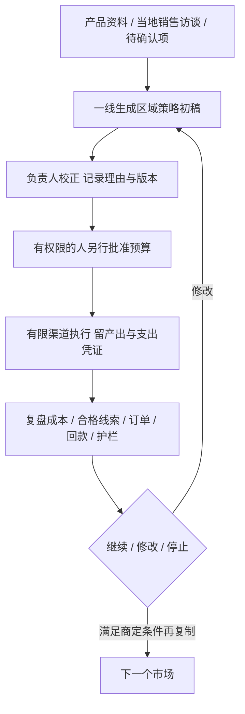

English brief: Challenge the existing marketing product against the customer's regional strategy request, preserve useful controls, and propose a narrow pilot without silently changing approved acceptance criteria.

# PRD挑刺与试点重构

## 结论

**[判断与建议] 客户当前更需要一份“哪个市场先怎么做、投入多少、谁执行、如何核验”的策略方案；现存sunwin演示的重心是获客与内容执行。** 不是从头推翻，而是把已有证据、渠道和审核机制放回这份方案下面。

本地文件只证明写了什么或代码如何组成，不证明客户事实与企业效果。主展开PRD目录缺失；旧归档找回了部分角色台实现，未运行。**不能说旧工作台从未实现，也不能把归档、007规范和当前sunwin成品混成一个已验收系统。** 详见证据报告。

## 一、先认清三个层次

| 层次 | 材料 | 可证明什么 / 不能证明什么 |
|---|---|---|
| 本轮需求线索 | `assets/real_request.md:5,16–30` | 来自截图AI总结，不是逐字访谈或签字验收。明确策略、试点、区域差异与负责人校正 |
| 现存演示 | `assets/day1024/submit/sunwin.html` 及配套deck | 可静态审查规则、模板和交互；不能证明真实模型、数据库授权、投放、增长 |
| 规范与历史归档 | `specs/007-*`；根目录两份fail_demo.zip | 规范规定版本人审；归档有旧实现。目录缺失不等于历史不存在，历史自述通过不等于本轮重跑 |

旧申沃任务本来要求四周内容、四类物料及审核版本，007也明确不做后端、真实模型和投放。[本地证据: 原始 `品牌渠道与内容规则.txt:1–6`；007 `spec.md:117–118`] 因此“不接真模型”不是旧mock违约；应批评的是新需求仍未闭环，以及演示把模拟说成真能力。

## 二、按真实需求逐条看

以下H=`assets/day1024/submit/sunwin.html`，D=`submit/sunwin-deck/sunwin-deck.html`，S=`specs/007-marketing-role-workbenches/spec.md`，C为该规格 `contracts/workflow.md`。

| 客户需求 | 已有基础 | 缺口与判断 |
|---|---|---|
| 产品亮点提炼 | H:575–580有品类、技术卖点；S:62–65有原句候选与确认规范 | 输入卖点不等于从材料提炼、比较并验证。部分覆盖 |
| 结合竞品分析 | Firstello参考页研究了交互，不是客户产品竞品研究 | 尚未找到进入策略产物的真实替代方案对比。应比较客户实际会选的竞品、代理、人工或不行动 |
| 可执行推广策略 | H:1372–1419有四渠道模板；:1521–1528有触达序列 | 不能说只会搜资料；但缺市场选择理由、预算、执行责任与验证条件 |
| 单市场试点，成功后复制 | H:578同时覆盖多个地区，:446–448讲全语种全天候 | 尚无已确认单市场、成本上限、成熟观察窗与复制判据 |
| 区域差异 | H:1278地域过滤；:1521–1528语言、时区 | 地理筛选不等于采购链、竞争、渠道与成本差异驱动打法 |
| 一线初稿、负责人校正 | H:1342–1353有画像反馈；007有审核链 | C:7–12中销售提问题、内容岗生成，与销售生成策略是不同权限和产物，不能直接换名复用 |
| 提升知名度和销售 | H:426–431、935–941有样例漏斗 | 未有真实成交、回款或增量证据；传播与经营目标需分别验证 |
| 确认市场、访谈当地负责人 | `real_request.md:29–30`仍是待办 | 未找到确认完成记录；宁波、墨西哥都是例子，不能默认已选定 |

## 三、按优先级挑刺

P0指可能误导经营与验收决策；P1指相对本轮策略需求的关键缺口；这是评审分级，**不是新增已批准AC**。

| 优先级 | 具体问题与证据 | 后果 | 建议 |
|---|---|---|---|
| P0 | H:460–462商机金额，:430商机86与:1282成交86混用；无付款回链 | 把管道价值当业绩，预算决策失真 | 商机、成交、收入、回款、贡献分列；预算到凭证全回链 |
| P0 | H:1293–1301随机池；:1343–1344负反馈固定加分；:1579–1590随机涨指标 | 让观众以为系统真在学习，曲线可支持追加投入 | 每图标模拟；不报未经评测的提升，反馈只生成记录与待验任务 |
| P0 | D:291承诺高风险生成拦截，H:1372–1419无对应证据状态判断 | 红标签制造已经保护的错觉 | 区分内部草稿与对外放行；展示一条无法绕过的失败路径 |
| P0 | 展开PRD、角色台路径与现存成品不一；007任务仍有未完成项 | 用规范能力替成品背书 | 为每个版本标文件、需求、已验证与未验证；归档代码不冒充当前功能 |
| P1 | H:805–825数据库连接/授权展示，:1490–1516联系人邮箱拼接与随机电话 | 隐藏真实授权采购成本，也容易误信能直接触达 | 标供应商示意、未采购未接通；核报价、授权范围与合法使用条件 |
| P1 | H:578全域范围，未有已确认试点成本与停止线 | 无法隔离哪笔钱买到什么 | 先一个市场、客群、有限渠道；客户商定限额、窗口和护栏 |
| P1 | H:1372–1401模板生成与竞品、地区条件缺因果关系 | 内容看起来丰富，策略仍是通稿 | 每条策略连到客户问题、竞争证据、当地条件、渠道理由与费用 |
| P1 | H:1224、1472–1473导出仅提示；:1511–1516加入序列仅状态提示 | 交付不可带走，无法回核 | 导出要有文件、采纳要有任务；未接外部动作写预览 |

上述不是“再加一张财务看板”的需求。风险根因是把页面完整度当业务完整度，把好看的结果当经过验证的结果。

## 四、已有价值不能抹掉

- 问题库把问题、切入角度、素材、风险、责任人放在一起；H:1061–1120。
- CQ04明确降本30%须基准与样本，CQ08强调来访不等于订单，CQ10区分试点、量产、商业运营；H:1076–1110。
- 有产品输入、地域、人工画像反馈与渠道适配；不是“完全没有营销能力”。
- 007把审批绑版本，原句定位与源改版失效是很好的规范；归档旧实现也确有相关阻断代码，但本次没有运行验收。

Firstello笔记中“客户不要全自动”“我们领先”“直接复用”过强。客户要求校正不可缺，不等于拒绝所有执行自动化；公开页面未展示人审，不等于竞品没有。[本地证据: `reference/firstello/分析与借鉴.md:45,62,73`]

## 五、建议的窄试点PRD，不直接改原AC

建议PRD只回答六件事：

1. **经营对象**：卖什么、谁付钱、为什么现在买、当地谁有决策权；产品对象本身仍待确认。
2. **试点边界**：哪个市场和客群、哪些有限渠道，哪些不做；不默认全球、全数据源、自动投放。
3. **输入与证据**：产品亮点、竞品/替代方案、当地销售知识；标有效日期、原句、负责人和未确认项。
4. **策略产物**：市场选择理由、价值主张、渠道排序、动作排期、预算选项、产出、责任人、下一步。
5. **控制与反馈**：稿件校正、预算批准、付款授权独立；源改版重审；支出、线索与订单可追溯。
6. **验证**：知名度与销售分别确定观察指标；补现有基线、实际销售周期、归因方法、护栏、继续/停止/扩张条件。曝光不当收入，长周期也不自动免除预算责任；全部由客户确认，不能让AI自己填验收。

## [判断与建议] 先补哪些访谈

先要产品与买方、正式PRD版本、单一试点、当地销售负责人、上一完整周期营销账、实际销售周期与回款数据。再问竞品、可取消旧支出、负责人校正的对象和范围。

没有这些信息时先交带缺口的候选方案，不假装交最终策略。预算与业务权限的改变需要后续确认；本报告没有替客户选市场、批准花费、改动验收或源演示。

> 免责声明：本输出由 AI 辅助生成，仅用于信息整理与研究参考，不构成专业意见或决策依据。
