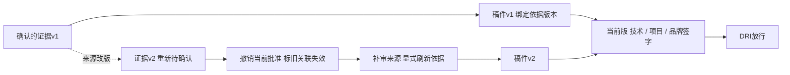
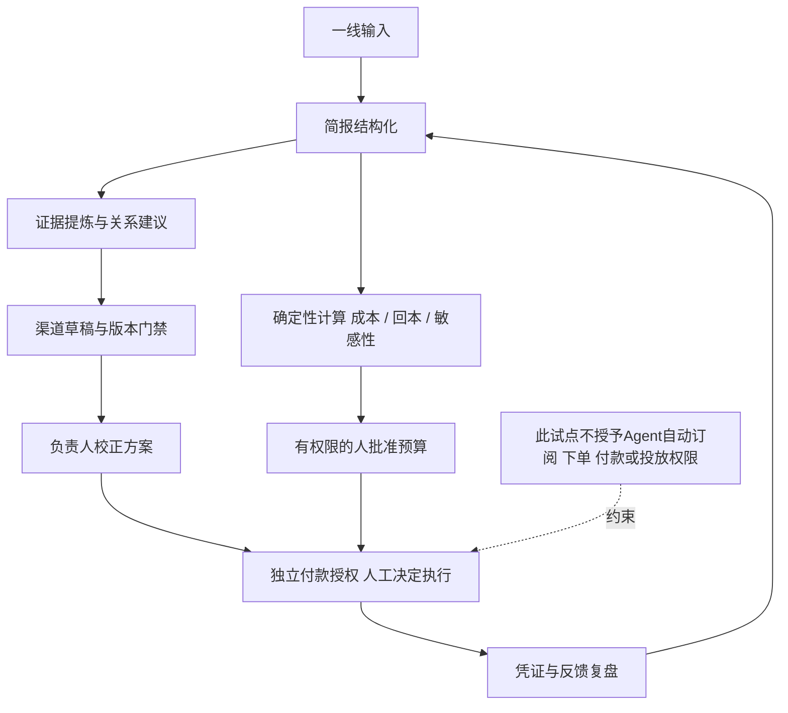

English brief: Extract reusable lessons from the marketing demonstrations and workflow specifications, while keeping evidence, human review and financial authority separate.

# 营销、产品、设计与Agent经验

## 结论

**[判断与建议] 值得沉淀的是让一次营销决定有依据、能纠正、有人负责、做完能复盘。** 岗位数量、页面数量和随机上升曲线不构成能力证明。

现存sunwin展示了客户问题、渠道模板和画像反馈；007有较扎实的版本审批规范，旧归档也找回部分实现。**这些分别是界面行为、规格与历史代码，不等于本轮通过测试，更不等于真实营销有效。**

下文H=`assets/day1024/submit/sunwin.html`；D为同目录 `sunwin-deck/sunwin-deck.html`；S=`specs/007-marketing-role-workbenches/spec.md`；C为其 `contracts/workflow.md`；R=`assets/real_request.md`。本地锚点只证明材料内容。

## 零、这轮材料留下的三次纠偏

| 材料里发生了什么 | 经验 | 下次先检查什么 |
|---|---|---|
| 旧sol任务被指出“有模有样但细乱、分工不明”，再要求职能工作台与DRI | 页面拟真不能代替责任设计 | 谁输入、谁修改、谁审核、谁放行，是否各自有明确产物 |
| 后续prompt追问“先收集标注，再做场景和传播关系”是否真的做到 | 会生成内容不代表证据加工链已经完整 | 原文在哪里、哪些已确认、哪些关系只是假设、源变化如何传递 |
| 现存sunwin把获客叙事做得更完整，但新需求又要求区域策略与试点 | 不能沿着旧原型惯性继续扩功能 | 客户此刻要做哪个决定，旧交付解决了几成，剩下的是否是另一种产品 |

前两条证据为 `day1024_fail_demo2.zip!day1024_sol_v1_v2/prompt2.md:3`、`prompt3.md:14–20`；最后一条对应R:16–30及H的输入、模板和触达设计。这是需求与机制的演进，不是按模型名字排能力高低；没有统一基准，不能作模型胜负结论。

## 一、营销：先回答这个市场怎么做

客户要亮点、竞品、区域方案与负责人校正，不只要信息收集。[本地证据: R:16–23] 产品卖点输入、地域筛选、渠道模板有价值，但不等于选了一个值得投入的市场。[H:575–580,1278,1372–1419]

下一次演示先讲清：找谁、客户为什么买、现有替代方案哪里不同、先做什么、钱付给谁、做到哪一步停。内容可以多，验证应窄。品牌知名度、合格线索、成交、贡献与回款分别看，不能让点击率替全部经营目标背书。

Firstello的“一句话→显式条件→排序候选”值得借鉴。[本地证据: `reference/firstello/page-snapshot-20261024.md:25–44`] 但本地笔记关于“全部mock”“零人工”“我们领先”“直接复用”的判断过强；公开页面没写某项能力，不等于竞品没有。只借可见交互，不照搬无依据匹配率，也不把落地页当产品实绩。[笔记:11,45,62]

## 二、产品：每个完成态都要有可检查结果

客户问题库关联切入角度、素材要求、风险与责任人，是对的业务对象；但“公开可查”还应落到具体来源。[H:1061–1120]

**导出应拿到文件，采纳应形成任务，发送应有真实外部回执。** 当前H:1224、1472–1473、1511–1516多为提示，不足以证明业务完成。没接服务时写“预览”，不要写“已同步”。

版本机制比“多一个Agent”更值得复用：S:40–42、62–65将签字绑定当前稿件和依据；源改版、改稿要撤销当前批准。归档旧sol角色台确有相关逻辑，当前sunwin不应自动继承这份能力。[归档: `day1024_fail_demo2.zip!day1024_sol_v1_v2/index.html:153–154,338–342,373–402`；本轮未运行]

## 三、设计：把理解、纠正和拒绝摆在用户面前

- 让用户看到系统理解的目标、地区、客群和约束，并能改；不要直接扔一个漂亮答案。
- 证据等级、负责人、成熟阶段和缺口成为主信息，不藏在脚注。
- 演示一条失败路径：缺测算，不能宣传降本30%；留下补证任务，不补造案例。
- 模拟标注跟着图表走。片头写“原型”，不能抵消后面的“已授权”“训练完成”和精确效果数字。

D:291声称高风险生成会拦截，H:1372–1419却没有对应门禁。**颜色提示没有改变动作，是设计与实现脱节。** H:1343–1344负反馈仍加分，:1582随机涨AUC，不能包装为因果提升。

## 四、Agent：角色名字不是Skill

“策略师、文案、审核Agent”只是角色；Skill至少要有输入、输出、工具、质量门槛、人工责任和拒绝条件。

**内容人审不等于预算审批，预算批准不等于付款授权。** 技术确认事实、项目确认阶段、品牌确认表达、DRI控制流程，都不自动获得花钱权限。[C:7–12] 模型可以提建议；算术、版本、权限、额度检查应走确定性程序。

### 六个Skill候选

仅作经验总结，不新增Skill配置、权限或PR。

| 候选 | 输入→输出 | 工具与质量门槛 | 人审与拒绝条件 |
|---|---|---|---|
| 市场简报结构化 | 目标、一线访谈→条件卡、待确认项 | Schema与必填校验；地区、客群、限制明确 | 负责人确认；关键条件缺失不出定稿 |
| 来源转可用主张 | 原文、版本→原句位置、可说范围 | 精确切片；原文和候选一致 | 专业确认；无原文、越阶段不外发 |
| 问题与场景关联 | 客户问题、证据→候选关系和理由 | 受约束检索与版本检查；测未知及否定句 | 内容确认；无相关证据不硬套热门场景 |
| 渠道草稿适配 | 批准主张、渠道要求→正文与备注 | 模板/生成、引用核对；改形式不改事实 | 编辑与专业核验；缺证据或授权不放行 |
| 版本审批门禁 | 当前稿、依据、职责→签字与状态 | 确定性状态机；越权不改状态；可审计导出 | 分职能签字；旧版本、缺审、源失效拒绝 |
| 反馈与经营复盘 | 事件、支出、成交→新任务与情景计算 | 去重、回链、确定性算术；单位、公式、基线齐全 | 负责人采纳、批准预算；无据不报提升、不自动花钱 |

机制依据：R:16–30；S:62–77；`tests/test_day1024_sol_business.py:61–76,125–141,210–230`；`test_day1024_sol_roles.py:168–240`。这里引用测试说明断言设计，**没有运行全仓测试，也不声称通过**。经济账工具是本轮建议补齐的职责。

### 现有制作类Skill怎么分工

以下是本轮建议的使用边界，不冒称历史版本已经调用过所有这些Skill。

| Skill或类别 | 适合干什么 | 不能替代什么 |
|---|---|---|
| `prompt-pro`、`truth-seeking-research` | 把粗需求落到范围与可核证据，保留未知 | 不替客户决定市场、预算和验收 |
| `content-craft`与渠道写作Skill | 把已经确认的主张写成渠道内容 | 不替竞品研究、市场策略和经营核算 |
| `mock-devops-platform`→`ui-mockups` / `web-prototype` | 展示工作台、权限、稿件和状态，做可点的假设验证 | 不自动获得后端、模型、数据授权与发送能力 |
| `frontend-slides`、`visual-explainer` | 按决策逻辑组织汇报与机制图 | 不能用漂亮图表给样例真实性背书 |
| `karpathy-explain-better` | 文字→结构图→交互页→有声讲解，保持事实与公式 | 不是“多写一篇长文”，也不修复错误前提 |
| `hyperframes-video`路由与已有视频管线 | 按实际需求选渲染方式，使用音频实测时间与字幕检查 | 不必为出一支讲解片重装全套引擎；能播不代表营销有效 |
| `shuorenhua`、`playwright-testing` | 前者删套话但保术语与数字；后者验证载体交互与播放 | 去AI味不能删掉限制；界面测试通过不能证明经营回报 |

本轮使用Karpathy的换形态方法，复用了现有Edge TTS、浏览器截图与ffmpeg组件，没有为了动效更换整条生产视频栈。具体参数和交付检查见验证记录。

### 版本与责任关系

看图：签字属于某个版本，不属于整个选题；复用依据不复用签字；源改版影响下游。图说明候选控制机制，不是企业真实审批系统已经落地。

### Skill协作与花钱边界

## 五、六条经验：结论、证据、下次断言、边界

| 结论 | 证据 | 下次断言 | 不适用边界 |
|---|---|---|---|
| 策略决定先于资料展示 | R:16–23 | 首屏说清市场、下一步、负责人 | 纯资料产品不强行扩成策略产品 |
| 展示系统理解 | Firstello快照:25–44 | 改条件能解释候选变化 | 解释合理不代表事实正确，排序分不是概率 |
| 风险必须约束动作 | D:291；H:1372–1419 | 页面和直接命令都过不了缺证据外发门禁 | 内部设想可保留，不能混入事实 |
| 复用依据，不复用签字 | S:40–42,65 | 改事实或来源版本使当前批准失效 | 纯格式调整按明确规则，不无差别增审核 |
| 完成提示须有结果 | H:1224,1473 | 导出拿文件；采纳形成可追溯任务 | 概念动画只能称预览 |
| 反馈不能直接兑换分数 | H:1343–1344,1582 | 固定评测允许持平、变差 | 样例切换不能叫在线学习 |

## 六、工作审视报告

**原定目标**：抽取可复用方法，同时不把mock当产品、把样例当实绩。

- 已完成：现存演示、规范、测试文本、参考页和旧归档的静态审阅；区分事实、判断与未核实，形成六类机制候选。
- 未完成：真实营销账核验、客户访谈、真实模型/投放效果验证；旧产品测试未运行。新的报告HTML和视频验证另见 `06-验证记录.md`，不与旧产品混用。

| 必须纠正的问题 | 方法根因 | 下次怎么防 |
|---|---|---|
| 随机涨分讲成学习 | 展示目标替代评测目标 | 固定样本、留对照，只有程序评测能改质量分 |
| 提示成功当任务完成 | 没定义可带走产物 | 一个完成态对应文件、记录或外部回执 |
| 参考页未展示就判没有 | 把信息缺失当否定事实 | 写“公开页面未见”，不替竞品补结论 |
| 用流程角色替代预算授权 | 业务职责与资金权限混杂 | 内容、预算、付款三项分别确认与记录 |

做对的地方：从客户问题出发，明确来访不等于订单、试点不等于商业运营；旧角色台有版本人审与反例设计，值得继续保留。

## [判断与建议] 下次重点

先验证一条真实交付和一条拒绝路径，再扩渠道与Agent数量。评测要同时看业务结果、成本和护栏；无可信对照时只说观察变化，不说“AI带来增长”。上述经验候选尚未写入Skill文件；后续若要沉淀，应先查重、补实跑证据，再经授权走仓库交付流程。

> 免责声明：本输出由 AI 辅助生成，仅用于信息整理与研究参考，不构成专业意见或决策依据。
