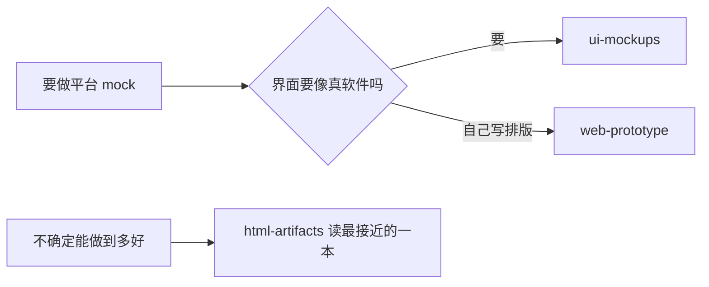

# 模拟平台原型：线上找过的 skill 与平台口径

**这一轮找到的东西分两类：一类是把平台画成"像真软件"的 skill，决定界面长什么样；一类是厂商对内容平台的模块划分，决定该有哪些屏。两类都要，一个管观感，一个管内容。**

## 1. ui-mockups（kgoedecke/ui-mockup-skill，MIT，commit 9f5f93e）

- **定位：** 把产品界面画成一张像真截图的假界面，单文件 HTML，内联 CSS，可选 CSS 动效；渲染成图能骗过截图，留在 HTML 里还能改。
- **故事先行：** 一个工作区、2–4 个有名有姓的角色、一个正在进行的任务，全屏每个标签都指向同一件事。不连贯是假的第一原因，不是配色问题。
- **界面密度：** 界面文字 10–13px，字重 500–600；营销站那种大字号出现在 UI 里，是"这不是软件"的第��特征。
- **分隔方式：** 发丝线 `1px solid #e6e6e2` 干分隔的活；阴影只给到 `0 1px 2px rgba(20,20,15,.04), 0 8px 20px rgba(20,20,15,.05)`，浮起来的阴影读起来像 dribbble 稿，不像真软件。
- **颜色：** 状态只给一个强调色，绿色留给 live/done，其余全是灰阶。
- **内容：** 灰色占位块不许有；骨架屏只能表示"加载中/进行中"，不能当"懒得写"的替身；数字、姓名、时间戳都要像真的。
- **图标：** 用真图标，不许裸 unicode 箭头对勾，会变豆腐块或 emoji；favicon 不超过 18px 且不许放大。
- **自检：** 截图看过 100% 和放大两遍才算交付，一遍不够。
- **本仓要改：** `references/components.md` 里的图标走 `icons.duckduckgo.com`、`api.iconify.design` 远端热链。本仓要求断网能双击打开、资产可 diff，所以一律换内联 SVG。
- **已装：** `.kilo/skills/ui-mockups/`，SKILL.md + references/components.md + LICENSE，3 个文件 15,099 字节。

## 2. web-prototype（nexu-io/open-design 的 design-templates/web-prototype，Apache-2.0，commit e03d5c2）

- **定位：** 通用桌面 web 原型。给一份已经编好排版、间距、强调色预算的种子 `assets/template.html`（16,951 字节），再从 `references/layouts.md` 挑 8 套 section 骨架贴进去。
- **别从零写 CSS：** 种子已经把好默认值编码进去了，这一步的工作是拼，不是造；class 缺了要补进 `<style>`，不是每处inline 重定义。
- **先定屏再写：** 动手前先用一句话说打算做哪几屏，这时候改成本最低，写完再改就是重写。
- **填空就是选错 layout：** `[REPLACE]` 位置空着说明这段不该用，换一个骨架，别硬填。
- **P0 自检里跟本仓直接撞上的几条：** 不许发明指标（每个数字要么来自任务书、要么明确写成占位）、不许 filler 文案（"Feature One"/lorem ipsum 一律删）、真实指名的对象要用真的图、图不许远端热链、单一强调色每屏最多两次、不许 emoji 当功能图标、不许紫藕渐变底。
- **本仓用不到的：** `data-od-id` 是 OpenDesign 的评论模式约定，本仓没装 OpenDesign，保留无害。
- **已装：** `.kilo/skills/web-prototype/`，SKILL.md + assets/template.html + references/{layouts,checklist}.md + example.html + LICENSE，6 个文件 54,354 字节。

## 3. html-artifacts（liush2yuxjtu/html-artifacts，Apache-2.0，commit 7767f60）

- **定位：** 单文件交互 HTML 的质量标杆库，带 20 个完整范例。范例来自 ThariqS/html-effectiveness（© Anthropic PBC，Apache-2.0），逐字原样捆绑，每个文件保留原版权头。
- **先读最接近的那本再动手：** 范例就是质量线，跳过它直接写，出来的东西就普通。
- **跟平台 mock 最相关的四本：** `08-prototype-interaction`（多屏可点击，看"手感"对不对）、`13-flowchart-diagram`（带注释的流程图，点开看每步跑了什么、耗时多少、失败路径，管线味最足）、`11-status-report`（看板版式）、`18/19/20-editor-*`（人在环里的编辑器：工单分诊、feature flag、prompt 调参，结尾都有导出）。
- **四条主张：** 空间胜过线性，有形状的东西要画出来；有形状就别写成段落；每个交互都要挣到自己的存在，只为人的决策服务才加；必须有出口，编辑器类界面结尾要能把人的决定带走，否则是死路。
- **本仓要改：** `scripts/open-artifact.sh` 是 bash，Windows 跑不了；默认输出目录 `~/.claude/artifacts/` 是 Claude 专属路径，本仓改成落 `assets/day1024/`，用 `Start-Process` 打开。
- **已装：** `.kilo/skills/html-artifacts/`，SKILL.md + reference/20 个 html + scripts + LICENSE + NOTICE，24 个文件 389,137 字节。

## 4. 厂商口径：内容平台到底有哪些模块（3 级，厂商自述，仅供参考）

- **迈富时 CMS/DAM：** 内容生产 → 管理 → 分发 → 分析。DAM 归纳的五个痛点是素材分散、版本混乱、版权合规风险高、跨团队协作低效、素材使用数据不可追踪。
- **华为云·特赞方案：** 内容中台 = 内容管理 + 智能创作 + 分发 + 数据洞察；审批通知、内容审阅（素材级多人评论）、文案合规检测（禁用词、必须附加的说明）是独立模块，不是附属功能。
- **易企秀的三分法：** CMS 管"发出去"，DAM 管"存起来"，内容中台管"从做到用、再到看效果"整条链路；它比 CMS/DAM 多做三件事——模板化生产、多组织协同、效果回流。
- **反推本仓 demo 该有的屏：** 口径库、素材库、合规前置检查、选题与生成、审核定责、复用与版本、效果回流。这七屏跟 day1023 那份五步流程是对得上的，不算另发明一套。
- **不引用的东西：** 厂商页面的效果数字（效率提升 70%、省 83% 用工成本）本仓一个字没写进交付物。

## 5. 阿里云六步闭环（4 级，用户投稿，仅供参考）

- **六步：** 营销简报 → 检索品牌知识 → 多创意方向 → 渠道适配 → 人工审核 → 效果数据。
- **必须人工确认的清单：** 价格与优惠、性能数据与效果承诺、客户名称与案例、与竞品对比、医疗金融建议、涉及个人信息、对外合同与声明。
- **为什么不进结论：** 文章是实名用户在开发者社区自发贡献的，只能当线索；它的价值在于那份"人工确认清单"跟本仓"低置信度必须走人工确认台"这条红线是一回事。

## 6. 三个 skill 怎么分工

- **分工判断：** 观感归 ui-mockups，排版工程归 web-prototype，质量线归 html-artifacts；三个正交，可以叠加，常见组合是 web-prototype 出骨架、ui-mockups 定密度、html-artifacts 当标尺。
- **本仓入口：** `.kilo/skills/mock-devops-platform/` 是唯一入口，它决定这一步调哪个上游、哪些上游默认要改；别让下个会话自己去拼三个 skill，拼法不一致就是"每次做的 demo 长得都不一样"的根因。

下一节看视频那条线，HyperFrames 是同一套思路在时间轴上的版本。
