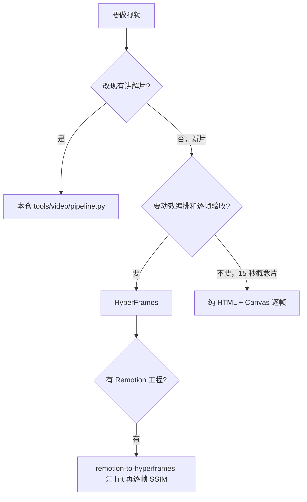

# 视频：HyperFrames 及其周边生态的调研结果

**HyperFrames 是真的，而且是最贴本题的那个：HTML 当源码、时间轴当数据、无头 Chrome 逐帧抓、FFmpeg 编码，同一输入永远同一输出。上游自带 7 个 skill，本仓装了 5 个。**

## 1. heygen-com/hyperframes 引擎本体（Apache-2.0，commit 8a102f6）

- **定位：** 开源的 HTML→MP4 框架。composition 就是普通 HTML 文档，元素用 `data-start` / `data-duration` / `data-track-index` 表达时间与层级，动画交给 GSAP、Lottie、CSS 或任何能定位到某一帧的运行时。
- **确定性怎么来的：** 帧号 = `floor(time × fps)`，每一帧独立用 Chrome 的 `beginFrame` API 抓，管道里没有 wall-clock 依赖，所以同一份 HTML 渲多少次都一样。
- **对 agent 友好在哪：** CLI 默认非交互，全部靠 flag，输出纯文本，失败即非零退出并带 `Fix:` 行；多数命令有 `--json`。
- **渲染链路：** HTML → 无头 Chrome 逐帧 → FFmpeg 编码 → mp4；本地跑、Docker 跑、云上跑都行。
- **包与版本：** npm 包名 `hyperframes`，实测版本 0.8.190，`engines.node >= 22`，bin 是 `hyperframes` 与 `hyperframes-localize-fonts`。

## 2. 上游自带 7 个 skill（`skills-manifest.json` 有文件数与 hash）

- **hyperframes（77 文件）：** 先读这个。渲染契约、12 条硬规则、工作循环，按视频类型分流（launch / explainer / music / data / vertical / 3d / character）。
- **hyperframes-cli（13 文件）：** CLI 命令手册，按"干什么"分组：init、check、snapshot、timeline、preview、render、doctor、history、upgrade，外加一张"命令失败怎么办"的对照表。
- **hyperframes-registry（13 文件）：** 50+ block/component 的目录与检索，装之前先搜目录，别手搓已有组件。
- **remotion-to-hyperframes（77 文件）：** 把 Remotion、Motion Canvas、Lottie、Three.js、p5.js、Canvas、Manim、AE、Blender 的东西搬进 HyperFrames，并逐帧比对；自带 4 档测试语料（标题卡 / 多场 / 数据驱动 / 逃生舱）。
- **slideshow（2 文件）：** deck 式视频。
- **media-use（116 文件 / 1.9 MB）：** 调色、LUT、去背景、TTS、转写、BGM、音效库。
- **figma（2 文件）：** 从 Figma 设计上下文生成动效。
- **本仓装了哪几个：** hyperframes、hyperframes-cli、hyperframes-registry、remotion-to-hyperframes、slideshow。
- **没装的两个，理由是本仓约束不是上游差：** media-use 里有约 1 MB 的 mp3 音效与 LUT 二进制，跟 AGENTS.md §13.1 纯文本资产这条冲突，而且本仓已经有 Edge TTS + numpy 配乐 + 混音，功能重叠；figma 需要 Figma 侧 MCP server 和设计资产，本仓没有。
- **额外砍掉的：** `hyperframes/assets/frame-presets` 13 套 deck 外观约 990 KB，含二进制字体。上游自己的 `references/look.md:27` 写明这是幻灯片外观、只在点名或做 deck 时用、不做兜底，所以按需再取。

## 3. 硬契约：违反就渲染不出来

- **定时元素：** 每个要有 `class="clip"` + `data-start` + `data-duration`（秒），显示区间是 `[start, start+duration)`。
- **片长：** 根节点的 `data-duration` 就是全片长度，超时截断，提前结束停在最后一帧。
- **时间轴：** 每个 composition 建一条暂停的时间轴，tween 注册完写 `window.__timelines["<data-composition-id>"] = tl`。
- **禁止不确定：** 不能用 `Date.now()`，无种子的 `Math.random()`、网络请求、定时器、`repeat: -1` 都不行——画面必须是时间轴时间的纯函数。
- **不要在 `.clip` 上 tween `display`/`visibility`/`autoAlpha`**，要动就动子元素；GSAP 要动的元素上不要留 CSS `transform`。
- **媒体：** 不许 `play()`/`pause()`/seek；`<video>` 要保留声音就 `data-has-audio="true"`，否则 `muted`；每个 `<audio>` 必须有 id。
- **资产路径根相对**（`assets/...`），子 composition 里也一样。

## 4. 本机环境实测（`npx hyperframes doctor --json`，2026-10-24）

- **就绪：** Node v22.14.0、ffmpeg 9.0.2、ffprobe 9.0.2、32 核 i9-13900HX、内存 63.7 GB、磁盘 819.1 GB 空闲、frames cache 所在盘 305.4 GB 空闲。
- **唯一硬缺口：** Chrome Headless Shell 没装，报 `Chrome Headless Shell is required for local rendering`，补法是 `npx.cmd hyperframes browser ensure`，约 150 MB。固定版本是刻意的——跨 Chrome 版本像素会漂，锁版本才能保证可复现。
- **可选没装，不影响出片：** Docker（只有 `render --docker --strict` 要）、whisper.cpp（转写）、Kokoro TTS（本地配音兜底）、MusicGen（本地配乐兜底）。后三个要拉 torch/transformers，对本仓已有 Edge TTS + numpy 配乐来说纯重复投资。
- **判断口径：** `doctor --json` 顶层 `ok` 会因为可选依赖缺失一直是 false，上游文档写明它恒 exit 0，要 gate 就 gate 在 `checks[].ok` 逐条上。
- **Windows：** `npx` 被 PowerShell 执行策略挡，要用 `npx.cmd`；ffmpeg 来自 WinGet 的 Gyan 包，路径在 `%LOCALAPPDATA%\Microsoft\WinGet\Packages\...`，别硬编码。
- **遥测：** 默认开，只收匿名用量，官方声明不收文件路径与 composition 内容，`hyperframes telemetry disable` 可关。

## 5. 官方文档里的装法与命令阶梯

- **装 skill：** Claude Code 走 `claude plugin marketplace add heygen-com/hyperframes` + `claude plugin install hyperframes@hyperframes`；其他 agent 走 `npx skills add heygen-com/hyperframes`。本仓不用这两条，因为 skills 要落在 `.kilo/skills/`，已手工装好。
- **插件模式的规矩：** 插件自带 `plugin.json` 时，不要再跑 `hyperframes skills update`、`skills check`、`npx skills add`，改用 `node "<PLUGIN_ROOT>/skills/hyperframes/scripts/plugin-cli.mjs" <command>`，版本由清单锁死，下载失败是错误不是"用最新版"的许可。
- **命令顺序：** init → 写 → lint → `check --json`（error 清零）→ `snapshot` 看帧 → `preview --background` → `render --quality looks --output out.mp4`。
- **质量档位：** `draft` 迭代、`looks` 交付、`delivery` 终版。
- **渲染超时：** 超过工具超时就设 `HYPERFRAMES_RENDER_DETACHED=1` 放后台等日志，不要用 `pgrep -f`（会匹配到自己然后等超时）。
- **review：** `snapshot --review` 出 REVIEW.md；改完要 snapshot 改动的那几帧再看一眼。

## 6. 博客：blog.cosine.ren/post/opus-5-5-motion-video-resources（3 级，个人经验，仅供参考）

- **最值得抄的一条流程：** 找参考片定风格 → 装引擎让每个场景都是代码 → 接组件库避免现场手搓 UI → 给品牌素材让它出 3 个分镜方向 → 每个场景先出静帧确认 → 最后用导演语言提意见（"推镜都放到 0.7 倍""这里硬切""推近到那个按钮"），别用"再好看一点"。
- **审片分工：** 多 agent 时把审片拆开，一个只看卡点节奏，一个专找"像 demo"的地方，一个看文字、安全区、素材合规；渲染一次只跑一个，避免缓存打架。这三条正好对上本仓评审会挑的刺。
- **缓存与额度：** 长任务反复读同一批脚本和组件，靠缓存命中摊成本。
- **提示词合集：** `athemeroy/awesome-opus-5-5-videos`、`zhuyansen/awesome-opus-5.5-video`、`opusvideo/awesome-claude-video`、`lemomo-ai/lemo-opuscar`（43 种影片风格 + 导演指南 + 技术指南）。
- **其他 skill：** `remotion-dev/skills`、`alexgreensh/anidoodle`、`op7418/guizang-product-video-skill`、`browser-use/video-use`（剪真实素材）、`feitangyuan/onetake`（一镜到底产品片）、`jakubkrehel/make-interfaces-feel-better`（界面动效打磨）、`ismoshushi/awesome-opus-video-skills`、`zhuyansen/awesome-claude-video-skills`（180 个，带安全评级）。
- **没采信的部分：** 成本节省和效果评价都是个人体验，本仓没写进任何交付物。

## 7. 知乎：一文搞懂 Opus 5.5 动效视频（3 级，媒体文章，仅供参考）

- **核心原理说清楚了：** 画面是时间的确定性函数。页面暴露 `window.DUR`、`window.render = (t) => {...}`、`window.READY`、`window.EV`（音效事件），任意时刻单独渲染那一帧，结果永远一样。
- **一条时间轴五路输出：** 画面 → 逐帧截图 → mp4；配音 → 词级时间戳；音乐 → 按同一时间轴编曲；音效 → 事件时间点程序化生成；字幕 → srt + 烧录；最后混音（闪避、压缩、平衡）→ ffmpeg → 两遍响度标准化到 −14 LUFS。
- **技术栈怎么选：** 2D 风格优先 Canvas 2D，文字与图形为主的发布片用 SVG + GSAP，涉及镜头运动再上 Three.js，WebGL2 着色器只当最后一层后期滤镜。43 种公开风格里 77 种是 2D、4 种 2.5D、17 种 3D——好看的动效大多不需要 3D。
- **进阶手艺：** 音乐卡点用 Demucs 分离人声 + Whisper 词级对齐 + 节拍网格；运动模糊靠子帧平均（静止区 12 子帧、甩镜最多 324 子帧）；"按二拍"动画可以让角色 12 fps 步进但镜头和光线每帧平滑；跟随主体的效果统一走"世界坐标→屏幕坐标"函数，别手写屏幕坐标；`readcheck.mjs` 这类工具自动查每段文字停留时间够不够读。
- **三条上手路线：** 复制提示词出单文件 HTML 再录屏（约 10 分钟，缺点是掉帧）；装 lemo-opuscar 做完整短片（30–60 分钟，要 Node 20+、ffmpeg、Python 3.11+）；用 HyperFrames 工程化批量出片（适合团队）。
- **跟视频生成模型怎么选：** 文字、图表、品牌元素为主选代码动效；需要真实人物和实景氛围选视频生成模型；做完整短片可以模型出写实空镜、代码动效叠标题字幕数据图层。
- **和本仓的关联：** 本仓 `tools/video/pipeline.py` 的"解析稿 → Edge TTS → 词级字幕 → 音频实测定时 → 逐帧 → 烧字幕 → 校验"，跟上面那条"一条时间轴五路输出"是同一个骨架，差别在本仓用 Python 手写逐帧插值，HyperFrames 把时间轴变成数据。

## 8. 相邻生态（本仓未装，理由各自不同）

- **nexu-io/open-design 的 hyperframes 模板：** SKILL.md 28 KB，带排版、转场、动效原则、音频响应、字幕、TTS、CSS 图案目录和 9 套风格预设，是"创作手艺层"。但它的 SKILL.md 与 OpenDesign daemon 强耦合（`$OD_PROJECT_DIR`），而且跟已装的 `hyperframes` 同名冲突，所以只取参考文件、不装它的 SKILL.md。
- **nexu-io/html-video：** HTML→视频工作台，21 套模板，storyboard 拆成每帧一个自包含 HTML 帧，Hyperframes 是默认引擎，是元层不是引擎。
- **tuzhechen2005/opus-video-skills（MIT）：** `kinetic-reel`（动效字 + three.js + WebGL 后期）和 `painted-animation`（p5.js 水彩 + 逐字卡拉 OK 字幕）。要求 Node + Chrome + ffmpeg + Python/numpy。纯代码路线，不依赖 HyperFrames。

## 9. MCP：现在没有能直连的 HyperFrames MCP server

- **官方口径：** CLI 就是 agent 接口——flag 驱动、纯文本输出、fail-fast、多数命令 `--json`。再套一层 MCP 只多一层 schema 维护，还丢 `check --json` 的原始结构。
- **确实存在的三种：** ① Studio 内的 **WebMCP**——浏览器原生 Model Context Protocol，W3C 规范 Origin Trial 阶段，API 挂在 `document` 不是 `navigator`，上游注释写明"拒绝不是可用的错误通道"，Studio 只注册自己用到的那部分；② **Figma MCP**——`hyperframes figma` 需要 Figma 侧 server；③ **外部 CDP 挂载**——`preview`/`play` 可用 `--browser-path` 或 CDP 端点接 Playwright/Puppeteer/browser-MCP，但 HyperFrames 自身不做 CDP 自动化，只暴露端点。
- **外部玩法：** 博客提到用 Runway MCP 让模型出镜头、Opus 只做剪辑包装，不在本仓默认范围。
- **本仓建议：** 暂不接。真要接，顺序是 CLI + `--json` → 外部 CDP + Playwright 做自动审片 → WebMCP 等规范稳定；最小形态只暴露 `timeline --json` / `check --json` / `snapshot` 三个只读能力，写操作仍走 CLI，MCP 挂了也毁不了工程。

## 10. 与本仓现有管线的关系

- **本仓现状：** `tools/video/pipeline.py` 已经是一条完整链路——解析稿 md → Edge TTS 逐句 → 词级字幕时间戳 → 每场 HTML 1920×1080 无头 Edge 截图 → numpy 配乐 → 按语音能量闪避混音 → 音频实测定时 → 逐帧几何插值 → libass 烧字幕 → 时长/命中/抖动校验 → 字幕三轴对齐。
- **增量在哪：** HyperFrames 多出来的是动效编排精度、组件复用、内置 lint 与审帧三件事；本仓做好的 TTS、字幕、混音、验收不必推倒。
- **迁移切法：** 换渲染层、留内容层，先拿新内容试点，不要动已跑通的 6 支讲解片。
- **状态：** 本机环境已实测就绪，但**还没有在本仓实际渲过一支 HyperFrames 片子**——渲染能力目前是"文档保证 + 环境就绪"，不是"本机已跑通"。

下一节看幻灯片那条线，那是同一批 skill 生态在页面方向的对应物。
