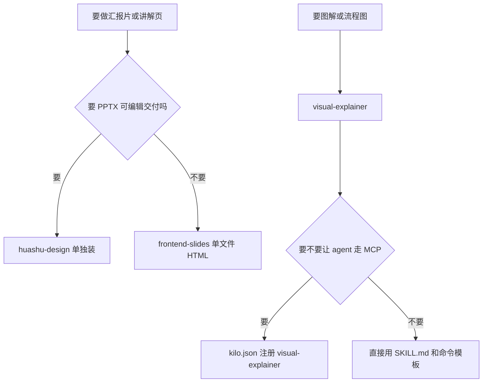

# 幻灯片：HTML 幻灯片 skill 清单与本仓选用

**清单本身是 GitHub API 按 star 排序的策展列表，25 个 skill 加一批模板库。本仓装了两个：frontend-slides 负责页面，visual-explainer 负责图解，它还自带一个能接进 Kilo 的 MCP server。**

## 1. ToseaAI/awesome-html-slide-skills（清单本体，CC BY 4.0）

- **它是什么：** 单文件 HTML 幻灯片类 agent skill 的策展列表，收录标准是"真能装、能跑、star 数够"。README 38 KB，中英双语，网页版在 tosea.ai/slide-skills。
- **排序规则：** star 数从 GitHub API 现拉，是唯一排序信号——所以本文里的 star 数是 2026-10-24 实取的，跟清单自己写的数会漂（例：huashu-design 清单写 19.5k，今天 API 是 25,953）。
- **分层：** Tier S 一千星以上、Tier A 一百到一千、Tier B 新兴与专门化。每条除了简介，还写"Fits / Doesn't fit / Aesthetics / Highlights / Why it stands out"——"不适合什么"比"适合什么"更有用。
- **skill 与模板的区别：** skill 是带 SKILL.md 和参考资料的包，模板库只是可挑的现成文件；模板库那条写着 32 套模板、每套三张样张（封面 · 中段 · 后段），用来验一个视觉系统在不同版式上撑不撑得住。
- **为什么值得留着：** 它是选型雷达，不是安装清单；以后要做汇报片，先在这上面扫一遍再决定装不装。
- **本仓用法：** 放进 `mock/学习笔记/` 当参考，不装进 `.kilo/skills/`，因为它本身不是 skill，是索引。

## 2. frontend-slides（zarazhangrui/frontend-slides，MIT，31,152★）——已装

- **定位：** 零依赖的 HTML 幻灯片，单文件、内联 CSS/JS、无 npm 无构建；也能把 PPT/PPTX 转成网页。
- **核心做法：** 不让人先选风格，先出预览——默认生成 3 个预览（1 个来自 `STYLE_PRESETS.md` 的稳妥预设、至少 1 个来自 `bold-template-pack` 的张扬模板），人看着顺眼了再全量生成。这是"视觉探索代替抽象选择"。
- **两条硬规则：** 幻灯片可见性用 `.active` / `.visible` 控制 `visibility`、`opacity`、`pointer-events`；每份演示都要把 `viewport-base.css` 的完整内容嵌进 `<style>`。
- **模板包：** `bold-template-pack/selection-index.json` 是紧凑索引，`templates/*/preview.md` 是轻量风格卡，选中之后才读那个模板的完整 `design.md`。
- **本仓装法：** 装了 SKILL.md、html-template.md、animation-patterns.md、STYLE_PRESETS.md、viewport-base.css、selection-index.json 和 14 张 preview.md，41 个文件 257,199 字节。
- **本仓没装的：** 14 套模板的 `design.md` 每份 40 KB 以上，全套约 3.5 MB 文本，撑不起常驻仓库；按需再从上游取。代价是"至少 1 个张扬模板"这步先没有，只剩稳妥预设。
- **配套脚本：** `scripts/export-pdf.sh`、`scripts/deploy.sh`、`scripts/extract-pptx.py` 是 bash/python，Windows 上要在 WSL 或 Git Bash 里跑。

## 3. visual-explainer（nicobailon/visual-explainer，MIT，10,608★）——已装

- **定位：** 给 agent 用的图解与讲解页生成器，产出富 HTML 页面或幻灯片，支持 diagram、slide deck、video、visual plan、compare、fact-check 等多种产物。
- **产物形态：** HTML 页面（kit 渲染）、可视化计划（plan）、PPTX 导出、`compare` 与 `diff-review` 的并排比对。
- **组件库：** 自带 kit（`kit/kit.css`、`kit.js`、`flow.mjs`、`html.mjs`、`look.mjs`、`tags.mjs`、`render.mjs`）和 vendored 的 `kit/vendor/pele.mjs`（677,963 字节，布局引擎）。命令模板在 `commands/` 共 9 个，参考文档在 `references/`。
- **MCP server（这是本仓最想要的那块）：** `plugins/visual-explainer/mcp/server.mjs` 是 stdio-only 的本地 MCP server，不起 HTTP、不管凭据、不调 LLM、不出机器。
  - **暴露的工具：** `visual_explainer_prepare`（只给流程建议，不写文件）、`visual_explainer_render_html`（校验并写出 HTML）。
  - **暴露的 prompt：** 9 个命令模板，`generate-web-diagram`、`generate-visual-plan`、`generate-slides`、`generate-video`、`diff-review`、`plan-review`、`project-recap`、`compare`、`fact-check`。
  - **暴露的资源：** `visual-explainer://skill/SKILL.md`、`references/*.md`、`kit/kit.css`、`commands/*.md`。
  - **写盘限制：** 只写配置的输出目录，默认 `~/.agent/diagrams/`，可用 `VISUAL_EXPLAINER_OUTPUT_DIR` 换；路径必须是 basename，拒绝目录穿越、控制字符和 symlink 目标；`render` 默认 `open: false`。
- **接进 Kilo 的写法（还没接，TODO）：** 在 `.kilo/kilo.json` 里加：

```json
{
  "mcp": {
    "visual-explainer": {
      "type": "local",
      "command": ["node", "D:\\GitRepo-AI\\FDE20261023\\.kilo\\skills\\visual-explainer\\mcp\\server.mjs"],
      "enabled": true
    }
  }
}
```

- **接之前要做的事：** 在 `.kilo/skills/visual-explainer/` 目录里 `npm install --no-package-lock`，否则 server 起不来；`node_modules` 已被 `.gitignore` 挡住，不入库。
- **本仓装法：** 装了 `plugins/visual-explainer/` 全量文本树，49 个文件 1,069,344 字节；跳过了 `banner.png`（1,187,907 字节）和 `replay.gif`（367,945 字节），二进制不入库。

## 4. 没装的候选，理由各自不同

- **op7418/guizang-ppt-skill（AGPL-3.0，28,534★）：** 质量高但是 AGPL，仓库里放第三方 skill 等于把许可义务一起带进来，要先想清楚再装；先用 `frontend-slides` 顶着。
- **alchaincyf/huashu-design（MIT，25,953★）：** 一句话拿回网页 / App 原型 / 可编辑 PPTX / 动画，覆盖面最广，但仓库 229,769 KB，sparse checkout 也没找到干净的 skill 目录；等真有"要可编辑 PPTX"的需求再单独装。
- **1weiho/open-slide（MIT，9,376★）：** 给 agent 用的 slide 框架，方向和 frontend-slides 重叠，先不装。
- **lewislulu/html-ppt-skill（MIT，8,809★）：** 24 套主题、31 种版式、20 多种动画，主题多，适合做"选一套现成风格"的场合。
- **zarazhangrui/beautiful-html-templates（MIT，4,849★）：** 纯模板库，32 套 × 每套三张样张；是挑风格用的，不是生成用的。
- **mucsbr/ppt-agent-workflow-san（650★）：** 渐进交互式 ppt 生成 skill，"先问再生成"的节奏和本仓"AI 猜的验收标准不算数"是一条路子。
- **archlizheng/frontend-slides-editable（536★）：** 可拖拽改尺寸的可编辑 HTML 演示，给 Codex/Claude Code 用。
- **likaku/Mck-ppt-design-skill（Apache-2.0，311★）：** 咨询公司风格的 PPT 设计系统，70 种版式——做给甲方看的汇报片可以对标。
- **vigorX777/ppt-svg-generator（MIT，260★）：** Markdown 文稿转 PPT 或 PDF，带预设风格。
- **12 个没取到 star 数的：** codesstar/next-slide、zuiho-kai/huawei-style-ppt-skill、FeeiCN/slide-writer、nghiahsgs/skills-slides、xhshow2025/-PPT-sense-deck-skill-、Phlegonlabs/Powerpoint-fancy-design、kaisersong/slide-creator、edu-ai-builders/visual-cognition-slides、Akxan/ppt-agent-skill、bytonylee/future-slide-skill、WayneZhon/KingDee-PPT-Skill、hugohe3/ppt-master、software-ai-life/Awesome-PPT-Design-Skills。取 star 数时 GitHub API 限流返回 403，仓库名来自清单，需要时重取。

## 5. 装进仓库之后的样子



- **分工判断：** 页面归 frontend-slides，图解归 visual-explainer；两者都是单文件 HTML，跟本仓 AGENTS.md §13.1 纯文本资产这条是一路的。
- **本仓现状：** `problems/` 下已经有 6 篇单页讲解版 HTML，是现成的基线；新工具应该对齐它们的打开方式（双击即开、无外链），而不是另立一套。
- **MCP 那一步的状态：** 还没接。接的话只需要 `.kilo/kilo.json` 一段配置加一次 `npm install`，但要先确认输出目录设到哪（本仓建议 `.kilo/skills/visual-explainer/out/` 或临时目录，别让它往用户主目录写）。

## 6. 接下来

- **先做：** 把 `visual-explainer` 的 MCP server 在本机跑起来一次，确认 `visual_explainer_render_html` 能写出图解页；这是本轮唯一有实际产出价值的验证点。
- **不做：** 不去装 Kokoro/MusicGen/whisper.cpp，不去装 AGPL 的 skill，不去为 14 套 deck 模板腾 3.5 MB 仓库空间。
- **待确认：** 汇报片最终要 HTML 还是可编辑 PPTX——这决定 huashu-design 值不值得单独装。
