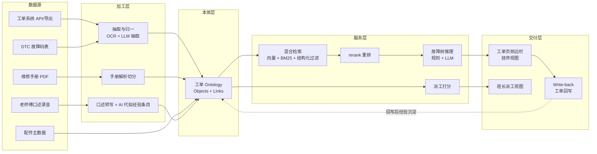

# 题 1 · 申沃客车 | 现场报修了，为什么还要从头查起？

| 项 | 内容 |
|----|------|
| **业务目标** | 现场维修智能协同、派工建议与工匠经验复用 |
| **组数** | 2 组 |
| **行业** | 智能制造（客车售后维修服务） |
| **北极星指标** | 同车型同故障的**首次诊断命中率** |
| **角色配置** | Echo：售后/技术专家（老师傅）· Delta：算法+后端 |

> **一句话方案**：把老师傅脑子里的「排查顺序」变成工人进场前就拿得到的答案——从「凭经验从零开始」变成「带着候选原因、排查步骤和配件清单进场」。

---

## 一、场景

### 1.1 业务现场

车辆在运营中出现故障 → 报修工单进来 → 维修站/服务班组的技师或工程师到场处置。

**"从头查起"指的是这条链路：**

1. 确认车型、配置、里程、近期维修记录
2. 回忆/查阅这个故障可能是什么原因
3. 逐条排查（可能查手册，可能问老同事，可能翻历史工单）
4. 确认需要的配件，临时调件
5. 修复、复检、填单、关单

**其中第 2、3 步是当前最大的时间黑洞**：判断依据在老师傅的脑子里（口口相传、离职即带走），历史工单里虽然写过原因，但字段是"故障描述 + 故障码 + 处理措施"这样的自由文本，检索等于没有。技师到了现场，要么打电话问人，要么翻手册，要么试错——每一次都是"重新查一遍"。

### 1.2 为什么"从头查起"（根因拆解）

| 表层现象 | 真实根因 | 对应解法方向 |
|---------|---------|-------------|
| 查手册慢 | 手册是 PDF/纸质，无结构化索引，按章节人工翻 | 手册 RAG + 按车型过滤检索 |
| 历史工单用不上 | 工单是自由文本，没有统一故障码/部件/步骤字段 | 工单 Ontology + LLM 抽取归一 |
| 老师傅经验留不下 | 经验是口头的，录成文字成本高，且无人整理 | 语音输入 + AI 代拟 + 派工时顺带沉淀 |
| 派工靠班长拍脑袋 | 技师技能标签（熟悉哪款车、哪类故障）没有数据化 | 技师技能画像 + 匹配打分 |
| 同型号重复踩坑 | 相同故障在多个车队反复发生，没人归因到"同一根因" | 故障聚类 + 知识回流 |

### 1.3 现有资产（数据从哪来）

| 数据 | 可能的形态 | 备注 |
|------|-----------|------|
| 工单系统 | 结构化字段 + 自由文本 + 配件清单 + 工时 | 主数据源 |
| 故障码 / DTC | 车载诊断导出的码表 | 需要与"人话描述"建立映射 |
| 车辆档案 | 车架号、车型、批次、电机/电池型号 | 过滤条件，必须接进来 |
| 维修手册 / 技术公告 | PDF、Word | 知识库主体，注意版权与更新版本 |
| 历史照片 | 工单附件 | 多模态线索（烧蚀、渗漏、锈蚀） |
| 老师傅口述 | 会议录音、访谈 | 最高价值、最易丢失的资产 |
| 配件主数据 | 料号、名称、库存 | 支撑"带什么件去" |

### 1.4 ⚠️ 待 Day1 现场确认

- 报修量级：日均/峰值多少单？其中多少是"到场后二次上门"？
- 车型与故障分布：Top 20 高频故障码/现象是什么？是否集中在 2–3 个车型？
- 工单系统可导出吗？是 API 还是 Excel 导出？有无历史照片？
- 手册形态与版本管理：会不会更新？更新后如何同步到系统？
- 老师傅在岗几人？愿不愿意录？是否有历史培训/带徒记录可用？
- 派工目前怎么做？班长/调度还是抢单？规则还是经验？

---

## 二、项目

### 2.1 项目定义与交付物

**「维修协同助手（Repair Copilot）」**：嵌在工单流程里的排障副驾。

**输入**：车架号 / 车型 + 故障现象（文字 + 照片 + 故障码）
**输出**（一屏内给完）：

1. **候选故障原因 Top-N**，每条附概率/依据与来源引用
2. **推荐排查步骤**（可勾选执行，执行后回写工单）
3. **需携带配件清单**（料号 + 名称 + 建议数量）
4. **建议派工**（推荐技师 + 理由 + 备选）
5. **每条结论可溯源**（命中哪条手册章节 / 哪张历史工单 / 哪位老师傅的经验条目）

### 2.2 范围

| 做 | 不做（第一轮明确砍掉） |
|----|------------------------|
| 只覆盖 **Top 20 高频故障码/现象** | 不做全车型覆盖 |
| 只做 **只读 + 一键回写工单备注/步骤** | 不改造工单系统本体，不动 ERP/MES |
| 手册 + 历史工单 + 口述经验三源检索 | 不接配件实时库存（先给清单，不查库存） |
| 排障步骤 + 配件建议 + 派工建议 | 不做维修工时自动报价、不做成本核算 |
| 部署在客户内网 | 不做公有云 SaaS 化 |

### 2.3 角色分工（Echo + Delta）

| 角色 | 承担人 | 职责 |
|------|--------|------|
| **Echo** | 售后技术主管 / 老师傅 | 说清"什么现象 → 什么原因 → 先查什么"；提供 Top20 故障清单与判定规则；判定建议是否"像人话" |
| **Delta** | 算法 + 后端 | 跑通数据接入、检索、推理、回写；把老师傅的判定规则写进可执行逻辑 |
| **共同** | 班长/调度 | 派工规则的真实约束（谁能上什么车、班次、资质） |

> ⚠️ 风险：**只请到"愿意配合的老师傅"**。若只拿得到拒绝配合的样本，经验复用这一条直接失效。Day1 必须先解决人的问题，而不是技术的。

### 2.4 成功标准

Day3 结束时，甲方技术主管当场用**一个真实故障码**跑一次完整流程，并在 5 分钟内判断"这建议能不能用"，且愿意说清楚"哪里不能用"。

---

## 三、专项技术点

| # | 技术点 | 为什么必须做 | 落地要点 |
|---|--------|-------------|---------|
| 1 | **工单 Ontology（Objects）** | 没有业务实体，所有检索都会退化成"搜字符串" | 用业务语言定义：`Vehicle` / `Fault` / `FaultCode` / `RepairAction` / `Part` / `Technician` / `WorkOrder` / `ManualDoc`，**不说"表"说"车、故障、工单"** |
| 2 | **Links（关联固化）** | 查询时才 JOIN = 每次查询都在算，且口径不一致 | 预固化：`FaultCode→Fault(现象)`、`Vehicle(车型)→适用手册版本`、`WorkOrder→UsedPart→Part`、`Technician→擅长故障域` |
| 3 | **混合检索 RAG（向量 + BM25 + 结构化过滤）** | 手册检索靠语义，工单检索靠精确词（料号、故障码），纯向量会漏料号 | 三路召回并集 → rerank；**必须带车型/品牌过滤条件**，否则召回跨车型手册是灾难 |
| 4 | **故障树 / 规则 + LLM 混合推理** | 老师傅的判断是"树"（A 则查 B），不是"相似度" | 已知部件 → 已知现象 → 候选原因排序；LLM 负责把现象描述映射到已有码和已有案例 |
| 5 | **历史工单抽取与归一（离线 ETL）** | 自由文本不归一，检索等于没有 | 批量抽取：故障现象、原因、步骤、配件、工时；人工校准 200 条作为评测集与 few-shot |
| 6 | **多模态线索（工单照片）** | 很多故障"照片一看就知道" | VLM 对工单照片做描述抽取，输出挂到 `Fault` 上作为检索线索 |
| 7 | **派工推荐（技能画像 + 匹配打分）** | 派工的经验规则要变成可计算 | `技师技能画像`（历史解决过的故障域、车型、认证）+ 约束（班次/资质/距离），出推荐 + 理由 |
| 8 | **Write-back 回写（Actions）** | 只读的助手进不了流程，等于又一个要人维护的网页 | 一键把"排查步骤 + 结论 + 配件"写回工单备注与步骤字段；回写失败要可见、可重试 |
| 9 | **评估体系（离线回测）** | "感觉挺准"不能作为结项证据 | 用历史已闭环工单做回测：给现象 → 看真原因是否在 Top-1/Top-3；跑分脚本随代码入库 |
| 10 | **内网离线部署（Docker）** | 客户数据不出厂区 | Docker Compose 一键起；模型走客户可用推理服务或本地部署；**准备 Plan B（离线包）** |
| 11 | **版权与更新治理** | 手册属客户资产，有版本 | 只索引有授权的文档；文档版本号进元数据；手册更新时触发重建索引 |

---

## 四、OKR

### O

> **让现场维修从「凭经验从头查起」变成「带着答案进场」，让老师傅的经验第一次变成可复用资产。**

| KR | 指标 | 基线 | 目标 | 怎么量 |
|----|------|------|------|--------|
| **KR1（北极星）** | 同车型同故障的**首次诊断命中率**（历史回测 Top-1） | Day1 实测（预计偏低） | **≥ 70%** | 用历史已闭环工单做离线回测集，随代码跑 |
| KR2 | 技师获取排障信息的时间 | Day1 实测 | **≤ 2 分钟**（现状可能 20 分钟+） | 现场秒表计时，5 名技师各测 3 次 |
| KR3 | 派工建议**采纳率** | 0 | **≥ 60%** | 班长确认采用次数 / 总建议次数（一周内统计） |
| KR4 | 老师傅经验条目化沉淀量 | 0 | **≥ 200 条**且被检索命中 | 知识库计数 + 命中率日志 |
| KR5 | 建议**准确率（人工抽检）** | — | **≥ 80%**，且错建议必须标红不推荐 | 抽样 50 条建议，技师判"可直接执行/需修改/不可用" |
| KR6 | 二次上门率 | Day1 实测 | 不高于基线（**不恶化**即可） | 报修工单闭环数据回看 |

> ⚠️ **KR6 是护栏指标**：工具可能让技师"照着系统走"而漏掉真实原因。这条不达标，即使 KR1 达标也算失败。

---

## 五、解决方案

### 5.1 总体架构

### 5.2 数据流（关键设计点）

1. **离线加工层**（Day1–Day2 完成）：工单导出 → 抽取归一 → 写入本体；手册解析切分 → 索引；口述录音 → 转写 → AI 生成经验条目草稿 → **老师傅只做"确认/修改"，不做撰写**。
2. **在线服务层**（Day2–Day3）：技师输入现象 → 查码表映射 → 混合检索召回（带车型过滤）→ rerank → 故障树推理出候选原因与步骤 → 组装答案（每条带出处）→ 展示。
3. **回写闭环**：技师勾选执行的步骤 + 最终原因 → 回写工单 → 该工单成为新的训练/评测样本（**这是"滚雪球"的入口**）。

### 5.3 核心链路的两个关键取舍

| 取舍点 | 选择 | 放弃的 |
|--------|------|--------|
| 召回方式 | 混合检索 + 强结构化过滤 | 纯向量语义检索（料号、故障码会漏） |
| 答案生成 | 检索结果 + 规则推理，LLM 只做"组织语言 + 映射现象" | 让 LLM 自由生成诊断（会编原因，不可信、不可溯源） |

> **红线**：LLM **不得**凭记忆生成故障原因。所有候选原因必须能指回手册章节 / 历史工单 / 经验条目；指不回的，直接不展示。

### 5.4 落地节奏

| 阶段 | 动作 | 交付物 |
|------|------|--------|
| **Day1 · 开题** | 跟 Echo 老师傅做 2 小时访谈（现状/痛点/期望/约束/优先级）；拉 100 条脱敏工单样本 + 手册 + DTC 表；跑通 `需求五问法`；定 Top20 故障范围 | 场景确认书 + 样本集 + 首轮路演稿 |
| **Day2 · 共解** | 抽取归一管线（抽样 200 条校准）；手册解析 + 索引；检索+推理服务；工单侧边栏最小可用界面；**离线回测脚本**跑第一版基线 | 可跑原型 + 第一版回测分数 |
| **Day3 · 出厂** | 用**真实故障码**端到端走一遍；老师傅当场打分（KR5 抽检）；写回工单打通；结项材料 + 验证记录 | 原型 + 验证记录 + 结项报告 |
| **后续 5 天节点** | 按 FDE 节奏补：多模态照片线索、派工推荐、配件库存联动 | 迭代计划 |

### 5.5 评估与验证（结项证据）

| 证据 | 怎么产出 |
|------|---------|
| 真实卡顿 | 记录 2 次实际踩坑（数据格式/接口/口径）——这是官方要求的"实战收获"之一 |
| 团队 AI 模型 | 回测脚本 + 评测集（≥ 200 条已闭环工单），输出 Top-1/Top-3 命中率 |
| 测试与验证记录 | 老师傅抽检记录表（逐条建议的"可用/需改/不可用"判定 + 理由） |

### 5.6 风险与兜底

| 风险 | 影响 | 兜底 |
|------|------|------|
| 老师傅不愿配合/时间不够 | 经验复用落空 | 语音录入 + AI 代拟（只让他确认）；先做 Top20 故障，缩小范围 |
| 工单数据脏、字段含义不一致 | 归一失败 | 抓 100 条样本先做字段映射表；不追求全量 |
| 手册跨车型混检导致错误建议 | **安全事故风险** | 结构化过滤强制车型/版本；无匹配则明确说"无手册依据"而非猜 |
| LLM 编造原因 | 技师误操作 | 强制溯源；无出处不展示；抽检 KR5 |
| 客户内网无外网/无 GPU | 跑不起来 | 离线镜像 + 本地小模型；Plan B：退化为"结构化查询 + 手册全文检索"，不依赖 LLM 也可演示 |
| 车间网络差、弱网 | 现场用不了 | 端侧缓存最近 N 个车型的排查清单（预计算） |

---

## 六、可沉淀的通用件（碎石路 → 高速公路）

| 通用件 | 说明 |
|--------|------|
| **工单抽取归一管线** | 换行业就是换字段映射表 |
| **故障树推理模板** | 从汽修 → 农机 → 半导体设备，故障树范式相同 |
| **技师技能画像模型** | 与业务域无关的通用匹配打分 |
| **人工确认式知识沉淀工作台** | "AI 出草稿 + 专家只做确认"的交互范式，可复用到任何经验传承场景 |
