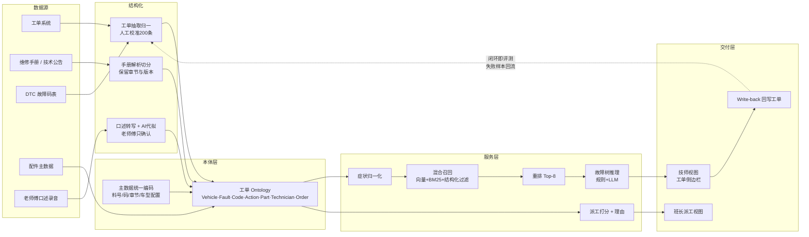

# 题 01 · 申沃客车 | 现场报修了，为什么还要从头查起？

| 项 | 内容 |
|----|------|
| **业务目标** | 现场维修智能协同、派工建议与工匠经验复用 |
| **组数** | 2 组 |
| **行业** | 智能制造（商用车售后服务） |
| **北极星指标** | 同车型同故障的**首次诊断命中率**（历史工单回测 Top-1） |
| **护栏指标** | 二次上门率**不高于基线** |
| **Echo / Delta** | Echo：售后技术主管 / 老师傅 · Delta：算法 + 后端 |

---

## 〇、企业背景与选题校准

| 事实 | 来源 | 等级 |
|------|------|------|
| 申沃客车是上汽集团旗下专业从事客车研发、制造和销售的核心企业，产品覆盖新能源、传统燃料及**智能驾驶客车** | 上观新闻 2026-06 | 3（仅供参考） |
| 2000 年成立，闵行莘庄工业区；车型 7–27 米，涵盖纯电、燃料电池、插混、双源无轨电车；累计销售 4.3 万台大中型客车 | 人民网 2022-08 | 3（仅供参考） |
| 9 系新能源公交车配备 **ADAS 智能驾驶辅助系统** | 人民网 2022-08 | 3（仅供参考） |
| 2026-06 与享道出行（SAIC 移动出行品牌）签署"数字化+智能化"战略合作：车联网平台、**RoboBus 自动驾驶**、信息安全、**AI 大模型**；享道输出 Robotaxi 云控架构，**联合构建车辆监控调度平台与乘客预约客户端**；为大模型规划算力与训练平台，**开发业务 Agent 应用，推动 AI 融入研发、生产、售后全流程** | 中国新闻网上海 2026-06-06 | 3（仅供参考） |
| 行业趋势：整车厂 + 出行平台 + 科技企业三方联动（宇通×滴滴、吉利远程×曹操出行、金旅×蘑菇车联 L4 巴士） | 中国新闻网上海 2026-06-06 | 3（仅供参考） |
| **申沃售后已做过数字化试点**：以**简道云零代码平台**为载体，在售后服务部门做小范围试点，按组织架构设服务 / 配件 / 技术支持 / 数据分析模块 | 简道云厂商案例 https://hc.jiandaoyun.com/solution/20107 | 3（仅供参考） |
| 同业已有成熟产品：宇通"智能网联智能远程诊断系统" | 宇通官网 | 3（仅供参考） |

**校准（这决定方案怎么写）**：

1. **真空白不是"没有系统"。** 申沃售后已有零代码试点（简道云）、同业已有智能远程诊断产品。**缺的不是工单系统，是"经验没结构化 + 派工没数据化"。** 所以本方案不是"给车企建一套售后系统"，而是**把已有的零代码试点接成能闭环、能评测、能沉淀经验的系统**。
2. 申沃的售后不是"修车厂"，是**车队型运营商的售后**——车辆归属公交公司、连续运营、故障直接影响线路。所以现场处置的目标函数是**恢复运营**，不是"修好"。
2. 上汽体系已明确"**AI 融入研发、生产、售后全流程**"并配套算力与训练平台。**不要写 AI 启蒙，要写闭环补全**——把已有算力/模型能力接到售后这一环。
3. 题 1（售后协同）与题 2（智能驾驶传播）是同一条链的两端：**RoboBus 的商业化 = 运营 + 品牌**，运营的底座是售后保障。方案要能对得上享道侧的"监控调度平台 + 乘客预约客户端"这套语境。
4. ⚠️ 照片未提供：报修量级、车队规模、所用售后系统、老师傅人数。**全部留到 Day1 现场确认**，方案里只写"Top 20 高频故障"这一相对确定的范围。

---

## 一、场景（L1 业务现场）

车辆运营中出故障 → 报修工单进来 → 技师/工程师到场处置。链路是：

> 确认车型与配置 → **判断原因** → **逐条排查** → 备件 → 复检关单

中间两步是黑洞：判断依据在老师傅口口相传里；历史工单只写了"故障描述 + 故障码 + 处理措施"这样的自由文本，**检索等于没有**。每一次处置，都是一次从零开始的诊断。

**关键事实（来自公开信息）**：9 系客车配 ADAS、新能源客车有电池/电机/电控专有故障特征；车型段 7–27 米、动力形式多种 → **同一现象在不同车型上原因不同**，这是"不能直接抄经验"的物理原因。

---

## 二、三层拆解树

### L1 业务问题

> **现场报修了，为什么还要从头查起？**

### L2 子问题（4 条能力缺口）

| # | L2 子问题（缺口） | 根因 | 为何值得做 |
|---|------------------|------|-----------|
| **L2-1** | **经验只存在于人脑，不存在于可检索系统** | 老师傅的排查顺序是口述的隐性知识；录成文字成本高，无人整理，离职即带走 | 直接对应业务目标里的"工匠经验复用"；且是唯一不可从外部采购的资产 |
| **L2-2** | **工单 / 故障码 / 手册 / 车型四种载体彼此不连通** | 现象、码、部件、车型、章节各自成表，查询时临时拼接 | 车型段多（7–27 m）+ 多动力形式，跨车型串检是真实事故风险 |
| **L2-3** | **现场输入的口径与知识库口径对不上** | 技师说"起步发闷"，码表写"P0AA6"，手册写"驱动系统功率限制" | 检索层的第一道门就漏，后面再准也没用 |
| **L2-4** | **派工与技师能力没有数据化** | 靠班长对"谁熟哪款车、哪类故障"的记忆 | 直接对应业务目标里的"派工建议"；也是工单闭环能否落地的组织前提 |

> 另有一条横贯性缺口（写进 L3 机制而非单列 L2）：**处理结果没有回流成可复用知识**——闭环断了，同一个坑反复踩。

### L3 机制（每个 L2 对应 2–3 条，全部标同族复用）

| 对应 L2 | L3 机制 | 怎么落地 | 同族复用（举一反三） |
|---------|---------|----------|----------------------|
| L2-1 | **经验条目化工作台** | 老师傅口述/现场随手记录 → ASR 转写 + LLM 代拟成标准条目（现象/可能原因/排查顺序/禁忌/所需配件）→ **老师傅只做"确认/改"，不做撰写** | 任何"经验随人走"的场景：新产品工艺规程、老师傅质检判据、老中医经验方 |
| L2-1 | **经验结构化为可执行排查路径** | 不是写成一段话，而是写成**有序步骤树**（分支条件 → 下一步），每步带观测点与判定标准 | 设备点检 SOP、巡检路线编排、应急预案决策树 |
| L2-1 | **经验与工单双向绑定** | 一条经验条目 = 一条带车型/故障域上下文的排查路径；工单可反向引用它 | 质量事故案例库、新员工带徒教材、审计举证 |
| L2-2 | **工单本体（Ontology）** | 用业务语言定义 `Vehicle / Fault / FaultCode / RepairAction / Part / Technician / WorkOrder / ManualSection`，并**提前固化关联**（车型↔手册版本↔章节、现象↔码↔部件、订单↔配件↔技师） | 通用"制造/服务/巡检"对象模型；换行业只换实体名 |
| L2-2 | **主数据统一编码** | 料号、故障码、手册章节号、车型配置各给唯一 ID 与版本；变更有生效日期 | 备件主数据、设备台账、固定资产编码统一 |
| L2-2 | **车型约束强制校验** | 任何检索与建议都必须带车型/配置过滤；**无匹配则明确说"无手册依据"，不猜** | 多规格多配置产品的选型与报价防错 |
| L2-3 | **现象 ↔ 故障码映射表** | 人工维护主干（码 → 标准现象描述），从历史工单反向挖掘补充同义映射；技师输入先做**症状归一化**再进检索 | 客服工单分类、售后问诊分流、设备报警代码归一 |
| L2-3 | **检索双过滤 + 混合召回** | 结构化过滤（车型/码域）+ 语义召回（手册语言）+ 关键词召回（料号/码）三路并集后重排 | 法规/标准/合同条款检索 |
| L2-4 | **技师技能画像** | 从历史工单反推每名技师的"擅长故障域 × 熟悉车型 × 认证资质 × 通过率" | 岗位胜任力画像、招聘匹配、外包队伍能力评估 |
| L2-4 | **派工匹配打分 + 理由生成** | `得分 = 技能匹配 + 故障域重合 + 班次可用 + 资质合规`，输出 Top-N 与**选他/不选他的理由** | 抢单派单、值班排班、售后工程师分派 |
| 横贯 | **回写闭环 + 闭环即评测** | 技师勾选执行的步骤与最终原因**回写工单**；每条闭环工单自动成为评测样本；误判案例回流为 few-shot 与规则修正 | 所有"人在回路"的 AI 系统通用：合同审核、质检判定、客服工单 |

> **L3 数量核对**：L2-1 → 3 条，L2-2 → 3 条，L2-3 → 2 条，L2-4 → 2 条，横贯 → 1 条。**L3 是 11 条机制，不是 11 个 L2。** L2 保持 4 条不变，这是深度控制。

---

## 三、项目定义与范围

**「维修协同助手（Repair Copilot）」**——嵌在工单流程里的排障副驾。

**输入**：车架号/车型 + 故障现象（文字 + 照片 + 故障码）
**输出**：候选故障原因 Top-N · 推荐排查步骤 · 携带配件清单 · 建议派工 · **每条结论可溯源**

| 做 | 不做（Day2 明确砍掉） |
|----|------------------------|
| 覆盖 **Top 20 高频故障码/现象** | 不做全车型全故障覆盖 |
| 手册 + 历史工单 + 口述经验 三源检索 | 不接配件实时库存（只出清单） |
| 排查步骤回写工单 + 结论回写 | 不改工单系统本体、不动 ERP/MES |
| 派工建议（技能画像 + 打分 + 理由） | 不做工时自动报价、不做成本核算 |
| 客户内网离线部署 | 不做公有云 SaaS |

**Echo / Delta 分工**

| 角色 | 承担人 | 职责 | 不可替代性 |
|------|--------|------|-----------|
| Echo | 售后技术主管 / 老师傅 | 说清"什么现象→什么原因→先查什么"；给 Top20 故障清单与判定规则；判定建议是否"像人话" | 隐性知识只有他有 |
| Echo | 班长 / 调度 | 给派工的硬约束（谁能上什么车、班次、资质） | 组织规则只有他有 |
| Delta | 算法 + 后端 | 数据接入、抽取归一、本体、检索、推理、回写、评测 | — |

**成功标准（Day3）**：用**一个真实故障码**端到端走一遍，老师傅当场在 5 分钟内判断"这建议能不能用"，并能**说出哪里不能用**。说不出哪里不能用 = 这套东西没进他的脑，不算通过。

---

## 四、专项技术点（三层技术栈）

| L1 技术域 | L2 组件 | L3 实现要点 |
|-----------|---------|-----------|
| **数据接入** | 工单/手册/码表/配件接入层 | API 优先、导出兜底；只取最近 N 年；原始件哈希留档 |
| | 手册解析切分 | 保留章节号与页码；表格单独处理；**版本号与生效日期入库**；更新触发重建索引 |
| **结构化** | 工单抽取归一 | 批量抽取故障现象/原因/步骤/配件/工时；**人工校准 200 条**作为评测集与 few-shot |
| | 主数据统一编码 | 料号/码/章节号/车型配置统一 ID；变更带生效日期，历史可追 |
| **本体层** | 工单 Ontology | Objects 用业务语言；Links 提前固化；**Actions + Write-back** 是完成定义的一部分 |
| **检索层** | 症状归一化 | 口语 → 标准现象描述；同义词表 + 模型改写双通道 |
| | 混合召回 | 向量 + BM25 + 结构化过滤三路并集；**过滤条件不可省** |
| | 重排 | Cross-encoder 重排；候选 Top-50 → Top-8 |
| **推理层** | 故障树 + LLM 混合 | 已知部件 + 已知现象 → 候选原因排序；**LLM 只做语言组织与现象映射，不生成原因** |
| | 溯源校验 | 每条结论必须绑定证据 ID；无证据 → 不展示 |
| **派工层** | 技能画像构建 | 从历史工单反推；数据不足时用"带教记录/认证/自评"补 |
| | 匹配打分与理由 | 打分可解释；输出"选他/为什么不选他" |
| **闭环层** | Write-back | 步骤勾选 + 结论 + 配件回写；幂等、失败可见可重试 |
| | 评测流水线 | 历史闭环工单回测；按车型/故障域分层看分；**随代码入库** |
| **工程化** | 部署与降级 | Docker Compose；弱网/离线 Plan B（退化为结构化查询 + 手册全文检索，无 LLM 也能演示） |

---

## 五、OKR

### O

> **让现场维修从「凭经验从头查起」变成「带着答案进场」，让老师傅的经验第一次成为可复用的组织资产。**

| KR | 指标 | 基线 | 目标 | 怎么量 |
|----|------|------|------|--------|
| **KR1（北极星）** | 同车型同故障的**首次诊断命中率**（历史回测 Top-1） | Day1 实测 | **≥ 70%** | 历史已闭环工单回测脚本，随代码入库 |
| KR2 | 技师获取排障信息耗时 | Day1 实测（预估 20 分钟+） | **≤ 2 分钟** | 5 名技师各测 3 次现场计时 |
| KR3 | 派工建议**采纳率** | 0 | **≥ 60%** | 班长确认采用数 / 总建议数（一周内） |
| KR4 | 老师傅经验条目化且**被检索命中** | 0 | **≥ 200 条** | 知识库计数 + 命中率日志 |
| KR5 | 建议**准确率**（人工抽检） | — | **≥ 80%** | 抽 50 条，技师判"可直接执行/需修改/不可用" |
| KR6 | 经验条目**由老师傅本人确认**的比例 | 0 | **≥ 60%** | 条目确认人字段统计（护栏：防止 AI 自说自话） |
| **KR7（护栏）** | 二次上门率 | Day1 实测 | **不高于基线** | 报修工单闭环数据回看 |

> **为什么必须有 KR7**：这套系统最阴险的失败是"技师照系统走 → 漏掉真实原因 → 二次上门变多"。命中率再高，只要 KR7 恶化，就是失败。
> **为什么必须有 KR6**：不确认的条目是 AI 编的。经验库一旦被污染，检索会越来越离谱。

---

## 六、解决方案与架构

### 关键链路：一次报修的一生

1. **接**：工单进来 → 带出车辆档案与最近 N 次工单
2. **归一**：技师输入"起步发闷" + 故障码 P0AA6 → 症状归一化 → 映射到标准现象
3. **检索**：结构化过滤（车型/配置/码域）+ 语义召回（手册语言）+ 关键词召回（料号）→ 重排 Top-8
4. **推理**：已知部件 + 已知现象 → 故障树给出候选原因与有序排查步骤
5. **组装**：一屏内给全——原因、步骤、配件清单、派工建议，**每条带出处**
6. **执行 + 回写**：技师勾选步骤、填最终原因 → 回写工单 → 该工单成为评测样本
7. **沉淀**：本次若出现新情况 → 语音补一条经验 → 老师傅确认 → 入库

### 关键取舍

| 取舍点 | 选择 | 放弃的 |
|--------|------|--------|
| 答案生成 | 检索 + 故障树，LLM 只组织语言 | 让 LLM 自由生成诊断（会编原因，不可信、不可溯源） |
| 召回方式 | 混合召回 + **强制车型过滤** | 纯向量语义检索（漏料号/漏码，且跨车型串检） |
| 覆盖范围 | Top 20 故障码 | 全故障覆盖（首日就做不完，且低频故障没人验） |
| 知识沉淀 | 老师傅只做确认 | 让老师傅写文档（成本高，做不完） |
| 自动化终点 | 人工确认不可省 | 全自动（一次误判就失去信任，且安全风险） |
| 部署 | 内网 + 离线 Plan B | 公有云（数据出厂区不可行） |

---

## 七、举一反三：本方案一并覆盖的同族问题

> 每条都满足：同数据形态 + 同痛点 + 不换业务知识即可复用。

| # | 同族问题 | 复用的 L3 机制 | 复用后长什么样 |
|---|---------|---------------|--------------|
| 1 | **售后技术公告/服务通报的闭环追踪** | 主数据统一编码 + 回写闭环 | 公告发布 → 受影响车型批次圈定 → 通知到位率与完成率可查 |
| 2 | **客服/车主热线的同类问题分流与话术沉淀** | 症状归一化 + 经验条目化工作台 | 热线问题自动归类并推送对应标准话术与排查路径 |
| 3 | **新能源车三电（电池/电机/电控）专项故障库** | 工单本体 + 故障树推理 | 把 Top20 换成"三电专项"即是一套独立故障库 |
| 4 | **配件预测与备件安全库存** | 主数据统一编码 + 闭环即评测 | 闭环工单的"实际用件"沉淀成按车型/故障域的用件分布 |
| 5 | **质量事故追溯与召回范围圈定** | 本体 Links + 故障树 + 经验条目 | 输入一个故障模式 → 输出受影响车型/批次/里程区间 |
| 6 | **新人带徒与技师认证** | 经验结构化为排查路径 + 技能画像 | 新人按路径走 + 系统按技能画像控制"谁可以独立处置哪类故障" |
| 7 | **已建零代码/低代码试点的部门如何"接得上"** | 本体 + 主数据统一编码 | 简道云、氚云、飞书多维表这类试点里已经攒了半年数据，但字段各写各的。**用一套本体把它们接起来**，比推倒重建便宜一个数量级——这个模式可复用到任何"已有零代码试点"的部门 |

> **一句话**：这不只是"维修问答机器人"。它同时是**故障知识库、派工引擎、质量追溯底座、技师培训系统**——四条线共用一套本体与闭环。

---

## 八、风险兜底与 Day1 必问

### 风险与兜底

| 风险 | 影响 | 兜底 |
|------|------|------|
| **老师傅不愿配合/没时间** | 经验复用落空，题目的核心目标失败 | 语音录入 + AI 代拟（他只做确认）；范围砍到 Top20；把"确认条目数"做成每日看板指标 |
| 工单数据脏、字段含义不一致 | 归一失败 | 抓 100 条脱敏样本先做字段映射表；不追求全量 |
| 手册跨车型混检 | **安全事故** | 车型/版本强制过滤；无匹配则明确说"无手册依据"，不猜 |
| LLM 编造原因 | 技师误操作 | 强制溯源；无出处不展示；KR5 抽检 |
| 客户内网无外网/无 GPU | 跑不起来 | 离线镜像 + 本地小模型；Plan B：退化为结构化查询 + 手册全文检索，**无 LLM 也能演示** |
| 车间弱网 | 现场用不了 | 端侧缓存最近 N 个车型的排查清单（预计算） |
| 派工建议被当成"自动派工" | 组织冲突 | 定位为**建议**，班长保留决定权；采纳率是指标，替换率是护栏 |

### Day1 现场必问

1. 报修量级：日均/峰值多少单？其中多少是到场后二次上门？（KR7 基线）
2. Top 20 高频故障码/现象是什么？是否集中在 2–3 个车型？
3. 工单系统可导出吗？API 还是 Excel？有没有历史照片？
4. 手册形态、版本管理、更新频率？更新后怎么同步？
5. 老师傅在岗几人？愿不愿意录？有没有历史带徒/培训记录可用？
6. 派工现在怎么做（谁定规则）？硬约束有哪些（班次/资质/车龄/地区）？
7. 上汽体系内，售后系统与享道侧车联网/调度平台是什么关系？**数据能不能互通？**（决定是"做原型"还是"做集成"）
8. **简道云那个零代码试点现在还在跑吗？覆盖了哪几个模块？**老师傅每天用不用？数据能不能从它导出来？（决定本方案是"接它"还是"绕它"——这是本题最关键的一问）
9. 内网部署条件：有没有推理算力？能不能装 Docker？模型调用走哪条合规通道？

> 备选方向（若第 7 题答案是否定的）：把题 1 收缩为"**单车型族（新能源 9 系）+ 老师傅经验复用**"的更小切口，先证明闭环有效，再谈打通。
