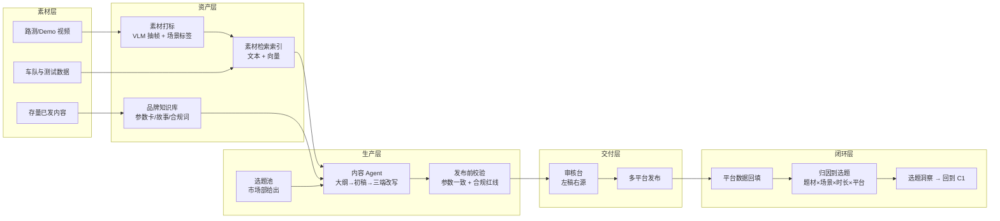

# 题 2 · 申沃客车 | 申沃的智能驾驶，下一站开向哪里？

| 项 | 内容 |
|----|------|
| **业务目标** | 智能驾驶品牌营销、场景化传播与内容持续运营 |
| **组数** | 2 组 |
| **行业** | 智能制造（客车 / 智能驾驶品牌传播） |
| **北极星指标** | **单条内容的有效线索数（可归因）**（口径 `⚠️ 待 Day1 确认`） |
| **角色配置** | Echo：市场部/品牌负责人（主导）· Delta：内容流水线工程师 |

> **一句话方案**：把散在硬盘里的路测素材和藏在工程师脑子里的技术亮点，变成一条能持续跑、每条都能溯源到真参数、内容效果能回流的运营流水线。

---

## 一、场景

### 1.1 业务现场

智能驾驶（无人驾驶公交 / 智慧出行）是申沃对外最有故事性、也最难讲清楚的技术资产。市场部要做的是：**让"智能驾驶"这件事被看见、被理解、被记住，并且被对的人看见**。

当前这条链路长这样：

1. 技术/测试团队产出素材（路测视频、场景 Demo、车队里程数据、接管/故障事件、专利与测试报告）
2. 素材躺在测试同事的电脑、共享盘、微信群里
3. 市场部要写内容 → 找素材 → 找技术同事问参数/要数据 → 写稿 → 内部改稿 → 改格式发不同平台
4. 发布后效果数据躺在各平台后台，与内容之间没有联系
5. 下个月再写，还是从零开始

### 1.2 为什么"下一站开向哪里"答不上来

| 表层现象 | 真实根因 | 对应解法方向 |
|---------|---------|-------------|
| 每篇内容都要重新找素材、重新问参数 | 素材没有资产化（无索引、无标签、无授权状态） | 多模态素材库 + 场景打标 |
| 技术参数要"翻译"成人话 | 技术口径与传播口径之间没有知识层 | 品牌知识库（参数卡 + 场景故事 + 合规口径） |
| 写完就发，发完就忘 | 没有"内容 → 效果"的闭环 | 效果回流 + 归因标签体系 |
| 各平台改写靠人工复制粘贴 | 缺少多端适配层 | 内容 Agent：一次成稿 → 多平台改写 |
| 稿件里的参数经常和实际对不上 | 没有发布前的参数一致性校验 | 参数溯源 + 发布前自动校验 + 人工审核卡点 |
| 不知道什么选题真正有效 | 历史内容没有结构化标签 | 历史内容回标 + 选题洞察 |

### 1.3 现有资产

| 资产 | 说明 |
|------|------|
| 路测 / Demo 视频 | 大量，但只有文件名，没有场景标签 |
| 车队运营数据 | 里程、车辆数、运营城市、场景覆盖 |
| 测试与接管记录 | 天气、路段、交通参与者、接管类型——**这是内容金矿**（"最难的场景我们跑了几万公里"） |
| 产品参数与卖点 | 官方口径（必须以最新版本为准） |
| 历史内容 | 公众号/小红书/视频号/新闻稿全平台存档 |
| 竞品资料 | 对比话术需要合规边界 |

### 1.4 ⚠️ 待 Day1 现场确认

- **指标口径**：市场部现在考核什么？线索？试驾/到访？媒体转载？还是声量？（这决定北极星，**第一优先级问题**）
- 现有平台与发布节奏：哪些平台？每月几条？谁审稿？
- 素材量级与格式：多少视频？单条多长？是否有机位/时间戳/车辆编号？
- 技术同事配合度：能不能在 Day2 抽 1 小时做一次集中访谈？
- 合规红线清单：哪些词不能说（"零事故""绝对安全"之类）？谁维护？
- 是否已有品牌视觉规范 / 模板可用？

---

## 二、项目

### 2.1 项目定义与交付物

**「智能驾驶内容工厂（Content Ops Copilot）」**：从素材到发布再到复盘的一条流水线。

**交付物**：

1. **多模态素材库**：视频/图片自动打标（场景、天气、路段、车辆、城市、是否有接管事件）+ 可检索
2. **品牌知识库**：参数卡、场景故事库、竞品对比、合规禁用词，统一口径且带版本
3. **内容 Agent 流水线**：选题 → 大纲 → 初稿 → 多平台改写 → 参数校验 → 合规校验 → 人工审核台
4. **可溯源审核台**：每一句涉及参数/数据的话，都标出它来自哪个源文件哪一段，审核人一眼可验
5. **效果回流与归因**：各平台数据回填 → 选题洞察（哪种题材、哪个场景、什么时长真正带来线索）

### 2.2 范围

| 做 | 不做（明确砍掉） |
|----|------------------------|
| 一个固定选题池（**8–12 个可复用选题**）跑通端到端 | 不做"什么都写"的通用文案机 |
| 公众号长文 + 小红书短文 + 短视频脚本 三端 | 不做视频自动剪辑（生成式视频不成熟，Demo 风险高） |
| 素材自动打标 + 检索 | 不做全量历史视频处理（先 Top 500 条） |
| 参数/合规**发布前拦截** | 不做舆情监控（不是本周期的题） |
| 效果回流（哪怕只有微信后台 + 简单表） | 不做自建 BI 平台 |

### 2.3 角色分工（本题是 Echo 主导的题）

> ⚠️ **本题最大的失败模式：做成一个"通用文案生成器"，演示很漂亮，市场部当场说"这个我们自己也能用 ChatGPT 写"。**

| 角色 | 承担人 | 职责 | 不可替代性 |
|------|--------|------|-----------|
| **Echo（主导）** | 市场部/品牌负责人 | 定义"什么内容有效"、给选题池、定品牌口吻、**成为最终验收人** | 品牌判断无法外包给模型 |
| **Echo（技术侧）** | 测试/研发同事 | 提供素材语义（这条视频到底在演什么）、参数口径 | 素材打标签题靠模型猜不准 |
| **Delta** | 内容流水线工程师 | 素材索引、知识库、Agent 流水线、审核台 | 工程实现 |
| **裁判** | 市场部 leader | Day3 当场用真实选题验收 | — |

**关键动作**：Day1 必须让市场部**当场给出 8–12 个他们真正想做的选题**。选题是市场部的资产，不是我们的。

### 2.4 成功标准

Day3：市场部用**自己出的真实选题**，在 30 分钟内拿到 3 端可发布的初稿（带参数溯源标记），并且**愿意修改后发布**。

---

## 三、专项技术点

| # | 技术点 | 为什么必须做 | 落地要点 |
|---|--------|-------------|---------|
| 1 | **多模态素材理解与打标** | 素材没有标签 = 没有资产，只能靠人翻 | VLM 对视频抽帧 + 关键帧描述 → 结构化标签（天气/路段/参与物/接管事件/车辆）；标签可人工纠正 |
| 2 | **以文本为主的素材检索**（多模态 embedding 落文本） | 素材多模态，但人检索时用自然语言描述（"雨天隧道"） | 视频→结构化文本+向量双索引，检索用文本，命中后回跳视频时间戳 |
| 3 | **品牌知识库 RAG（参数卡 + 场景故事）** | 技术话翻译成人话，且不能编 | 每个参数带版本与出处；检索强过滤（当前在售车型/当前版本） |
| 4 | **参数溯源与发布前一致性校验** | 编参数 = 事故 | 正文里的参数与知识库逐项比对，不一致标红阻断；**人工审核必须真有人签字** |
| 5 | **合规红线校验（规则 + LLM）** | 绝对化用语、未经证实的承诺 | 禁用词表 + 规则正则 + LLM 语义判定双层，输出拦截原因 |
| 6 | **内容 Agent 流水线（选题→成稿→改写）** | 人工写稿的耗时结构里，80% 在"找素材 + 翻译 + 改格式" | 用工作流编排（不是单次 prompt）：每步有输入输出契约、可回放、可单步重跑 |
| 7 | **多平台适配（3 端）** | 同一选题在公众号/小红书/视频号结构完全不同 | 平台模板：长度、结构骨架、标题风格、话题标签；同一"事实核心"三端不同表达 |
| 8 | **效果回流与归因** | "内容持续运营"的落点 | 发布时绑定 `选题ID / 场景标签 / 题材 / 时长 / 平台`，后端回填曝光/互动/线索；归因到选题层级而非单篇 |
| 9 | **历史内容回标** | 用已有内容冷启动选题洞察 | 对存量内容做标签回填（哪怕人工/LLM 辅助），建立第一版"什么题材有效"的基线 |
| 10 | **内容质量评估（LLM-as-Judge + 人工）** | 需要可判定的质量分 | 双评：Judge 打结构/口吻/信息密度分，人工打"能不能发"；两者的差值即模型缺陷 |
| 11 | **审核台交互** | 审核是流程的一部分，不是流程之外 | 左稿右源（正文 ↔ 参数出处 ↔ 视频片段），审核人改动留痕 |
| 12 | **合规的数据与素材边界** | 路测视频涉及人脸/车牌/路段 | 入库前脱敏；内部素材库权限分级（市场部可见 / 研发可见） |

---

## 四、OKR

### O

> **让智能驾驶的技术资产持续变成可运营的内容——市场部不再"每次从零写"，且每条内容都能说清它的效果。**

| KR | 指标 | 基线 | 目标 | 怎么量 |
|----|------|------|------|--------|
| **KR1（北极星）** | **单条内容的有效线索数（可归因）** | Day1 实测（需市场部给口径） | **≥ 基线 × 1.5**，或 **月有效线索数 ≥ 基线** | 发布时绑定选题ID，后端回填线索；口径由市场部定义（`⚠️ 待确认`） |
| KR2 | 单篇内容生产周期（从拿到素材到可发布初稿） | Day1 实测（预估 1–3 天） | **≤ 3 小时**（初稿） | 流水线跑批计时，5 个选题取均值 |
| KR3 | **素材复用率** | 当前极低 | **≥ 60%**（新内容基于已有素材库的比例） | 内容引用素材 ID 计数 |
| KR4 | 参数错误 / 合规违规被拦截率 | 0（无机制） | **100%**（发布前拦截） | 故意构造 10 条错误参数样本做对抗测试，拦截率必须 100% |
| KR5 | 存量内容标签化覆盖 | 0 | **≥ 200 条**历史内容完成回标，产出首版选题洞察 | 标签库计数 + 洞察报告 |
| KR6 | 市场部**采纳率**（AI 初稿被采用或轻改后发布） | — | **≥ 50%** | 审核台记录"采用/重写/弃用" |
| KR7 | 人工审核耗时 | Day1 实测 | **不高于基线**（护栏：护栏指标，不能因为工具更慢） | 审核台计时 |

> ⚠️ **KR7 是护栏**：内容工具常见的失败是"机器写 1 分钟，人审 40 分钟"。宁可少写，不要把审核负担搬家。

---

## 五、解决方案

### 5.1 总体架构

### 5.2 内容 Agent 的工作流契约（每步可单独重跑）

| 步 | 输入 | 输出 | 失败兜底 |
|----|------|------|---------|
| 1 选题匹配 | 选题池 + 素材标签 | 候选素材 Top-K | 素材不够 → 标注"待补拍"，不硬编 |
| 2 大纲 | 选题 + 素材 + 参数卡 | 结构化大纲（每节挂素材引用） | — |
| 3 初稿 | 大纲 | 正文（数字/参数处插 `{{ref:参数ID}}` 占位） | — |
| 4 三端改写 | 正文 + 平台模板 | 3 个平台版本 | 改写失败退回正文 |
| 5 参数校验 | 正文占位符 vs 知识库 | 通过 / 冲突清单 | 冲突 → 阻断 |
| 6 合规校验 | 正文 + 禁用词表 | 通过 / 拦截清单 | 拦截 → 阻断 |
| 7 审核签发 | 上述全部 | 定稿 + 审核留痕 | — |

### 5.3 关键取舍

| 取舍点 | 选择 | 放弃的 |
|--------|------|--------|
| 事实来源 | **只允许参数库与素材库**进正文（其余占位） | 让模型自由写数据（必编） |
| 生成 vs 检索 | 先检索素材再生成，**没有素材不写** | 无条件生成（内容会假、素材会断档） |
| 视频处理 | 抽帧 → 文本标签 → 文本检索 | 全库多模态向量检索（成本高、效果不稳） |
| 归因粒度 | 归因到**选题/题材/场景**（可聚合） | 归因到单篇（样本太少，无统计意义） |
| 存量内容 | 先回标再建洞察 | 直接按直觉定选题（不可验证） |

### 5.4 落地节奏

| 阶段 | 动作 | 交付物 |
|------|------|--------|
| **Day1 · 开题** | 跟市场部做 2 小时访谈（**拿到真实选题池 8–12 个 + 指标口径**）；拿 50 条素材 + 50 条存量内容；收集参数卡与禁用词；跑通需求五问法 | 选题池 + 素材样本 + 口径确认单 + 首轮路演稿 |
| **Day2 · 共解** | 素材打标管线跑通（Top 500）；参数知识库 + 合规词表；Agent 工作流 7 步全实现；审核台可用；用 3 个真实选题出稿 | 可跑原型 + 3 篇三端稿 + 校验拦截演示 |
| **Day3 · 出厂** | 市场部**当场出 3 个新选题**跑通；参数对抗测试（10 条错误样本）演示拦截；采纳率与审核耗时记录 | 原型 + 验证记录 + 选题洞察初版 |
| **后续 5 天节点** | 存量内容全量回标、选题洞察 v2、自动发布排期 | — |

### 5.5 评估与验证（结项证据）

| 证据 | 怎么产出 |
|------|---------|
| 真实卡顿 | 记录参数口径冲突、素材授权不清等实际卡点 |
| 团队 AI 模型 | 选题级归因表（题材 × 场景 × 平台 × 线索） |
| 测试与验证记录 | 10 条错误参数样本的拦截日志 + 审核台采纳/重写/弃用统计 |

### 5.6 风险与兜底

| 风险 | 影响 | 兜底 |
|------|------|------|
| **做成通用文案机，市场部说"我自己也能写"** | 本题最大失败 | 全程用**市场部自己的真实选题**与**真实素材**，不用通用样例；审核台必须能溯源到内部资产 |
| 市场部给不出选题/口径（Day1 没要到） | 无从验收 | Day1 硬性要求：没有 8 个选题和指标口径，**不进入 Day2 开发**，改为当场帮他们一起列（这是 Echo 的活） |
| 参数版本乱，AI 引用旧参数 | 内容出错 | 参数卡强制版本 + 停用标记；校验时旧版本直接冲突 |
| 合规红线不清 | 法律风险 | 用通用红线兜底（绝对化用语、未经证实承诺），并要求市场部 Day2 补齐正式清单 |
| 路测视频涉人脸/车牌 | 合规 | 入库前脱敏；素材权限分级 |
| 效果数据拿不到（各平台后台不通） | 无法归因，北极星量不了 | 至少实现"发布时绑定选题ID + 手工回填周数据"，保住最小闭环 |

---

## 六、可沉淀的通用件（碎石路 → 高速公路）

| 通用件 | 说明 |
|--------|------|
| **"素材 → 文本标签 → 检索"的资产化管线** | 与行业无关，可复用于任何非结构化素材库 |
| **占位符 + 校验的发布前事实核验范式** | 任何"AI 写对外内容"的场景都需要（产品说明、投标材料、财报解读） |
| **选题级归因模型** | 从单篇归因升级到选题归因，可复用于任何内容运营 |
| **审核台"左稿右源"交互** | 人工审核低摩擦化的通用界面范式 |
