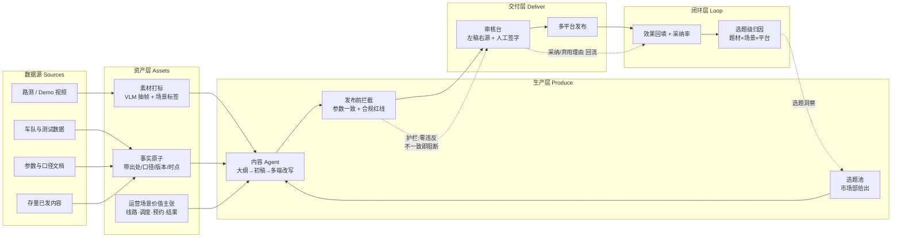

# 题 02 · 申沃客车 | 申沃的智能驾驶，下一站开向哪里？

| 项 | 内容 |
|----|------|
| **业务目标** | 智能驾驶品牌营销、场景化传播与内容持续运营 |
| **组数** | 2 组 |
| **行业** | 智能制造（商用车 / 智能驾驶品牌与场景传播） |
| **北极星指标** | **月有效线索数**（可归因到选题与场景，口径由市场部 Day1 定义 `⚠️`） |
| **护栏指标** | 单条内容的人工审核与返工总时长**不高于基线** |
| **Echo / Delta** | Echo：市场部 / 品牌负责人（主导）· Delta：内容流水线工程师 |

---

## 〇、企业背景与选题校准

| 事实 | 来源 | 等级 |
|------|------|------|
| 申沃客车是上汽集团全资客车研发制造企业，产品覆盖新能源、传统燃油及**智能驾驶客车** | 上观新闻 2026-06；人民网 2022-08 | 3（仅供参考） |
| 2000 年成立，闵行莘庄工业区；年产能近 3000 台，车型 7–27 米；累计销售 4.3 万台大中型客车 | sgurbanmobility；人民网 2022-08 | 3（仅供参考） |
| 9 系新能源公交车配备 **ADAS 智能驾驶辅助系统** | 人民网 2022-08 | 3（仅供参考） |
| 2026-06-05 与**享道出行**（SAIC 移动出行品牌）签"数字化+智能化"战略合作：车联网平台、**RoboBus 自动驾驶**、信息安全、**AI 大模型**；享道输出 Robotaxi 云控架构，**联合构建车辆监控调度平台与乘客预约客户端**；为大模型规划算力与训练平台，**开发业务 Agent 应用，推动 AI 融入研发、生产、售后全流程** | 中国新闻网上海 2026-06-06；上观新闻；网易/凤凰（线索） | 3（仅供参考） |
| 行业趋势：整车厂 + 出行平台 + 科技企业三方联动（宇通×滴滴、吉利远程×曹操出行、金旅×蘑菇车联 L4 巴士） | 中国新闻网上海 2026-06-06 | 3（仅供参考） |
| **申沃已以简道云零代码平台为载体，在售后服务部门做过小范围试点**，按组织架构设了服务 / 配件 / 技术支持 / 数据分析模块 | 厂商案例 https://hc.jiandaoyun.com/solution/20107 | 3（仅供参考） |
| 同业已有成熟产品：宇通"智能网联智能远程诊断系统" | https://www.yutong.com/news/video/ytsp/04/1911968825822285824.shtml | 3（仅供参考） |
| 已有"本体平台 + 大模型 + 知识图谱"的售后案例（某重卡企业，厂商稿自述：15 万实体 / 40 万关系边量级，上线 12 个月后诊断准确率 65%→92%、平均诊断时长 4.5 天→1.2 天） | https://www.admin5.com/article/20260605/1063709.shtml | 4（厂商稿 · **仅说明此类方案存在，不作为本方案的目标基线**） |

**校准（这决定方案怎么写）**：

1. **"下一站开向哪里"在业务上等于"从卖车转向卖运营服务"。** 申沃的智能驾驶不是一块 ADAS，而是 **RoboBus 运营 + 云控 + 调度平台 + 乘客预约** 的组合。所以选题必须覆盖**运营场景**（车队、调度、预约、真实线路、运营方结果），而不只是技术参数。**只讲参数 = 没答这题。**
2. **真空白不是"没有系统"。** 售后部门已用**简道云零代码平台**做过小范围试点（服务 / 配件 / 技术支持 / 数据分析四个模块），同业宇通也已有远程诊断系统 → **企业内部对数字化不陌生、也有零代码平台的落地经验与组织基础**。所以本题的立意**不是"给车企从零建一个内容中台"，而是"把散在零代码试点与各系统里的东西，接成一条能持续运营、能归因的内容流水线"**。配套的真空白是：**素材与对外事实没有资产化与可归因**（题 1 那条链的真空白则是**经验没结构化 + 派工没数据化**）。
3. **上汽体系已明确"AI 融入研发、生产、售后全流程"并配套算力与训练平台。** 不写 AI 启蒙，写**闭环补全**——把已有能力接到品牌与内容这一环。
4. **本题最大失败模式：做成一个"通用文案生成器"，市场部当场说"这个我自己也能用 ChatGPT 写"。** 所以 Echo（市场部 / 品牌负责人）**是主角**，全程用他们自己的真实选题与真实素材验收；系统交付的是"素材资产 + 事实口径 + 可归因闭环"，不是"一个能写字的框"。
5. 题 1（售后协同）与题 2（品牌传播）是同一条链的两端：**RoboBus 的商业化 = 运营 + 品牌**，运营的底座是售后保障；两边共用一套"事实口径"与"素材资产"。
6. **宣讲会给的口径比题面细：这题做的是"企业品牌营销"，不是"内容生产工具"。** 官方口径是**品牌号 + KOL + KOC 三层账号矩阵**（平台落在抖音 / 小红书 / 视频号）+ **巨量引擎 / 千川投放** + **AI 做舆情分析、数据整理，同时管控品牌调性与舆论风险**，可参考新能源品牌打法。我方原方案偏"内容工厂"（一条把素材变成稿子的流水线），矩阵、投放、舆情这三块没接上。宣讲会那句话说得很直白：**「我们这个是在做企业品牌的营销，不是说一个人偶尔通过 AI 跑出来一篇爆款就结束了。」** → 判断依据：单条爆款是偶发，能反复复用的账号体系 + 投放口径 + 舆情管控才是机制，所以这三块进范围，不留作"以后再说"。
7. ⚠️ **照片未提供**：市场部考核口径与线索定义、发布平台与节奏、素材总量与形态、对外可讲数字由谁定、RoboBus 实际运营城市/线路/车队规模、享道侧平台进展、简道云试点当前用到了哪些模块。**全部留到 Day1 现场确认**，方案里只写相对确定的范围（8–12 个选题池、Top 500 条素材）。

---

## 一、场景（L1 业务现场）

智能驾驶是申沃对外最有故事性、也最难讲清楚的技术资产。市场部要的是：**让"智能驾驶"被看见、被理解、被记住，并且被对的人看见**。

当前这条链路：

1. 技术 / 测试 / 运营团队产出素材（路测视频、场景 Demo、车队里程数据、接管与故障事件、测试报告、专利与公告）
2. 素材躺在测试同事的电脑、共享盘、微信群里，**只有文件名**
3. 市场部要写内容 → 找素材 → 找技术同事问参数与口径 → 写稿 → 内部改稿 → 改格式发不同平台
4. 发布后效果数据躺在各平台后台，**与内容之间没有联系**
5. 下个月再写，还是从零开始

**最贵的不是写稿，是"每篇都要重新找素材、重新问参数"。** 这两次打断把生产周期拉长，还让内容质量取决于当天找谁——这就是"下一站开向哪里"始终答不出来的真正原因。

**关键事实（来自公开信息）**：车型段 7–27 米、动力形式含纯电 / 燃料电池 / 插混 / 双源无轨电车；9 系新能源公交配 ADAS；累计销售 4.3 万台大中型客车；已与享道明确要联合构建"车辆监控调度平台"与"乘客预约客户端"；**售后部门已以简道云零代码平台做过小范围试点（服务 / 配件 / 技术支持 / 数据分析模块）**。→ **同一个"智能驾驶"在不同车型、不同动力形式、不同运营场景里讲法完全不同**，这是"一套稿子发全网"行不通的物理原因；而"已有零代码试点"意味着采集与登记**可以接进现成的台子，不必另建系统**。

**数据在哪**：

| 资产 | 现状 | 缺什么 |
|------|------|--------|
| 路测 / Demo 视频 | 量大，只有文件名 | 场景标签、时点、授权与脱敏状态 |
| 车队运营数据 | 里程、车辆数、城市、线路 | 统计口径与时点没有随数据入库 |
| 接管 / 故障事件记录 | 最硬的运营素材 | 没有与场景、视频对齐的索引 |
| 产品参数与卖点 | 官方口径散在 PPT / 手册 / 口述 | 没有"当前在售 + 当前生效"的唯一版本 |
| 存量已发内容 | 全平台存档 | 无结构化标签，效果数据不在旁边 |
| 合规红线与竞品边界 | 靠人记 | 没有机器可执行的清单 |

---

## 二、三层拆解树

### L1 业务问题

> **申沃的智能驾驶，下一站开向哪里？**

### L2 子问题（4 条能力缺口）

| # | L2 子问题（缺口） | 根因 | 为何值得做 |
|---|------------------|------|-----------|
| **L2-1** | **素材与运营数据没有变成可检索的场景事实** | 售后侧虽已有零代码试点，但**市场侧的素材仍是视频、里程、接管事件这些非结构化或半结构化资产**，只以文件名与口述存在；没有场景标签、没有出处、没有时点 | "场景化传播"四个字的底座就是**场景能不能被检索到**；也是"不再每月从零开始"的唯一前提 |
| **L2-2** | **讲得出参数，讲不出运营价值** | 内容停在"自动驾驶 / 激光雷达 / 算力"的概念与技术层；RoboBus 的价值在运营链路（城市线路、车队调度、乘客预约、运营方结果），这条链路没有被翻译成内容语言 | 讲不出运营价值，RoboBus 就只是一台更贵的车——**这正是"下一站"要回答的** |
| **L2-3** | **对外事实没有唯一版本与出处，发布前拦不住** | 参数、里程、车辆数、接管率散在 PPT、测试报告、同事口述里，版本与时点不明；多端改写靠复制粘贴，口径逐版漂移；合规红线没有可执行清单 | 一次对外参数错误 = 一次公开事故 + 一次信任损失，而且往往发布后才发现；**凡要签字的数字必须可溯源** |
| **L2-4** | **内容效果不回流，选题只能凭直觉** | 发布后各平台数据与内容之间没有绑定，"哪类题材 / 哪个场景有效"没人答得出来；市场部的采纳与弃用意见也没留痕 | 业务目标第三条是"内容**持续运营**"——没有回流就没有学习闭环，流水线跑得再快也只是更快地产出无效内容 |

### L3 机制（每个 L2 对应 2–3 条，全部标同族复用）

| 对应 L2 | L3 机制 | 怎么落地 | 同族复用（举一反三） |
|---------|---------|----------|----------------------|
| L2-1 | **多模态素材场景打标管线** | 视频抽帧 → VLM 生成场景描述 → 归一为受控标签（天气 / 路段 / 交通参与者 / 车型 / 城市 / 线路 / 是否接管）+ 人工纠正回写 | 任何"素材躺在硬盘"的库：展会演示录像、现场施工照片、培训录像、产品开箱视频 |
| L2-1 | **事实原子抽取与归一** | 把测试报告、车队台账、口述补充抽成结构化事实原子 `主体 + 指标 + 数值 + 口径 + 时点 + 出处`；同名指标只留一条，多条并存显式标"口径分歧" | 财报关键数据抽取、招投标参数归集、质检报告指标入库、产品参数表治理 |
| L2-1 | **结构化过滤 + 文本检索双索引** | 按城市 / 线路 / 天气 / 车型做结构化过滤 + 自然语言语义召回；命中回跳视频时间戳；**没标签 = 不存在** | 素材库、工程影像库、案例库、投标文件库 |
| L2-2 | **运营场景价值主张结构化** | 把 RoboBus 运营链拆成 `城市/线路 → 车队与调度 → 乘客预约端 → 运营方结果` 四环，每环绑定一个可量化运营指标 + 一个证据锚 | 任何 To G / To B 产品的"能力 → 运营结果"映射：云厂商、政务 SaaS、工业设备 |
| L2-2 | **场景故事骨架** | 固定骨架 `谁 · 在什么路况/时刻 · 遇到什么 · 车怎么应对 · 乘客或运营方得到什么 · 证据来自哪`；骨架固定、表达可换 | 客户案例故事、展会解说稿、战报、对外版故障复盘 |
| L2-2 | **受众分讲法改写** | 同一事实核心，面向公交公司运营方 / 乘客 / 媒体 / 政府四种讲法不同；**只换表达与例子，不换事实** | 发布会多受众材料、投资者 / 客户 / 媒体三套说明 |
| L2-3 | **对外口径卡（唯一权威事实表）** | 每个可对外的数字与承诺有唯一 ID、当前版本、生效日期、停用标记；检索强制过滤"当前在售车型 + 当前生效版本" | 对外说明书、价目表、服务承诺口径、对外白皮书 |
| L2-3 | **正文占位符 + 发布前一致性校验** | 正文里的数字只允许来自 `{{fact_id}}` 占位符；校验器逐项比对口径卡，未替换占位符或不一致即阻断 | 财报解读、投标文件、ESG 报告、对外白皮书 |
| L2-3 | **合规红线双层校验 + 人工签字** | 禁用词表 + 规则正则 + LLM 语义判定（绝对化用语、未经证实的承诺、竞品比较边界）；拦截清单必须有人签字放行 | 广告合规、招聘 JD、外资披露材料、平台运营规范 |
| L2-3 | **舆情与调性管控** | 平台舆情工具 + 人工定时看两条路；发布前红线校验拦绝对化用语与越界竞品比较，发布后异常上升回溯当天发了什么；**舆情不进内容生成链路，只做发布后的看和发布前的拦** | 通用"对外内容合规"：法务审稿、政务发布、上市公司 IR 口径、平台社区运营 |
| L2-4 | **发布即绑定选题 ID + 效果回填** | 发布时写入 `选题ID / 场景标签 / 题材 / 时长 / 平台 / 发布时间`；各平台数据手工或接口回填进同一张表 | 活动投放、电商详情页、SEO 内容、雇主品牌 |
| L2-4 | **选题级归因 + 存量内容回标** | 归因到可聚合的题材 / 场景 / 平台，而非单篇；存量内容回标建第一版"什么有效"基线 | 内容复盘、投放素材效果回流、渠道组合分析 |
| L2-4 | **采纳率回流校准** | 审核台记录"采用 / 轻改 / 重写 / 弃用 + 原因"，回流成 few-shot 与风格约束；**弃用理由是最贵的训练信号** | 任何人机共写场景：客服话术、法务文书初稿、财报点评 |

> **L3 数量核对**：L2-1 → 3 条，L2-2 → 3 条，L2-3 → 4 条，L2-4 → 3 条 = **13 条机制，不是 13 个 L2**。L2 保持 4 条不变，这是深度控制。

---

## 三、项目定义与范围

**「智能驾驶内容工厂（Content Ops Copilot）」**——从素材到发布再到复盘的一条流水线。

**输入**：市场部的真实选题 + 内部素材库 + 对外口径卡
**输出**：三端可发布初稿（带事实溯源标记）· 拦截清单 · 审核签字记录 · 效果归因表

| 做 | 不做（Day2 明确砍掉） |
|----|------------------------|
| 固定选题池（**8–12 个市场部自己的选题**）跑通端到端 | 不做"什么都写"的通用文案机 |
| 抖音短视频 + 小红书短文 + 视频号脚本 三端 | 不做视频自动剪辑（生成式视频不成熟，Demo 风险高） |
| **品牌号 + KOL + KOC 三层账号矩阵**（各层能说什么、哪类话题留给 KOL、KOC 走哪几道检查，写在同一张表里） | 不做 MCN 代运营，不做账号买卖与养号 |
| **投放侧接巨量引擎 / 千川**，内容与投放数据合到同一张表（先有选题编号，再配定向与出价） | 不做投放代理（不代投、不代优化账户） |
| 素材打标 + 检索（先 Top 500 条） | 不做全量历史视频处理 |
| 事实原子 + 口径卡 + 发布前拦截（参数 + 合规） | 不做自建舆情监测平台（舆情用平台现成工具 + 人工定时看） |
| **舆情与调性管控**：**用平台现成舆情工具 + 人工定时看，不另建舆情系统**；发布前红线校验拦绝对化用语与越界竞品比较，发布后异常上升回溯当天发了什么 | 不做全网舆情爬取与自研情感打分 |
| 效果回流（哪怕只有后台手工周表）+ 存量内容回标（先 200 条） | 不做自建 BI 平台；不做全平台历史数据爬取 |
| 采集与登记**优先复用既有零代码平台**（挂新表 / 走导出与接口） | **不新建内容中台、不替换既有零代码平台实例** |

**Echo / Delta 分工**

| 角色 | 承担人 | 职责 | 不可替代性 |
|------|--------|------|-----------|
| **Echo（主导）** | 市场部 / 品牌负责人 | 定义"什么内容有效"、给 8–12 个真实选题、定品牌口吻、**当最终验收人** | 品牌判断无法外包给模型 |
| **Echo（技术/运营侧）** | 测试 / 研发 / 运营同事 | 说清"这段视频到底在演什么"、给运营口径与可对外的数字 | 素材语义与参数口径，模型猜不准 |
| **Delta** | 内容流水线工程师 | 素材索引、事实层、Agent 流水线、校验器、审核台 | 工程实现 |
| 裁判 | 市场部 leader | Day3 当场用真实选题验收 | — |

**关键动作**：Day1 必须让市场部**当场给出他们真正想做的 8–12 个选题**。选题是市场部的资产，不是我们的。

**成功标准（Day3）**：市场部用**自己出的真实选题**，在 30 分钟内拿到带溯源标记的三端初稿，并且**愿意修改后发布**。"愿意发"才是验收线；我们演示成功不算通过。

---

## 四、专项技术点（三层技术栈）

| L1 技术域 | L2 组件 | L3 实现要点 |
|-----------|---------|-----------|
| **数据接入** | 素材接入层 | 共享盘 / 网盘 / 测试平台导出；原始件哈希留档；先接 Top 500 条；**采集与登记优先复用既有零代码平台（表单化登记 + 导出 / 接口），不新建系统** |
| | 运营与存量数据接入 | 车队里程 / 车辆数 / 城市线路，**口径随数据一起入库**（谁统计的、什么时点）；各平台已发内容 + 发布日期（无日期的先补） |
| **素材理解** | 抽帧与场景标签生成 | 均匀抽帧 + 事件点抽帧（接管 / 异常），保留时间戳；VLM 描述 → 受控词表归一 → 人工纠正回写 |
| | 素材检索索引 | 结构化过滤（城市 / 线路 / 天气 / 车型）+ 文本向量；命中回跳时间戳 |
| **本体层** | 内容本体 Ontology | Objects：`Material / Scene / Fact / FactVersion / Topic / Draft / Platform / Result`；Links 固化（事实→稿件、选题→效果）；场景标签为受控词表 + 版本，标签与事实分离（标签可重打而不改事实）；**Actions + Write-back**：发布写回 + 效果回填 + 采纳率回流 |
| **事实层** | 事实原子抽取 | `主体+指标+数值+口径+时点+出处`；同名指标多口径并存时显式标分歧 |
| | 对外口径卡 | 唯一 ID + 版本 + 生效日期 + 停用标记；当前在售车型强过滤 |
| **生产层** | 内容 Agent 工作流 | 7 步契约（选题匹配→大纲→初稿→多端改写→参数校验→合规校验→签发）；每步可单步重跑、可回放 |
| | 多端改写 | 平台模板：长度 / 结构骨架 / 标题风格 / 话题标签；**事实核心不变** |
| **校验层** | 参数一致性校验 | `{{fact_id}}` 占位符逐项比对口径卡；未替换占位符 = 阻断 |
| | 合规红线校验 | 规则正则 + LLM 语义判定双层；输出**拦截原因**而非只给"不通过" |
| **交付层** | 审核台（左稿右源） | 正文 ↔ 事实出处 ↔ 视频片段三栏并排；改动留痕；**签字才放行** |
| | 发布与排期 | 选题 ID + 标签 + 平台 + 发布时间写进发布记录 |
| **闭环层** | 效果回填 | 各平台数据回填进同一张表；无接口时手工周表兜底 |
| | 归因与洞察 | 归因到题材 × 场景 × 平台 × 时长；产出下轮选题建议 |
| | 采纳率回流 | 采用 / 轻改 / 重写 / 弃用 + 原因 → few-shot 与风格约束 |
| **工程化** | 部署、降级与权限脱敏 | 内网优先；离线 Plan B（无 LLM 时退化为素材检索 + 口径卡核对）；路测视频人脸 / 车牌脱敏，素材库权限分级（市场部 / 研发 / 法务） |

---

## 五、OKR

### O

> **让"智能驾驶"从一段技术介绍，变成一条持续产出的运营场景内容线——市场部不再每次从零写，每条内容都能溯源到真参数、真素材、真效果。**

| KR | 指标 | 基线 | 目标 | 怎么量 |
|----|------|------|------|--------|
| **KR1（北极星）** | **月有效线索数**（可归因到选题与场景） | Day1 实测（口径由市场部定义 `⚠️`） | **≥ 基线 × 1.5** | 发布时绑定选题 ID，后台回填线索；口径由市场部书面确认 |
| KR2 | 单条内容生产周期（拿到选题→可发布初稿） | Day1 实测（预估 1–3 天） | **≤ 3 小时** | 流水线跑批计时，5 个选题取均值 |
| KR3 | **素材复用率**（新内容基于已有素材库的比例） | 当前极低 | **≥ 60%** | 内容引用素材 ID 计数 |
| KR4 | 参数错误 / 合规违规的**发布前拦截率** | 0（无机制） | **= 100%**（零违反） | 故意构造 10 条错误样本做对抗测试，拦截率必须 100% |
| KR5 | 存量内容标签化覆盖 | 0 | **≥ 200 条**历史内容完成回标，产出首版选题洞察 | 标签库计数 + 洞察报告 |
| KR6 | 市场部**采纳率**（AI 初稿被采用或轻改后发布） | 0 | **≥ 50%** | 审核台记录"采用 / 轻改 / 重写 / 弃用" |
| **KR7（护栏）** | 单条内容的**人工审核与返工总时长** | Day1 实测 | **不高于基线** | 审核台计时（改稿轮次 × 耗时） |
| KR8 | **舆情异常发现时延**（异常上升 → 定位到当天发布的内容） | 当前靠人工刷，> 1 天 | **≤ 2 小时** | 舆情表每日拉数 + 异常告警；抽 10 次异常复盘计时 |
| KR9 | 舆情与调性结论的**人工确认率** | 0 | **= 100%** | 舆情表每条结论带确认人；未确认不外发 |

> **为什么必须有 KR7**：内容工具最阴险的失败是"机器写 1 分钟，人审 40 分钟"。宁可少写几条，也不要把审核负担从写稿搬家到审稿。
> **为什么必须有 KR4**：参数错误是公开事故。拦截率 100% 是"零违反"级要求，不接受"大部分拦住"。

---

## 六、解决方案与架构

### 关键链路：一条内容的一生

1. **选**：市场部从选题池挑一条 → 检索候选素材 + 事实原子 → **素材不够就标"待补拍"，不硬编**
2. **组**：大纲每节挂素材引用与事实引用 → 运营场景骨架套上
3. **写**：初稿生成，正文里的数字一律写成 `{{fact_id}}` 占位符
4. **改**：按平台模板出三端版本（抖音 / 小红书 / 视频号脚本），**只换表达不换事实**
5. **校**：参数校验器逐项比对口径卡 + 合规红线双层判定 → 不一致就阻断
6. **审**：左稿右源，人工签字放行（改动留痕）
7. **发**：发布记录写入选题 ID + 标签 + 平台 + 时间
8. **回**：平台数据回填 + 采纳率入库 → 归因到题材 × 场景 → 产出下轮选题建议

### 关键取舍

| 取舍点 | 选择 | 放弃的 |
|--------|------|--------|
| 事实来源与生成策略 | 只允许口径卡与事实原子进正文（其余占位）；**先检索素材与事实再生成，没有素材不写** | 让模型自由写数据（必编）、无条件生成（内容假、素材断档） |
| 视频处理 | 抽帧 → 文本标签 → 文本检索 | 全库多模态向量检索（成本高、效果不稳） |
| 叙事主线 | **运营场景**（车队/调度/预约/真实线路） | 参数堆砌的技术种草（那就答错了题） |
| 归因粒度与存量冷启动 | 归因到**选题 / 题材 / 场景**（可聚合）；存量内容先回标再建洞察 | 归因到单篇（样本太少）；凭直觉定选题（不可验证） |
| 自动化终点 | 人工签字不可省 | 全自动发布（一次参数错误就失去信任） |
| 部署 | 内网 + 离线 Plan B | 公有云（素材含未公开产品与运营信息） |

### 落地节奏（Day1–Day3 + 5 天节点）

| 阶段 | 动作 | 交付物 |
|------|------|--------|
| **Day1 · 开题** | 与市场部做 2 小时访谈，**拿到 8–12 个真实选题 + 指标口径 + 审核链路**；拿 50 条素材与 50 条存量内容（拿不到真数据就用假数据把链路跑通——**假数据比没数据好**）；收参数卡与禁用词；跑通需求五问法 | 选题池 + 素材样本 + 口径确认单 + 首轮路演稿 |
| **Day2 · 共解** | 打标管线跑通（Top 500）；事实原子 + 口径卡；Agent 7 步全实现；审核台可用；用 3 个真实选题出稿 | 可跑原型 + 3 篇三端稿 + 拦截演示 |
| **Day3 · 出厂** | 市场部**当场出 3 个新选题**跑通；参数对抗测试（10 条错误样本）演示拦截；记录采纳率与审核耗时 | 原型 + 验证记录 + 选题洞察初版 |
| **后续 5 天节点** | 存量内容全量回标、选题洞察 v2、自动发布排期 | — |

---

## 七、举一反三：本方案一并覆盖的同族问题

> 每条都满足：同数据形态 + 同痛点 + 不换业务知识即可复用。

| # | 同族问题 | 复用的 L3 机制 | 复用后长什么样 |
|---|---------|---------------|--------------|
| 1 | **车型年度改款 / 配置升级后的对外参数同步**（官网参数页、经销商手册、发布通稿三处口径不一致） | 对外口径卡 + 占位符校验 | 参数只改一处口径卡，三处下游自动标红待更新，发布前拦下 |
| 2 | **售后技术公告 → 对外二次传播**（题 1 的公告库变成市场部素材） | 事实原子抽取 + 素材打标管线 | 公告按"故障域 × 车型"自动转成科普稿，数字直接引用公告事实原子，不重抄 |
| 3 | **面向公交公司 / 交管部门的 B 端采购决策材料**（RoboBus 运营方案书） | 运营场景价值主张结构化 + 场景故事骨架 | 同一套运营场景拆成"给运营方的成本与效率口径"，每个结论挂证据锚 |
| 4 | **展车与路演现场素材的会后复用**（展会当天拍了上百段视频） | 多模态打标 + 结构化过滤检索 | 会后按场景标签筛出可用片段，不用逐个翻 |
| 5 | **与出行伙伴的联名传播口径统一**（同一 RoboBus 运营数据，两个主体对外各说各话） | 事实原子归一 + 受众分讲法 | 事实层只有一份，双方内容各自改写表达，数字永远一致 |
| 6 | **多平台内容排期与预算分配**（抖音 / 小红书 / 视频号 / 媒体稿节奏不同） | 发布即绑定选题 ID + 选题级归因 | 每个平台单独归因，反推"该平台该投什么题材"，产出下月内容表 |
| 7 | **平台社区与评论区的舆情**（一条内容发出去，评论区追问参数、竞品来蹭） | 舆情与调性管控 + 合规红线双层校验 | 关键词提及量、情绪与来源平台每天一张表；评论区追问参数时按口径卡回话，越界的竞品比较在发布前就被拦下 |

> **一句话**：这不只是"文案生成器"。它同时是**素材资产库、对外事实口径库、发布前事实核验台、选题效果归因台**——四条线共用一套本体与闭环（**碎石路 → 高速公路**：换行业只换数据与口径表，方法不动）。

---

## 八、风险兜底与 Day1 必问

### 风险与兜底

| 风险 | 影响 | 兜底 |
|------|------|------|
| **做成通用文案机，市场部说"我自己也能用 ChatGPT 写"** | 本题最大失败 | 全程用市场部自己的真实选题与真实素材；审核台必须能溯源到内部资产与口径卡；Day3 用市场部当场出的新选题验收 |
| 市场部给不出选题 / 指标口径 | 无从验收 | Day1 硬性要求：拿不到 8–12 个真实选题与指标口径，**不进入 Day2 开发**，改为当场与市场部一起列（这是 Echo 的活） |
| 口径卡拿不到（参数散在各处） | 事实层塌了，校验退化成摆设 | 先建"最小口径卡"：只收 Top 20 会对外讲的数字，逐条找业务方确认版本 |
| 运营侧信息拿不到（RoboBus 进展 / 线路 / 车队） | 内容只能停在技术参数层 → 退回"技术种草" | Day1 明确运营侧数据由谁给、何时给；拿不到就如实写"运营侧暂未公开"，**不编** |
| 素材授权 / 肖像与车牌 | 合规与法律风险 | 入库前脱敏；素材权限分级；对外使用前走一次授权确认 |
| 效果数据拿不到（各平台后台不通） | 无法归因，北极星量不了 | 至少实现"发布时绑定选题 ID + 手工回填周数据"，保住最小闭环 |
| 多端改写导致口径漂移 | 三端数字不一致 | 改写层只允许换表达，不允许换事实；数字始终是占位符校验对象 |
| 合规红线不清 | 法律风险 | 用通用红线兜底（绝对化用语、未经证实承诺），Day2 前市场部补正式清单 |
| **另起炉灶建新内容中台，与既有零代码试点重复** | 落不了地，也答错了题 | 采集与登记复用既有平台实例；交付物按"能接进现有台子"设计，Day1 确认实例可用性 |

### Day1 现场必问

1. 市场部现在考核什么？**"线索"怎么定义、怎么记、谁记**？（北极星口径，第一优先级）
2. 现有发布平台、节奏、每条内容谁审、审几轮、改稿平均几轮？
3. 素材规模与形态：多少视频 / 图片？是否带机位、时间戳、车辆编号？授权与脱敏状态如何？
4. **"对外可讲的数字"目前由谁定义、以哪份文件为准？** 有没有停用或旧版本参数在流传？
5. 合规红线清单在哪、谁维护？竞品比较允许到什么程度？
6. 运营侧现状：RoboBus 在哪些城市 / 线路跑？车队规模？**享道侧的监控调度平台与乘客预约客户端到哪一步、能不能对外讲？**（决定内容主线）
7. 与享道在内容口径上的分工：谁的数据、谁署名、能不能互认？
8. **既有的零代码平台试点现在用到了哪些模块？能不能直接挂"素材登记 / 发布记录"两张表？** 市场侧是否另有内容中台 / 素材库 / 账号矩阵？历史内容能否导出？
9. 内网部署条件：有没有推理算力？能不能装容器？模型调用走哪条合规通道？

> 备选方向（若第 6 题答案是否定的）：把题 2 收缩为"**单一城市 / 单一线路的 RoboBus 场景内容包 + 最小口径卡**"——用一个真实运营场景做深，先证明资产化与溯源闭环有效，再谈选题库与全平台归因。
