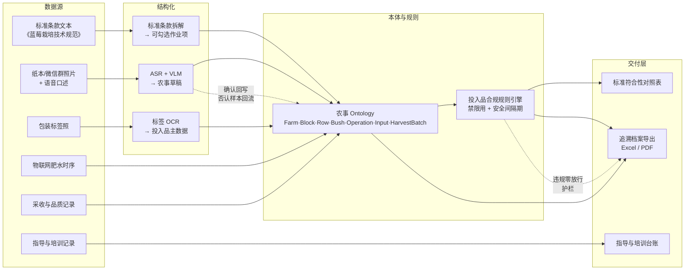

# 题 03 · 蓝莓研究所 | 蓝莓种植的每一步，能不能都有据可查？

| 项 | 内容 |
|----|------|
| **业务目标** | 蓝莓种植档案与农事记录智能整理 |
| **组数** | 2 组 |
| **行业** | 农业科技（蓝莓栽培技术推广 / 质量追溯） |
| **北极星指标** | **追溯完整度**（抽 1 个采收批次，能回溯到的关键农事占标准要求项的比例） |
| **护栏指标** | 不合规投入品（禁用 / 超安全间隔期 / 超剂量）**入库存量为 0** |
| **Echo / Delta** | Echo：农艺师 / 基地负责人 · Delta：算法 + 后端 |

> **一句话方案**：让每一步种植操作都挂在"对象 + 标准条款"上——拍照说一句就入库，出问题时能倒查到那一次操作，交出去时能证明"这次符合规范"。

---

## 〇、企业背景与选题校准

| 事实 | 来源 | 等级 |
|------|------|------|
| 2012-01-18 成立，**民办非企业单位**，法定代表人/所长陆敏，地址上海金山区吕巷镇白漾村 4288 号，主管单位**上海市绿化和市容管理局** | 百度百科（引自国家林草局、上海绿化局公告） | 3（仅供参考） |
| 业务：蓝莓新品种引进/筛选/繁育/示范推广、**蓝莓技术培训服务**、栽培/保鲜储藏/安全生产技术研究 | 同上 | 3（仅供参考） |
| 牵头起草**上海市地方标准《蓝莓栽培技术规范》**（2023-10 通过技术审查，涵盖品种选择、建园、定植、土肥水管理、修剪、病虫鸟害防治、采收） | 国家林草局政府网（经百科引用） | 1 |
| 敏蓝"**五个统一**"质量管理体系（统一标准/标识/包装/宣传/销售），获**第九届金山区区长质量奖**（2024，农业领域首次） | 金山区政府网；解放网 | 1 / 3 |
| 基地为上海市蓝莓鲜果与种苗供应基地之一、全国蓝莓品种资源圃之一、国家级特色经济林蓝浆果种植示范基地；已通过无公害产地、无公害产品、绿色农产品认证 | 百度百科；上海市绿化和市容管理局（经引用） | 1 / 3 |
| 已用物联网建成**智慧农业肥水一体化灌溉系统**（全园无人值守自动化）、根域限制栽培、蜜蜂授粉与花期调控（成熟期提前 45 天） | 百科；解放网 | 3（仅供参考） |
| 引进品种 83 个、筛选适生品种 12 个；长三角推广种苗近 20 万株、标准化技术 3 万余亩；辐射带动 502 亩；核心示范区平均亩产 622.3 kg、增产 18.78% | 中央财政林业科技推广示范项目验收公告（国家林草局 / 上海市绿化局） | 1 |
| 开办**田间学校**，免费培训百余次、**培训 6000 余人次**，服务近万人次 | 百科；上海金山教育 | 3（仅供参考） |
| 所长陆敏 2025 年推动蓝莓种植"智能化"升级，利用 20 余年数据构建 AI 模型 | 百度百科 AI 摘要（经百科页面引述） | 3（仅供参考） |
| **行业侧基线**：贵州麻江县已搭建**蓝莓产业互联网大数据服务平台**——采集整理近 10 年种质资源、墒情、花期气象、病虫害图谱、水肥配比、挂果周期，收录 **117 类种质资源**，建成山地蓝莓专项数据集与"山地浆果专属大模型"；采集方式为物联网传感器 + 田间摄像头 + 移动采集终端 + **技术员人工采集 + 清洗标注入库** | 贵阳市大数据局转载《农民日报》 https://dsjj.guiyang.gov.cn/newsite/xwdt/xyzx/202608/t20260828_90794874.html | 1 / 2 |
| **官方承认的行业缺口**：生产数据"**大多停留在农户脑海，没有形成标准化、结构化的数据**"，生产数据碎片化、地块破碎 | 同上 | 1 / 2 |
| 企业级溯源已有先例：佳沃曲靖蓝莓使用慧云农产品溯源系统，全程追溯中含"农事记录"环节 | 搜狐号转载 https://www.sohu.com/a/250444619_793445 | 4（仅作线索） |

**校准（这决定方案怎么写）**：

1. **这家单位不是种植企业，是技术推广方。** 它的资产是"标准 + 品种 + 技术 + 培训"，服务半径远超自有基地（辐射 502 亩、长三角标准化技术 3 万余亩、帮扶外地基地）。所以题 3 的真问题不是"给自己种的地建档"，而是**"把标准、种苗、技术指导的交付过程沉淀成可复核的数据"**。方案里档案的主角必须是**作业 + 标准条款 + 指导交付**，地块只是坐标。
2. **标准已经有了，缺的是"作业 ↔ 条款"的接口层。** 它牵头起草的《蓝莓栽培技术规范》已经过技术审查，但标准是文本，作业是散落的田间记录，两者之间没有任何可勾选、可判定的连接。AI 该干的活正是这一层：**把条款变成可执行的作业项，把作业变成可对照的证据**。
3. **行业侧已有产业级平台，缺的是"植株/行级日常农事"的结构化。** 麻江县已建成蓝莓产业互联网大数据服务平台，近 10 年种质与农情数据、117 类种质资源、山地蓝莓专项数据集均已入库，采集方式里就明确包含"技术员人工采集 + 清洗标注入库"。官方口径也承认行业缺口：生产数据"**大多停留在农户脑海，没有形成标准化、结构化的数据**"，生产数据碎片化、地块破碎。→ **所以不能写"农业记录完全没数字化"（那是错的）**；真空白在**投入品、日期、责任人这些日常农事字段的植株/行级结构化，以及标准符合性视角**——麻江平台解决的是"产业级数据底座与模型"，而上海市蓝莓研究所的差异化资产是**标准 + 品种 + 技术 + 培训**，它缺的是**标准条款与作业记录之间的可复核接口**。它的感知数据（物联网肥水）与 20 余年历史数据已在，缺的是**人工农事环节的结构化、有人确认、带质量字段**。
4. ⚠️ 照片未提供：基地/地块/株数、农工人数、现有记录形态、投入品合规规则是否成文、对外认证交付口径、现有信息化系统。**全部留到 Day1 现场确认**，方案里只写"5–6 类高频农事 + 1 套标准"这一相对确定的范围。

---

## 一、场景（L1 业务现场）

蓝莓是典型的**重农艺、强时序、慢验证**的作物。一株苗从定植到采收，要经过修剪、疏花、疏果、施肥、灌溉、打药、铺膜、采收；这些操作决定了最终的糖度、硬度、果径和商品率。

而在推广方的业务里，这条链是这样的：

> **标准（怎么种）→ 种苗（种什么）→ 技术指导（谁来种、怎么种）→ 田间作业（实际怎么做的）→ 采收与品质（结果如何）→ 认证与示范（能不能拿出去说）**

**今天的记录长这样：**

- 纸本田间记录本（下雨就丢，字迹靠认）
- 微信群里发的照片（"今天打的这个药"——没有地块、没有剂量、没有日期）
- 各自电脑上的 Excel（一个技术员一份，列名都不一样）+ 农艺师脑子里的经验（"这个地块去年打过 XX，今年要注意"）
- 指导与培训：大多只留一张签到表和一个 Excel 名单

**"每一步有据可查"难在哪**：记录不是没有，而是**记的不是能对照标准的东西**。它记到"地块 + 日期 + 一句话"，没有对象（品种、生育期、行、株、投入品、采收批次），所以既判不了标准符合性，也倒查不了品质波动原因；指导与培训这两项"产品"更是几乎没有交付留痕。

**关键事实（来自公开信息）**：《蓝莓栽培技术规范》已于 2023-10 通过技术审查并覆盖品种选择到采收全流程；该所已建成物联网肥水一体化灌溉系统；核心示范区平均亩产 622.3 kg、增产 18.78%。

**行业基线（这决定我们的切口在哪）**：产业级平台已经存在——麻江县已搭建蓝莓产业互联网大数据服务平台，近 10 年数据 + 117 类种质资源 + 山地蓝莓专项数据集 + 专属大模型都已入库，采集链路里就包含"技术员人工采集 + 清洗标注入库"；企业级溯源也已有先例（佳沃曲靖蓝莓用慧云农产品溯源系统，追溯链中含农事记录环节）。**所以本题不是"从零建一个农业数字化平台"，而是补两块**：① **植株/行级日常农事字段（投入品、日期、责任人）的结构化与清洗标注**——官方口径承认这仍是行业空白（"大多停留在农户脑海"）；② **面向"标准符合性"的视角**——这是上海蓝莓研究所区别于规模型产区平台的差异化资产。

→ **标准在、感知数据在、产业平台形态已被验证，缺的是把人工环节接进同一套口径、并且能对上标准条款的那一层**。

---

## 二、三层拆解树

### L1 业务问题

> **蓝莓种植的每一步，能不能都有据可查？**

### L2 子问题（4 条能力缺口）

| # | L2 子问题（缺口） | 根因 | 为何值得做 |
|---|------------------|------|-----------|
| **L2-1** | **农事记录没有对象化，"标准"落不到现场动作上** | 记录形态是"地块 + 日期 + 一句话"，没有品种/生育期/地块/行/株/农事批次/采收批次这些对象，标准条款挂不到具体动作上 | 档案的唯一价值是"能不能证明这次操作符合规范"。不对象化，标准符合性、品质归因、认证举证三条线全部接不上 |
| **L2-2** | **投入品是不可核的黑箱** | 农药/肥料/水的信息只存在于包装标签照片里，登记证号、成分、剂量、禁限用属性没有落成可比对的字段 | 禁限用与安全间隔期是红线；投入品不可核 = 抽检与认证必挂；也是 AI 模型的输入质量底线 |
| **L2-3** | **技术指导与培训交付过程没有留痕** | 品种推荐、栽培方案、建园指导、田间学校授课是这家单位的"产品"，但交付给谁、给了什么、覆盖多少面积、结果如何，几乎没有记录 | 这是推广方特有的缺口，也是本方案区别于"普通农场建档"的地方；没有它，档案只能覆盖自有基地，覆盖不了真正的服务半径 |
| **L2-4** | **农事与品质、成效指标不在同一时间轴上** | 出现糖度、硬度、商品率波动时，无法定位到某次施氮、打药或灌溉；示范区的亩产/增产/辐射面积/培训人次也散在不同报表里 | 归因与推广成效统计都不可用；20 余年历史数据与陆敏想做的 AI 模型，缺的就是这条统一的时间轴 |

> 另有一条横贯性缺口（写进 L3 机制而非单列 L2）：**记录没有"确认"环节**——AI 抽的草稿、事后凭记忆补录的口头剂量、与实际不符的组数据，会原样进入档案并被当成证据。

### L3 机制（每个 L2 对应 2–3 条，全部标同族复用）

| 对应 L2 | L3 机制 | 怎么落地 | 同族复用（举一反三） |
|---------|---------|----------|----------------------|
| L2-1 | **农事本体（Ontology 三步法）** | Objects（Farm / Block / Row / Bush / Operation / Input / HarvestBatch / Quality / Clause）→ Links（Block→Row→Bush、Operation→Block·Bush、HarvestBatch→Operation+Quality、Clause→Operation）→ Actions+Write-back（确认即写入、作废即改） | 通用"种植/养护"对象模型；换行业只换实体名（设备/模具/批次/客户同一套结构） |
| L2-1 | **标准条款 → 可勾选作业项** | 把《蓝莓栽培技术规范》拆成有对象、有触发条件、有判定依据的作业项（如"采前 N 天内不得使用某类药剂"），**条款原文与判定口径一起入库** | 任何"标准/规范/规程"落到现场的场景：施工工艺卡、检验规程、EHS 检查项、内审条款 |
| L2-1 | **确认式采集（拍照 + 一句话）** | 拍照或语音口述 → ASR+VLM 抽成草稿 → **农工只做"确认/改"** → 低置信字段高亮 → 写入对象 | 任何"现场零散输入"的场景：巡检打卡、仓储收货、实验记录、设备点检 |
| L2-2 | **投入品主数据 + 包装标签 OCR 管线** | 从包装/标签照读产品名、成分、登记证号、剂量 → 映射投入品主数据 → **登记证号与禁限用属性由人工补录确认** | 任何"标签即主数据"的场景：建材质保书、危化品 SDS、兽药疫苗、试剂耗材 |
| L2-2 | **合规规则引擎（禁限用 + 安全间隔期）** | 规则来自官方清单与农艺师，**模型不得臆造**；录入即校验，不通过当场阻断并指出依据条款 | 任何有硬性约束的场景（药、证、票、危化品、超期资质） |
| L2-2 | **投入品—采收批次关联台账** | 每条投入品使用记录绑定对象 + 时间；采收批次反向展开"采前 N 天内的全部投入品" | 食品安全抽检溯源、农残速测异常溯源、追溯召回范围圈定 |
| L2-3 | **技术指导交付记录** | 每次指导登记：指导对象（合作社 / 农户 / 新基地）、方式（现场 / 电话 / 田间学校）、交付物（栽培方案 / 种苗建议 / 建园指导）、面积与株数、交付人 | 技术服务型组织通用：设备维保商技术服务单、咨询公司顾问工单、检测机构委托单 |
| L2-3 | **培训场次台账** | 课次、学员名单与人数、教材版本、签到、考核结果 | 企业内训、农机校/驾校、职业院校课程记录 |
| L2-3 | **指导闭环与复访回流** | 指导后按节点回访（成活率、产量、品质），复访结论回流修订方案与教材 | 售后回访、慢病随访、农户随访、会员复购跟进 |
| L2-4 | **植株/批次级时序视图** | 农事、投入品、品质指标落在同一时间轴上，按株 / 行 / 批次查询 | 通用"资产时序档案"：设备履历、批次质量谱、客户跟进史 |
| L2-4 | **相关性归因提示（只提示不下结论）** | 计算投入品暴露与品质指标的同期共现与相关性，输出"可能相关 + 样本量 + 区间"；文案统一写"提示 / 相关" | 通用"多因素同期共现"提示：工单与返修、巡检与故障、投放与转化 |
| L2-4 | **成效指标台账** | 示范区亩产/增产/辐射面积/培训人次/种苗销量统一口径入库，支持按品种、区域、年度对比 | 项目后评价、示范区验收、推广成效统计、专项资金绩效报告 |
| 横贯 | **确认闭环 + 闭环即评测** | 每条记录带确认人与确认时间；**未确认不计入统计**；否认样本回流成 few-shot 与评测集；历史人工记录回测作为基线 | 任何"AI 出草稿、人来定稿"的通用闭环（合同审核、质检判定、客服工单） |

> **L3 数量核对**：L2-1 → 3 条，L2-2 → 3 条，L2-3 → 3 条，L2-4 → 3 条，横贯 → 1 条。**L3 是 13 条机制，不是 13 个 L2。** L2 保持 4 条不变，这是深度控制。

---

## 三、项目定义与范围

**「蓝莓种植档案与标准符合性工作台（Farm Ontology + 标准符合性视图）」**——把标准、作业、指导三条线挂到同一套对象上。

**输入**：照片 + 一句口述（田间现场）· 包装标签照 · 物联网肥水时序 · 采收与品质记录 · 指导与培训记录 · 标准条款文本
**输出**：对象级农事档案 · **标准条款 × 作业记录对照表** · 投入品合规结论 · 采收批次追溯档案（Excel / PDF）· 指导与培训台账 · 相关性提示（带样本量）

| 做 | 不做（Day2 明确砍掉） |
|----|------------------------|
| **1 个基地、1–2 个地块**打样（可复制到全部示范区与指导地块） | 不做全基地一次性铺开 |
| **5–6 类高频农事**（按农艺师清单） | 不做全部农事类型 |
| **1 套标准**（《蓝莓栽培技术规范》）的条款拆解与对照 | 不做多标准同时拆（先对齐一套） |
| 行级为默认粒度，株级按需指定 | 不做株级传感器接入、不接灌溉控制系统 |
| 照片 + 语音双通道 + 确认式入库 | 不做表单穷举所有字段 |
| 追溯档案导出 + 指导培训台账 | 不做与政府认证 / 监管系统的直连 |
| 归因只给**相关性提示**，不下因果结论 | 不做预测模型（**没有多年结构化数据，任何预测都是编的**） |

**Echo / Delta 分工**

| 角色 | 承担人 | 职责 | 不可替代性 |
|------|--------|------|-----------|
| Echo | 农艺师（必须是每天下地的人） | 定义农事类型与必填项；给禁限用清单与安全间隔期；判定标准条款拆得对不对；判归因提示是否讲得通 | 投入品合规规则与标准判定口径只有他有 |
| Echo | 基地负责人 | 定追溯粒度与对外交付口径；确认归档制度（谁签字、什么时候补录） | 签字口径是组织事实，不是技术判断 |
| Delta | 算法 + 后端 | 采集端、结构化管线、本体与时序库、标准对照、追溯导出 | — |
| 共同 | 农工代表 | 试用采集端 1 小时，把"难用"的地方骂出来 | **这是本产品最重要的用户** |

**成功标准（Day3）**：拿**一个真实采收批次**，一键导出完整追溯档案，农艺师当场逐项核对通过（"这份东西能拿出去给客户 / 检查方看"）。
**数据缺位时**：假数据比没数据好——用 20 条脱敏历史记录 + 3 条模拟农事先把链路跑通，Demo 里明确标注"这是模拟数据"，**绝不拿模拟数据冒充真实档案**。**后续 5 天节点**：全基地铺开、存量纸本回填、认证模板对齐、品种/砧木档案扩展、指导台账挂到合作社名录。

---

## 四、专项技术点（三层技术栈）

| L1 技术域 | L2 组件 | L3 实现要点 |
|-----------|---------|-----------|
| **数据接入** | 多源采集接入层 | 手机拍照/语音入口；微信群历史照片回捞；物联网肥水时序只取原始值与设备号；原件哈希与来源批次留档 |
| | 存量记录回填 | 纸本拍照 + 历史消息 → AI 辅助抽取 → 人工校对；**只建当前季，历史缺失区间显式标注** |
| **结构化** | 语音与图像草稿抽取 | ASR 转写（方言口音优先）+ VLM 抽取农事类型/对象/时间/剂量 → JSON + 置信度；保留原始音频与照片 |
| | 包装标签 OCR | 读产品名/成分/登记证号/剂量；模糊或遮挡字段标"待补录"，不猜 |
| | 人工校准集 | **人工标注 100 条**作为评测集与 few-shot，标注口径来自农艺师 |
| **本体层** | 农事 Ontology | Objects 用业务语言；Links 提前固化；**Actions + Write-back 是完成定义的一部分** |
| | 标准条款对象 | 条款号 / 原文 / 判定依据 / 适用范围 / 版本；**条款原文必须入库，模型不得改写条款文字** |
| **规则层** | 投入品合规引擎 | 禁限用 + 安全间隔期 + 剂量上限；规则来自官方清单与农艺师，**模型不得生成规则** |
| | 录入时校验与阻断 | 不合规当场阻断并指出依据条款；**阻断记录留痕**（护栏指标的数据来源） |
| **存储层** | 对象 + 时序存储 | Postgres（主数据与对象）+ 时序表（投入品-品质序列）+ 对象存储（照片/音频）；按株/行/批次索引 |
| **归因层** | 相关性提示计算 | 同期共现 + 相关性 + 样本量 + 区间；**计算走确定性代码**，模型只组织文案 |
| **交付层** | 标准符合性对照表 | 条款 × 作业 × 结论（符合 / 不符合 / 无记录）三列；"无记录"即缺项，不得默认通过 |
| | 追溯档案导出 | 采收批次反向展开 → 模板化导出（时间线 + 操作表 + 投入品清单 + 照片索引） |
| | 指导与培训台账 | 按对象/年度/区域聚合：指导次数、覆盖面积、学员人次、示范亩产与增产 |
| **工程化** | 离线优先与部署降级 | 采集端本地队列 + 断点续传 + 幂等写入；内网部署；**无 GPU 时退化为"表单 + 规则校验"，无 LLM 也能演示合规阻断** |

---

## 五、OKR

### O

> **让每一步种植操作都能追溯到地块、行、株，让"符不符合《蓝莓栽培技术规范》"变成一个能勾选、能出证的问题。**

| KR | 指标 | 基线 | 目标 | 怎么量 |
|----|------|------|------|--------|
| **KR1（北极星）** | **追溯完整度**：随机抽 1 个采收批次，能回溯到的关键农事占标准要求项的比例 | Day1 实测（现状 ≈ 0，纸质散记无法倒查） | **≥ 90%**（抽 3 个批次，缺项逐条列出） | 随机抽批次跑追溯导出，逐项打勾 + 出缺项清单 |
| KR2 | 农事记录**结构化率**（字段正确且落到正确对象） | 0 | **≥ 85%**（抽样 100 条人工核对） | 抽样核对表 |
| KR3 | 单条农事**录入耗时** | Day1 实测（预估 10–15 分钟填表） | **≤ 2 分钟**（拍照 + 一句话） | 现场秒表，5 名农工各录 3 条取均值 |
| KR4 | **标准符合性对照表**可判定率（有作业记录可对照的条款占比） | 0 | **≥ 80%** | 对照表统计 |
| KR5 | 投入品**可核率**（有登记证号与剂量、能参与合规校验的记录占比） | Day1 实测 | **≥ 95%** | 字段完备度统计 |
| KR6 | 追溯档案**人工复核一次通过率** | — | **≥ 80%**（导出后未被要求修改的份数） | 复核记录 |
| **KR7（护栏）** | 不合规投入品**入库存量**（禁用 / 超安全间隔期 / 超剂量） | 0 | **= 0** | 阻断日志 + 对全量记录复跑合规校验，违规 0 条 |

> **为什么必须有 KR7**：这套系统最阴险的失败是"记录很全，但有一条违规投入品混进档案，还被拿去做抽检"。追溯完整度再高，护栏一旦破，等于把风险从纸面搬进了系统。
> **为什么 KR4 不能省**：对照表如果只在"有记录的条款"上打勾，就变成了自我表扬；**"无记录"必须单列成缺项**。

---

## 六、解决方案与架构

### 关键链路：一条农事记录的一生

1. **采**：农工在地里拍 1 张现场照 + 1 张包装标签照，语音说"3 号地块 B 区今天打 XX，稀释 800 倍"
2. **挂**：当前动作自动匹配到已拆解的作业项（"土肥水管理 · 施药"），标准条款随之带出
3. **抽**：ASR 转写；VLM 读包装得产品名/登记证号候选；对象名"3 号地块 B 区"映射到 Block / Row
4. **校**：合规引擎检查——该药在本作物是否禁限用？离采收是否过了安全间隔期？剂量是否超限？→ 不通过**当场阻断**并给出依据条款
5. **认**：低置信字段（剂量、日期）高亮，农工点头确认 → 写入 `Operation` 批次
6. **挂**：按操作对象挂到行（默认）或株；照片、语音原文、抽取结果全部留痕
7. **出**：采收批次反向展开 → 一键生成追溯档案（时间线 + 操作表 + 投入品清单 + 照片索引），对照表同步给出"符合 / 不符合 / 无记录"

### 关键取舍

| 取舍点 | 选择 | 放弃的 |
|--------|------|--------|
| 档案主角 | **作业 + 标准条款 + 指导交付**，地块只是坐标 | 只做"地块台账"（推广方的价值不在自己那几百亩） |
| 默认粒度 | **行级**，株级按需 | 一上来就株级（录入成本爆炸） |
| 标准怎么用 | 条款原文入库 + 拆成可勾选作业项 | 让模型复述标准原文（必错，且不可追责） |
| 合规规则来源 | **官方清单 + 农艺师**，模型不得生成 | 模型"合理推断"农药能不能用 |
| 归因强度 | 只给**相关性提示 + 样本量 + 区间** | 因果结论（会被农艺师当场打脸） |
| 数据缺失 | 先建"当前季"档案，缺失区间显式标注 | 假装有完整历史（造假） |
| 预测能力 | 不做 | 产量/品质预测（没有多年结构化数据，会被当成玄学） |

### 可沉淀的通用件（碎石路 → 高速公路）

| 通用件 | 说明 |
|--------|------|
| **标准条款 → 可勾选作业项** | 与行业无关：施工工艺卡、检验规程、EHS 检查项、内审条款 |
| **"拍照 + 一句话"确认式采集范式** | 农业、维修、巡检、仓储通用；**标签/包装 OCR → 主数据映射**换行业只需换标签库 |
| **合规规则引擎 + 录入即阻断** | 任何有硬性约束的场景（药、证、票、危化品）通用 |
| **低置信确认台 + 否认样本回流 + 追溯档案模板引擎** | 认证、审计、抽检、客户验厂通用；任何"自动结果可能出错且要签字"的场景通用 |

---

## 七、举一反三：本方案一并覆盖的同族问题

> 每条都满足：同数据形态 + 同痛点 + 不换业务知识即可复用。

| # | 同族问题 | 复用的 L3 机制 | 复用后长什么样 |
|---|---------|---------------|--------------|
| 1 | **地方标准符合性自查（内部审核用）** | 标准条款 → 可勾选作业项 + 农事本体 | 条款变成可逐条勾选的检查表；"无记录"单列成缺项并给整改建议，不允许默认通过 |
| 2 | **绿色 / 有机 / 地理标志认证与食品安全抽检举证 + 已有农产品溯源系统对接** | 追溯档案导出 + 投入品—采收批次关联台账 | 抽检样品反查采前 N 天投入品与作业序列出材料包；同时把结构化农事字段按既有溯源系统（慧云等）的接口口径导出，省掉人工二次整理 |
| 3 | **示范区成效统计（亩产 / 增产 / 辐射带动面积）** | 成效指标台账 + 植株级时序视图 | 核心示范区与辐射区按品种、年度、区域统一口径出表，可直接支撑项目验收与年度推广报告 |
| 4 | **合作社社员管理 + 田间学校培训台账** | 投入品主数据 + 技术指导交付记录 + 培训场次台账 | 同一批服务对象（社员 / 学员）统一编号：投入品清单与栽培方案统一分发，每条指导记录挂到人，课次、教材版本、考核结果可查 |
| 5 | **新基地建园指导（品种选择 → 定植 → 水肥）** | 标准条款作业项 + 确认式采集 + 指导闭环与复访回流 | 新基地按标准作业流建园，每一步有记录与复访结果；建园成活率与产量可量化对比 |
| 6 | **陆敏想做的 AI 模型的数据底座** | 植株/批次级时序视图 + 相关性归因提示计算 | 20 余年历史数据 + 新增结构化农事记录统一成同一张时序表；模型训练不再靠散落的 Excel 与记忆 |

> **一句话**：这不只是"种植档案系统"。它同时是**标准符合性自查工具、推广成效统计底座、社员与培训管理台账、以及 AI 模型的数据地基**——四条线共用一套对象与确认闭环。
> **为什么这套形态敢信**：它不是凭空设想——麻江县的产业级平台采集链路里就明确包含"技术员人工采集 + 清洗标注入库"，机制形态已被验证过。**我们的差异不在规模，在标准化、培训与标准符合性视角。**

---

## 八、风险兜底与 Day1 必问

### 风险与兜底

| 风险 | 影响 | 兜底 |
|------|------|------|
| **农工不用**（嫌麻烦） | 数据源枯竭，追溯完整度上不去 | 录入做到 2 分钟内；拍照即存；**Day1 必须让农工试用并把吐槽记下来**；录入量做成每日看板指标 |
| **做成"农场建档"，答非所问** | 重点跑偏到自有基地，推广方价值没体现 | Day1 先问清"这套档案对外交付给谁"；标准对照与指导台账必须进 Demo，不接受只有地块台账的版本 |
| 田间无网 | 采集断流 | 离线队列 + 断点续传 + 幂等写入 |
| 投入品信息抽取不准 | 错用农药 = 合规事故 | 关键字段强制人工确认；抽取值**只用于预填，不直接用于合规判定**；登记证号缺失由农艺师补录 |
| 归因被误读为因果 | 农艺师不信任系统 | 文案与界面统一用"提示 / 相关"，展示同期数据与样本量 |
| 追溯口径不满足检查方 | 交不了差 | Day1 直接问清交付模板；模板化导出而非自由排版 |
| 历史数据缺失，档案"半空" | 客户觉得没价值 | 明确标注缺失区间；用存量纸本/微信群做一次性回填补齐当前季 |
| 标准条款被模型复述变形 | 判定错、追责无据 | 条款原文入库，界面只展示原文，模型不得改写条款文字 |

### Day1 现场必问

1. **这套档案对外交付给谁？**（检查方 / 客户验厂 / 合作社 / 内部自查）——决定追溯粒度与导出模板，**第一优先级问题**
2. 基地规模：几个基地？多少地块、多少株？自有基地与辐射/指导地块各占多少？
3. 现有记录形态：纸本、微信群、Excel 各占多少？农工年龄与对数字工具的接受度？
4. 真正需要记的农事有哪几类？（先砍到 5–6 类）
5. 投入品合规规则（禁限用清单、安全间隔期、剂量上限）**是否已成文**？谁签字？
6. 指导与培训现在怎么记录？有没有学员名单、课次、教材版本？
7. 现有信息化：有无 ERP / 农场管理系统 / 溯源系统？有就对接，没有就自建最小版
8. 田间有网吗？用什么拍？照片怎么传回？**陆敏的 AI 模型要用什么数据、想解决什么问题**（决定我们的数据底座要不要与它对齐）

> 备选方向（若第 1 题答案含糊）：把题 3 收缩为"**1 个地块 + 1 个采收批次 + 1 张标准符合性对照表**"的最小闭环，先证明这份档案能拿出去出证，再扩到指导台账与成效统计。
