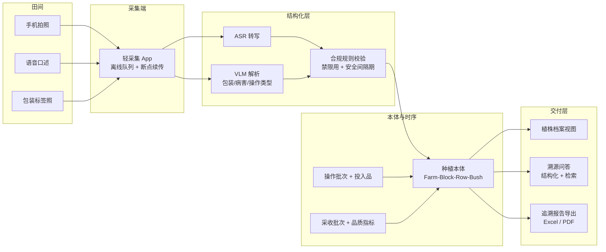

# 题 3 · 蓝莓研究所 | 蓝莓种植的每一步，能不能都有据可查？

| 项 | 内容 |
|----|------|
| **业务目标** | 蓝莓种植档案与农事记录智能整理 |
| **组数** | 2 组 |
| **行业** | 农业科技（蓝莓种植 / 质量追溯） |
| **北极星指标** | **追溯完整度**（一个采收批次能否回溯全部关键农事） |
| **角色配置** | Echo：农艺师 / 基地负责人 · Delta：算法 + 后端 |

> **一句话方案**：让农事记录从"纸本 + 微信群照片 + 各自 Excel"变成"植株级的电子档案"——拍照说一句就能入库，出问题时能倒查到那一次操作。

---

## 一、场景

### 1.1 业务现场

蓝莓是典型的**重农艺、强时序、慢验证**的作物。一株苗从定植到采收，要经历修剪、疏花、疏果、施肥、灌溉、打药、铺膜、采收等操作；这些操作决定了最终的糖度、硬度、果径和商品率。

**今天的农事记录长这样：**

- 纸本田间记录本（下雨就丢，字迹靠认）
- 微信群里发的照片（"今天打的这个药"——没有地块、没有剂量、没有日期）
- 各自电脑上的 Excel（一个技术员一份，列名都不一样）
- 农艺师脑子里的经验（"这个地块去年打过 XX，今年要注意"）

**"每一步有据可查"难在哪：**

1. **记录散**：没有统一入口，事后补录、漏录、补记忆
2. **颗粒度不对**：大多数记录只到"地块级"，真正需要追溯时是"行/株级"（同一块地不同行差异很大）
3. **非结构化**：照片和语音承载了大部分关键信息（打药照片 + 口头剂量），但系统只收得下表单
4. **无法归因**：出现品质波动/病害时，**不知道是第几次施氮、第几天打药导致的**
5. **合规刚需**：绿色食品认证、农产品抽检、客户验厂，都要求"能拿出完整种植档案"

### 1.2 为什么"每一步"记录不下来

| 表层现象 | 真实根因 | 对应解法方向 |
|---------|---------|-------------|
| 农工不愿填表 | 录入成本高（15 分钟/条），且填完看不到用在哪 | 拍照 + 语音，2 分钟内完成；填完当场出"这株/这行档案"给他看 |
| 记录只到地块 | 录入对象定义太粗 | 本体下沉到**行（Row）/ 株（Bush）**，但默认按行操作、株级只在需要时指定 |
| 照片没法用 | 照片没有结构化字段（什么药、什么剂量、哪块地） | VLM + ASR + 规则映射到结构化农事批次 |
| 出了问题查不到 | 农事与品质指标没有在同一对象上对齐 | 植株/批次级时序表，把投入品与品质指标挂到同一株/同一批 |
| 认证要材料时来不及 | 追溯报告只能人工翻本子拼 | 一键生成可交付的追溯档案（Excel/PDF） |
| 田间没网 | 纯云端方案在现场直接失效 | 离线优先：采集端本地缓存/弱网队列，联网后回传 |

### 1.3 现有资产

| 数据 | 说明 |
|------|------|
| 田间记录本 | 纸本，是最原始也最真实的一份 |
| 微信群照片 | 大量，含农事现场、投入品包装、病害叶片、果实 |
| 投入品包装/标签照片 | 关键——农药登记证号、成分、剂量常在包装上 |
| 采收与品质记录 | 糖度、硬度、果径、分级出货 |
| 地块与植株档案 | 品种、砧木、树龄、种植密度（如果有） |
| 气象 | 温度、降雨、日照（与品质强相关） |
| 采收批次 | 出货时打的批次标签（是追溯的天然锚点） |

### 1.4 ⚠️ 待 Day1 现场确认

- **基地规模**：几个基地？多少地块？多少株？多少农工？
- **现有记录习惯**：纸本还是微信为主？农工年龄与数字工具接受度？
- **农事类型清单**：真正要记的到底有哪几类（先砍到 5–6 类）？
- **投入品合规**：农药登记证、限用清单、采收安全间隔期——这些规则**必须由农艺师给**，不能自己编
- **追溯对象**：对外出证要按什么粒度（批次/地块/行/株）？
- **现有信息化**：有无 ERP / 农场管理系统 / 溯源系统？有就对接，没有就自建最小版
- **网络与设备**：田间有网吗？用什么拍（手机/相机）？照片怎么传回（微信/相册/OFD）？

---

## 二、项目

### 2.1 项目定义与交付物

**「蓝莓种植档案系统（Farm Ontology + 农事智能整理）」**：轻采集 + 植株级档案 + 溯源与品质归因。

**交付物**：

1. **轻采集端**（小程序 / Web 表单 / 微信入口）：拍照 + 语音 → 自动结构化 → 农工确认 → 入库
2. **农事本体**：基地→地块→行→株；农事批次→投入品；采收批次→品质指标
3. **植株/批次级档案与时序视图**：一眼看清"这块地这株今年经历过什么"
4. **溯源与归因问答**："这批果子的农事档案是什么？""这块地去年打了几次药？""糖度下降可能和哪次施氮有关？"
5. **可交付的追溯档案导出**：符合抽检/认证/验厂要求的结构化文件

### 2.2 范围

| 做 | 不做（明确砍掉） |
|----|------------------------|
| **1 个基地、1 个地块**打样（可复制到全基地） | 不做全基地一次性铺开 |
| **5–6 类高频农事**（按农艺师清单） | 不做全部农事类型 |
| 行级为默认粒度，株级按需指定 | 不做株级 IoT 传感器接入 |
| 照片 + 语音双通道结构化 | 不做表单穷举所有字段 |
| 追溯报告导出（Excel/PDF） | 不做与政府认证系统的直连 |
| 归因给**相关性提示**，不下因果结论 | 不做预测模型（**没有多年数据，任何预测都是编的**） |

### 2.3 角色分工

| 角色 | 承担人 | 职责 |
|------|--------|------|
| **Echo** | 农艺师（必须是每天下地的人） | 定义农事类型与必填项；给投入品合规规则；判断归因提示是否讲得通 |
| **Echo** | 基地负责人 | 定追溯粒度与对外交付口径；确认归档制度（谁签字、什么时候补录） |
| **Delta** | 算法 + 后端 | 采集端、结构化管线、本体与时序库、溯源导出 |
| **共同** | 农工代表 | 试用采集端 1 小时，把"难用"的地方骂出来（**这是本产品最重要的用户**） |

### 2.4 成功标准

Day3：拿**一个真实采收批次**，一键导出完整追溯档案，农艺师当场逐项核对通过（"这份东西能拿出去给客户/检查方看"）。

---

## 三、专项技术点

| # | 技术点 | 为什么必须做 | 落地要点 |
|---|--------|-------------|---------|
| 1 | **种植本体（Objects）** | 颗粒度与业务语言决定追溯能力 | `Farm`→`Block`(地块)→`Row`(行)→`Bush`(株)；`Operation`(农事批次)→`Input`(肥料/农药/水)；`HarvestBatch`(采收批次)→`Quality`(糖度/硬度/果径)；`Weather` |
| 2 | **Links（关联固化）** | 追溯靠的就是关联链 | `Bush→Row→Block`；`Operation→Block/Row/Bush`；`HarvestBatch→Bush+Operation`；`Input→InputProduct(登记证)` |
| 3 | **照片 → 结构化（VLM）** | 照片承载了大部分农事信息 | 从包装照读**产品名/成分/登记证号/剂量**；从叶片照识别病害；从现场照推断操作类型；输出 JSON + 置信度 |
| 4 | **语音 → 结构化（ASR + 规则映射）** | 农工不会打字，方言口述是真实形态 | ASR（支持方言口音）→ LLM 抽取为农事批次字段 → 映射到本体；低置信度字段必须人工确认 |
| 5 | **置信度驱动的"确认式入库"** | 农艺师不会逐条审核 AI 结果 | AI 出草稿，农工只确认；**低置信度字段高亮**；确认后的结果才是数据 |
| 6 | **植株/批次级时序存储** | 归因需要时间维度 | Postgres（主数据）+ 时序表（投入品-品质序列）+ 对象存储（照片）；按株/批次索引 |
| 7 | **相关性归因（提示而非断言）** | 数据量不足以支持因果推断 | 计算投入品暴露与品质指标的相关性/时序共现，输出**"可能相关"提示 + 数据量说明**；文案必须写"提示"，不写"导致" |
| 8 | **溯源报告生成器** | 认证/抽检/验厂是硬需求 | 按批次反向展开完整链路 → 模板化导出（时间线 + 操作表 + 投入品清单 + 照片附件索引） |
| 9 | **混合检索问答** | 农户/农艺师用自然语言问 | 结构化查询（SQL/图查询）+ 非结构化检索（历史对话、语音转写文本）联合 |
| 10 | **离线优先与弱网队列** | 田间没网是常态 | 采集端本地队列 + 断点续传；图片压缩与断点上传；服务端幂等写入 |
| 11 | **合规规则引擎** | 农药禁限用、安全间隔期是红线 | 规则来自农艺师/官方清单（**不得由模型臆造**）；录入时即时校验并阻断 |
| 12 | **植株档案冷启动** | 历史农事数据可能不存在 | 用现有纸本/微信群做一次性回填（AI 辅助抽取 + 人工校对），先建"当前季"档案 |

---

## 四、OKR

### O

> **让每一步种植操作都能追溯到地块、行、株，让品质问题有据可查，让认证与抽检不再靠人翻本子。**

| KR | 指标 | 基线 | 目标 | 怎么量 |
|----|------|------|------|--------|
| **KR1（北极星）** | **追溯完整度**：随机抽 1 个采收批次，能回溯到全部关键农事的比例 | 当前 ≈ 0（纸质散记，无法倒查） | **100%**（抽 3 个批次全部达标） | 随机抽批次跑追溯导出，逐项打勾 |
| KR2 | 农事记录**结构化率** | 0 | **≥ 85%**（抽样 100 条人工核对） | 抽样核对：字段正确且落到正确对象 |
| KR3 | 单条农事**录入耗时** | 预估 ~15 分钟（填表） | **≤ 2 分钟**（拍照 + 一句话） | 现场秒表，5 名农工各录 3 条取均值 |
| KR4 | 植株/行级档案覆盖 | 0 | **≥ 1 个地块 100% 建档**（含品种/树龄/历史操作） | 建档完成度报表 |
| KR5 | 归因提示的**准确可用性** | — | **≥ 60%** 的相关性提示被农艺师认可（"方向对"） | 农艺师对每条提示打"有用/无用" |
| KR6 | 追溯档案**人工复核一次通过率** | — | **≥ 80%**（导出后未被要求修改的份数） | 复核记录 |
| KR7 | 农工**持续使用率**（护栏） | 0 | **≥ 70%** 的农事记录由农工本人录入，而非事后由农艺师补 | 录入来源字段统计 |

> ⚠️ **KR7 是护栏**：如果所有记录最后都是农艺师事后补录，这个系统只是把补录工作搬到了线上，没有真正降低总成本。

---

## 五、解决方案

### 5.1 总体架构

### 5.2 关键链路：一条农事记录的一生

1. **采**：农工在地里拍 1 张全景 + 1 张包装标签照，语音说"3 号地块 B 区今天打 XX，稀释 800 倍"
2. **解**：ASR 转写；VLM 读包装得产品名/登记证号；规则映射"3 号地块 B 区"→ Block/Row
3. **校**：合规引擎检查：该药在本作物是否禁用？离采收是否过了安全间隔期？→ 不通过就**当场阻断**并提示
4. **认**：低置信度字段（剂量、日期）高亮，农工点头确认 → 写入 `Operation` 批次
5. **挂**：按操作对象挂到行（默认）或株；照片、语音原文、抽取结果全部留痕
6. **用**：农艺师查"这批果子经历了什么"；相关性分析提示"7 月 12 日高氮与 8 月糖度下降同期"
7. **出**：一键生成追溯报告（时间线 + 操作表 + 投入品清单 + 照片索引）

### 5.3 关键取舍

| 取舍点 | 选择 | 放弃的 |
|--------|------|--------|
| 默认粒度 | **行级**，株级按需 | 一上来就株级（录入成本爆炸） |
| 归因强度 | 只给**相关性提示 + 数据量说明** | 因果结论（会被农艺师当场打脸） |
| 输入方式 | 拍照 + 语音为主，表单兜底 | 穷举表单（农工不填） |
| 合规规则来源 | **农艺师/官方清单**，模型不得生成 | 模型"合理推断"农药是否可用 |
| 数据缺失 | 先建"当前季"档案，历史标注为缺失 | 假装有完整历史（造假） |
| 预测能力 | 不做 | 产量/品质预测（数据量不够，会被当成玄学） |

### 5.4 落地节奏

| 阶段 | 动作 | 交付物 |
|------|------|--------|
| **Day1 · 开题** | **下地跟班半天**（不是会议室）；跟农艺师拿到 5–6 类高频农事清单 + 投入品合规规则 + 追溯粒度；拿 50 条真实农事（纸本照片 + 微信群照片 + 语音样本）；农工试采集端 1 小时收集"难用点" | 农事类型清单 + 合规规则表 + 样本集 + 首轮路演稿 |
| **Day2 · 共解** | 采集端可用（离线队列 + 上传）；结构化管线跑通（ASR + VLM + 规则）；本体 + 时序入库；植株档案视图 + 溯源问答；导入 1 个地块数据做建档 | 可跑原型 + 1 个地块的档案 |
| **Day3 · 出厂** | 拿**真实采收批次**跑完整追溯导出；农艺师逐项核对；农工现场再录 3 条测耗时；**故意录一条禁用农药**验证阻断 | 原型 + 追溯报告样本 + 验证记录 |
| **后续 5 天节点** | 全基地铺开、存量纸本回填、认证模板对齐、品种/砧木档案扩展 | — |

### 5.5 评估与验证（结项证据）

| 证据 | 怎么产出 |
|------|---------|
| 真实卡顿 | 记录 VLM 读包装的失败样本（字迹模糊/标签遮挡/方言口音） |
| 团队 AI 模型 | 结构化准确率评测集（人工标注 100 条）+ 置信度分布 |
| 测试与验证记录 | 合规阻断测试（禁用农药、间隔期不足）+ 追溯报告人工核对表 |

### 5.6 风险与兜底

| 风险 | 影响 | 兜底 |
|------|------|------|
| **农工不用**（嫌麻烦） | 数据源枯竭，护栏 KR7 失败 | 录入做到 2 分钟内；拍照即存；**Day1 必须让农工试用并把吐槽记下来**；录入量作为每日看板指标 |
| 田间无网 | 采集断流 | 离线队列 + 断点续传 + 幂等写入 |
| 农药/用量抽取不准 | 错用农药 = 合规事故 | 关键字段强制人工确认；抽取值**不自动用于合规判定**，只用于预填 |
| 归因被误读为因果 | 农艺师不信任系统 | 文案与界面统一用"提示/相关"，展示同期数据与样本量 |
| 追溯口径不满足检查方 | 交不了差 | Day1 直接问清交付模板；模板化导出而非自由排版 |
| 历史数据缺失，档案"半空" | 客户觉得没价值 | 明确标注缺失区间；用存量纸本/微信群做一次性回填补齐当前季 |
| 投入品登记证信息不全 | 合规校验不完整 | 由农艺师补录产品清单；不靠模型猜 |

---

## 六、可沉淀的通用件（碎石路 → 高速公路）

| 通用件 | 说明 |
|--------|------|
| **"拍照 + 一句话"确认式采集范式** | 与行业无关：农业、维修、巡检、仓储通用 |
| **包装/标签 OCR → 主数据映射** | 换行业换标签库即可复用 |
| **可编辑的植株/资产级本体模板** | 从"株"换到"设备/模具/客户"是同一套结构 |
| **合规规则引擎 + 即时阻断** | 任何有硬性约束的场景（药、证、票、危化品）通用 |
| **追溯报告模板引擎** | 认证/审计/客户验厂通用 |
