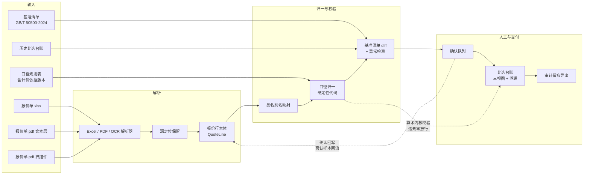

# 题 04 · 山南勘测 | 报价各说各话，工程分包怎么比？

| 项 | 内容 |
|----|------|
| **业务目标** | 分包比选报价归集比对与比选台账生成 |
| **组数** | 2 组 |
| **行业** | 工程勘察 / 勘测设计（工程服务分包比选） |
| **北极星指标** | **比选台账产出耗时**（归集 + 比对 + 生成，含人工确认环节） |
| **护栏指标** | **未经确定性校验或未经人工确认即进入台账主表的行数 = 0** |
| **Echo / Delta** | Echo：商务/造价负责人（国家一级造价工程师）· Delta：解析 + 后端 |

> **一句话方案**：把各家格式各异的报价单，变成**一行一来源、一个数字都能点回原表**的比选台账——口径统一、漏项现形、算术全部交给代码、低置信度必须人工点头。

---

## 〇、企业背景与选题校准

| 事实 | 来源 | 等级 |
|------|------|------|
| 2003 年成立，浦东金桥自贸区，员工 260–370 余人；持自然资源部测绘甲级（工程测量/海洋测绘/界线与不动产测绘）、住建部工程勘察甲级（岩土工程/工程测量/水文地质）、上海市地基基础检测评估甲级等 6–7 项甲级资质 | 公司官网 shsnkc.com；百度百科 | 3（仅供参考） |
| 主营：工程勘察、工程监测、土工实验室、工程测绘、工程质量检测、工程物探、岩土工程设计与咨询、地基基础施工、房屋检测、环境评估修复、水土保持咨询 | 公司官网 | 3（仅供参考） |
| 上海市经信委"质量标杆"案例：创新提出 **AI（All In，全维度嵌入）工作法**——高层/生产部门/项目部分工嵌入政府、设计院、施工、运管单位，构建地下空间三维数据信息库，勘测成果与更新工程方案**反演、反敷**。成效：项目优良率 75%→90%，总工期减少 40%+，节约投资 1.2 亿+，用户满意度 95%+ | 上海市经济和信息化委员会 2022-10-20 | 1 |
| 设 BIM 应用研究中心、研发中心、数字化交互应用平台；与同济大学、上海师范大学建产教融合/产学研基地 | 公司官网 | 3（仅供参考） |
| 2026-10-18 荣获 2026 地理信息科技进步奖一等奖 | 公司官网新闻 | 3（仅供参考） |
| 党总支书记、常务副总经理顾小双为国家**一级造价工程师**、**上海市政府采购评审专家** | 公司官网专家页 | 3（仅供参考） |
| **行业侧基线**：勘察/监测类单位对外分包多走**公开比选 / 询比采购公告 + 报价清单文件**；实际投标文件附件里就有"比选须知.xlsx""报价清单.xlsx"这类标准件 | 招标平台公开公告（示例） https://www.qianlima.com/bid-636449848.html | 4（仅作线索） |
| **行业侧已有软件**：用友畅捷通工程分包管理程序等分包管理 SaaS，已覆盖分包合同与结算流程 | 厂商产品页 https://www.chanjet.com/sem/function-7xwnzlu4aa6uydq.html | 3（仅供参考） |
| **监管侧有依据**：地方交通运输主管部门已出台勘察设计分包管理办法（如《四川省公路水运建设工程勘察设计分包管理暂行办法》），对分包程序与责任作出规定 | 四川省交通运输厅 http://jtt.sc.gov.cn/jtt/c111873/2022/11/29/d497cb90b4b846eaacc44b1502ded6ac.shtml | 1 |
| **计价标准现行版本**：工程量清单计价的现行标准为 **GB/T 50500-2024《建设工程工程量清单计价标准》** | 国家标准编号 | 1 |

**校准（这决定方案怎么写）**：

1. **山南已经在做 AI 工作法。** 上海市经信委把它列为"质量标杆"案例：AI = All In，全维度嵌入政府、设计院、施工、运管单位，已建地下空间三维数据信息库，勘测成果可"反演、反敷"。所以本题**不是"引入 AI"，而是"把已有的 AI 能力从生产/技术环节接到商业与合规环节"**——本方案要定位成**接进它现有数字化盘子里的一个模块**，不是另起炉灶。
2. **口径与留痕是刚性要求。** 常务副总经理顾小双是国家一级造价工程师、上海市政府采购评审专家；监管侧也已有勘察设计分包管理办法对分包程序与责任作出规定。→ 题 4 的答案因此指向**"可溯源 + 审计留痕"**，而不是"自动比价排名"。**凡要签字的数字，必须能点回原表。**
3. **别把话说反：分包管理 SaaS 已经存在**（用友畅捷通工程分包管理程序等），比选公告 + 报价清单附件也是行业常规做法。**真空白是三件事：口径归一 + 每个数字可溯源 + 漏项自动比对**——现有 SaaS 做的是合同与流程，不做报价口径归一与数字级溯源，人工归集这一步仍然存在。本方案就补这三件。
4. **计价口径必须锚定现行标准。** 各家报价能不能比，前提是都按同一版计价规则出清单：现行标准是 **GB/T 50500-2024《建设工程工程量清单计价标准》**。基准清单与口径规则表都必须锚定它；**"这版标准"本身要作为一个显式字段**（每家按哪版口径报的），否则归一无从谈起。
5. ⚠️ 照片未提供：比选频次、每次几家、报价单格式分布（xlsx / PDF / 扫描件占比）、基准清单是否已按 GB/T 50500-2024 成文、口径规则由谁定、台账是否需签字与存档期限、历史台账能否拿到。**全部留到 Day1 现场确认**。

---

## 一、场景（L1 业务现场）

收到多家分包商的报价（Excel、PDF、扫描件、微信里发来的表格），商务/造价人员要在一两天内完成：

1. 把每家的报价**拆成统一格式的清单行**（项目、单位、数量、单价、合价）
2. 处理**口径差异**（含税/不含税、含不含运费、含不含甲供材、措施费、暂列金、品名写法不同、计价依据版本不同）
3. 发现**漏项和多项**（有的报了，有的没报；有的把某项拆细了，有的合并了）
4. 算出**可比口径**的排序结果，并出一张**能存档、能追责**的比选台账给领导看

**为什么山南的报价"各说各话"特别难归一**：它同时做勘察、监测、检测、物探、土工实验室、地基基础施工 → 分包形态有外业分包、检测分包、劳务分包、仪器设备分包；每种的计价方式、计价依据、结算周期都不同。**同一家公司内部的不同专业分包，报价口径可能都不一样**——这才是"各说各话"的结构性来源。

**行业基线**：公开比选 / 询比采购公告 + 报价清单附件已是常规做法，分包管理 SaaS 也已覆盖合同与结算。但**报价行归集、口径归一、漏项比对这三步仍然靠人工**——这正是本方案的切口，也说明"引入一个系统"不是答案，"补齐归集与溯源"才是。

---

## 二、三层拆解树

### L1 业务问题

> **报价各说各话，工程分包怎么比？**

### L2 子问题（4 条能力缺口）

| # | L2 子问题（缺口） | 根因 | 为何值得做 |
|---|------------------|------|-----------|
| **L2-1** | **报价单与基准清单之间没有统一的行结构** | 每家表结构、品名写法、计量颗粒度都不同（有的把桩基检测按桩计、有的按米计；有的合并报、有的拆细报） | 没有共同坐标系，"谁便宜"这个问题根本无法被形式化；这是所有后续动作的前提 |
| **L2-2** | **各家的"总价"不是同一件事（口径不可比）** | 含税/不含税、含不含运费、含不含甲供材、措施费、暂列金、暂估价、**计价依据版本（GB/T 50500-2024 还是旧版）**各报各的 | 口径不统一时任何排序都是错的——这是本题真正的深水区，也是"归集比对"四个字的难点所在 |
| **L2-3** | **漏项与多项不可见** | 少报的项目是后期变更与索赔的来源；多报、拆分合并导致错配与重复计价 | 直接对应业务目标里的"归集比对"；也是评审与审计最关心的一栏 |
| **L2-4** | **台账数字不可溯源、评审过程不留痕** | 台账要签字、要追责、要经得起采购评审与审计；但数字来源目前靠人记，改动看不出谁改的 | 顾小双作为一级造价工程师与政府采购评审专家，口径严谨与留痕是天然要求；这也是本页唯一的"合规刚需" |

> 另有一条横贯性缺口（写进 L3 机制而非单列 L2）：**算术没有纪律**——合计、数量×单价、税率换算、可比单价全靠人脑与手工 Excel，出错不可察。

### L3 机制（每个 L2 对应 2–3 条，全部标同族复用）

| 对应 L2 | L3 机制 | 怎么落地 | 同族复用（举一反三） |
|---------|---------|----------|----------------------|
| L2-1 | **报价行本体（Ontology 三步法）** | Objects（Quote / QuoteLine / BillItem / Bidder / Offer / 口径标记）→ Links（QuoteLine ↔ BillItem 基准映射、QuoteLine ↔ 源定位）→ Actions+Write-back（确认即定稿、改动留痕） | 通用"多主体方案横向比"对象模型；换行业只换实体名（供应商/投标/比选同构） |
| L2-1 | **多格式解析管线（xlsx / PDF 文本层 / PDF 扫描件分层）** | Excel 取**计算值**不取公式串；扫描件走 OCR + 表格结构还原；每行携带源定位与置信度 | 合同、投标文件、检测报告、结算单的多格式归集通用 |
| L2-1 | **品名别名与规格映射表** | 历史别名表优先；无别名时给候选（规格 + 单位 + 语义相似）；**禁止模型静默归一**，一律人工选 | 物料主数据归并、产品线对标、跨系统科目映射 |
| L2-2 | **口径标记与归一引擎（规则表驱动）** | 规则表由商务给并签字，每条写死：含税与否、税率、运费、甲供材、措施费、暂列金、**计价依据版本**；归一计算在确定性代码里跑 | 规则表与行业无关，可复用到分包、采购、外协、设备租赁 |
| L2-2 | **计价依据版本作为显式字段** | 每份报价记录其报价依据（GB/T 50500-2024 等）与版本生效区间；版本不一致 → 标"口径存疑"，不自动归一 | 任何"按不同版本标准/规范报价"的场景：软件版本、检测规程、设计规范 |
| L2-2 | **可比单价与三视图** | 原始价 / 归一价 / 可比单价并排；**总额不可比**；未定义口径的行标"不可比"并单列，不参与排序 | 任何"总价不可比、要按单位能力比"的场景：物流单价、服务人天、材料单价 |
| L2-3 | **基准清单双向 diff** | 与我方清单（锚定 GB/T 50500-2024）双向比对：缺项、名称不匹配、数量偏差超阈值、同一项被拆成多行 | 通用"应有 vs 实有"校验器：报价 vs 清单、发货 vs 订单、清单 vs 结算 |
| L2-3 | **异常检测（离群 / 逻辑冲突 / 算术平衡）** | 单价离群、合价不平衡、分项和≠合计、税率异常、同一项在不同家数量不一致 | 通用"低频错误抓取"：体检指标异常、结算单不平、发票重复 |
| L2-4 | **数字级溯源（源定位）** | 每个数字记录 `源文件 → 页码/单元格 → 原文片段 → 解析置信度`；台账上可点开看原图/原表 | 审计、举证、复核通用件（检测数据、验收记录、结算单同构） |
| L2-4 | **审计留痕与原表只读快照** | 原始件哈希、每次修改记 who/when/what、原表只读快照、评审意见归档、导出带溯源脚注 | 合同评审、采购评审、内控检查通用 |
| 横贯 | **确定性算术内核** | Decimal 定点；求和、乘除、税率换算、可比单价、平衡校验全部在代码里；**单元测试覆盖，等于 0** | 任何"数字要签字"的场景通用：结算、对账、计量、绩效核算 |
| 横贯 | **低置信度人工确认台** | 无映射 / 口径存疑 / 算术不平 / 版本不一致 → 进确认队列；**未确认不得进主表** | 任何"自动结果可能出错且要签字"的场景通用 |

> **L3 数量核对**：L2-1 → 3 条，L2-2 → 3 条，L2-3 → 2 条，L2-4 → 2 条，横贯 → 2 条。**L3 是 12 条机制，不是 12 个 L2。** L2 保持 4 条不变，这是深度控制。

---

## 三、项目定义与范围

**「分包报价归集与比选台账系统（Quote Ontology + 口径归一 + 可溯源台账）」**——给商务/造价人员用的比选副驾。

**输入**：各家报价单（xlsx / PDF 文本层 / PDF 扫描件）· 我方基准清单（锚定 GB/T 50500-2024）· 口径规则表 · 历史比选台账
**输出**：统一报价行 · 可比口径排序与漏项差异清单 · **每个数字可溯源**的比选台账 · 人工确认台 · 审计留痕导出（Excel / PDF）

| 做 | 不做（Day2 明确砍掉） |
|----|------------------------|
| **1 类分包**（例如外业分包或某一专业分包）的报价项 | 不做全专业通用 |
| 解析 **3–5 家**报价单 | 不做批量几百家 |
| 基准清单锚定 **GB/T 50500-2024**，口径规则由商务给死 | 不做自动推断口径（**推断口径 = 算错账 = 赔钱**） |
| 漏项检测 + 可比单价排序 + 数字级溯源 + 算术校验 | 不做自动定标、不做评标打分模型 |
| 人工确认台 | 不追求 100% 自动化（**本题自动化到 70% 即可，剩下 30% 给人**） |
| Excel / PDF 导出 + 审计留痕 | 不做与现有分包管理系统的直连（本期只对齐字段口径） |

**Echo / Delta 分工**

| 角色 | 承担人 | 职责 | 不可替代性 |
|------|--------|------|-----------|
| Echo | 商务/造价负责人（国家一级造价工程师） | 定义口径规则表（含计价依据版本口径）；确认哪些项可归一、哪些必须分开列；**最终签字人** | 口径的正确性只有签字人能判定 |
| Echo | 造价工程师 | 提供历史台账与历史评审结论（评测基准）；给出"坑"案例 | 历史人工结论是最有价值的评测集 |
| Delta | 解析 + 后端 | 解析器、归一引擎、算术内核、校验、确认台、台账生成、溯源与留痕 | — |
| 裁判 | 分管领导 / 商务经理 | Day3 当场看台账，判断"敢不敢签" | — |

**成功标准（Day3）**：拿**一组真实报价单**，当场跑出比选台账，商务负责人逐行核（抽 20 行）后说"这个表我敢拿去开会、敢签字"。
**数据缺位时**：假数据比没数据好——用历史台账脱敏 + 3 份合成的口径各异的报价单先跑通链路，Demo 里标明"模拟数据"，**绝不用模拟报价冒充真实比选**。**后续 5 天节点**：别名表随每次比选自动积累、扫描件质量提升、历史台账全量结构化、与现有分包管理系统的字段口径对齐。

---

## 四、专项技术点（三层技术栈）

| L1 技术域 | L2 组件 | L3 实现要点 |
|-----------|---------|-----------|
| **数据接入** | 报价单接入层 | API 优先、导出兜底；xlsx / pdf / 扫描件分流；原件 SHA-256 留档 |
| | 基准清单接入 | 锚定 **GB/T 50500-2024** 的清单结构与编码；**版本与生效日期入库**；基准不稳 → 整个方案不稳 |
| | 口径规则表接入 | 规则以结构化表落库（税、运费、甲供材、措施费、暂列金、计价依据版本），**不写在 prompt 里** |
| **解析层** | Excel 解析器 | 多 sheet、合并单元格、公式取计算值、隐藏行列、小计行识别、千分位与中文大写金额 |
| | PDF 解析器 | 先判是否有文本层；有→直接抽表；无→**OCR + 表格结构还原**（有线框/无线框两种） |
| **结构化层** | 报价行抽取 + 源定位保留 | 字段：项目名/规格/单位/数量/单价/合价/口径标记/**计价依据版本**/源定位/置信度；源定位绑定 sheet+单元格 / 页+行 / OCR bbox；**LLM 只抽字段，不做算术** |
| | 品名别名映射 | 历史别名表优先；无别名时给候选；**禁止静默归一**；别名表变更留痕 |
| | 单位与金额归一 | 换算表（吨↔kg、米↔mm、㎡↔m²）；**无法确定的不转，标"待确认"** |
| **本体层** | 报价行 Ontology | Objects·Links·Actions 三步；QuoteLine ↔ BillItem 基准映射提前固化，不做查询时 JOIN |
| **归一与计算** | 口径标记与归一引擎 | 规则表驱动；每行打"含税/含运费/含甲供材/是否含措施费"标记；**版本不一致 → 口径存疑** |
| | 确定性算术内核 | Decimal 定点；求和/乘除/税率换算/可比单价/平衡校验全在代码；**单元测试覆盖，等于 0** |
| | 可比单价三视图 | 原始价 / 归一价 / 可比单价并排；未定义口径行标"不可比"、不参与排序 |
| **校验层** | 基准清单双向 diff | 缺项、名称不匹配、数量偏差、拆行合并 |
| | 异常检测 | 单价离群、合价不平衡、分项和≠合计、税率异常、同项数量不一致 |
| **交付层** | 确认队列 | 低置信 / 无映射 / 口径存疑 / 算术不平 → 人工；**未确认不得进主表** |
| | 数字级溯源 | 源文件→页/单元格→原文片段→置信度；台账上可点开原表原图 |
| | 台账导出与审计留痕 | Excel 带溯源批注 + 归档 PDF；原表只读快照；修改记 who/when/what |
| **工程化** | 内网部署与降级 | 原件不出域；模型调用走本地/专有通道；**无 LLM 时退化为"解析 + 规则校验 + 算术校验"** |

---

## 五、OKR

### O

> **让多份口径不同的分包报价，在两小时内变成一张可评审、可签字、可追溯的比选台账。**

| KR | 指标 | 基线 | 目标 | 怎么量 |
|----|------|------|------|--------|
| **KR1（北极星）** | 比选台账产出**耗时**（归集 + 比对 + 生成，含人工确认环节） | Day1 实测（预估 2 人 × 1 天） | **≤ 1 人 × 2 小时** | 端到端计时，含确认环节 |
| KR2 | 报价行**归一准确率**（数量 / 单价 / 金额三项都对） | — | **≥ 95%**（抽 100 行人工核对） | 人工抽检表 |
| KR3 | **漏项 / 口径异常检出率** | — | **≥ 90%**（用历史 3 次比选回测，真漏项能抓到） | 回测脚本，随代码入库 |
| KR4 | 数字**可溯源率** | 0 | **100%**（台账每个数字能点回原文件位置） | 抽样 50 个数字逐一点开 |
| KR5 | 台账**一次签字通过率** | — | **≥ 70%**（商务负责人未要求修改数字的比例） | 评审记录 |
| KR6 | 口径规则**覆盖率** | 0 | 我方确定口径（含计价依据版本）**100% 有明确规则**，无"未定义口径"行 | 规则表 vs 实际数据交叉检查 |
| **KR7（护栏）** | **未经确定性校验或未经人工确认即进入台账主表的行数** | 0 | **= 0** | 审计日志 + 对台账全量复跑校验脚本，违规 0 行 |

> **为什么必须有 KR7**：本题最大的失败不是"不准"，而是"看着准但没人核对"。算术一旦交给模型，或未确认行被静默放进主表，这张台账就不能签字——**凡要签字的数字必须可溯源**。
> **为什么 KR6 不能省**：口径没定义就排序，等于把"猜"包装成"比"。

---

## 六、解决方案与架构

### 关键链路：一份报价单的一生

1. **入**：文件进来 → 判类型（xlsx / pdf-text / pdf-scan）→ 记录 SHA-256
2. **抽**：按类型走对应解析器 → 候选 `QuoteLine`（含**源定位**与置信度）；同时抽取该报价单声明的**计价依据版本**
3. **归**：品名别名匹配 → 数量与金额单位归一 → 打口径标记 → 归一计算（**代码算，模型不算**）
4. **校**：
   - 与基准清单（GB/T 50500-2024）diff → 缺项 / 多项 / 数量偏差
   - 算术校验：`数量 × 单价 ≈ 合价`？`分项和 ≈ 合计`？
   - 离群检测：同项单价显著偏离中位数；**版本不一致 → 标口径存疑**
5. **信**：置信度打分（解析置信度 × 匹配置信度 × 口径明确性）→ 分三档
   - 高置信 → 直接进台账（标记"自动"）
   - 中低置信 / 口径存疑 / 算术不平 → **强制人工**，并提示"请核实"
6. **出**：台账（原始价 / 归一价 / 可比单价三视图 + 溯源列 + 漏项清单 + 异常清单 + "不可比"单列）→ 导出
7. **留**：所有原始件哈希、每行确认人与时间、每处修改留痕、原表只读快照

### 关键取舍

| 取舍点 | 选择 | 放弃的 |
|--------|------|--------|
| 归一基准 | **我方基准清单（GB/T 50500-2024）+ 口径规则表** | 要求各家按统一模板重报（现实里不可能） |
| 计价依据版本 | 作为**显式字段**参与校验，版本不一致即标存疑 | 默认各家口径一致（这是最贵的错） |
| 口径推断 | 只用**商务给定的规则表** | 模型"合理推断"口径（会算错账） |
| 算术 | 确定性代码（Decimal 定点） | LLM 心算（不可信，且要签字） |
| 归一动作 | 自动给候选 + 人工确认 | 模型直接归一（错一次就失去信任） |
| 扫描件 | OCR + 结构还原，**带置信度** | 假装 OCR 100% 准 |
| 自动化目标 | ~70% 自动化 + 30% 人工 | 追求 100% 无人化（本题不成立） |
| 输出 | 三视图台账（原始 / 归一 / 可比） | 只出一个"总价排行榜"（会误导） |
| 与现有软件的关系 | 本期**只对齐字段口径**，不做系统直连 | 直接做 SaaS 对接（会把周期拖死） |

### 可沉淀的通用件（碎石路 → 高速公路）

| 通用件 | 说明 |
|--------|------|
| **非结构化报价 → 统一行结构 + 数字级溯源** | 任何"多份格式不一致的附件要横向比"的场景通用（比价、比资、比排期） |
| **口径归一引擎（规则表驱动 + 版本显式字段）** | 规则表与行业无关，可复用到分包、采购、外协、设备租赁 |
| **基准清单双向 diff（漏项检测）** | 通用"应有 vs 实有"校验器；报价 vs 清单、发货 vs 订单通用 |
| **确定性算术内核 + 低置信度人工确认工作流** | 任何"数字要签字"的场景通用（结算、对账、计量）；任何"自动结果可能出错且要签字"的场景通用 |

---

## 七、举一反三：本方案一并覆盖的同族问题

> 每条都满足：同数据形态 + 同痛点 + 不换业务知识即可复用。

| # | 同族问题 | 复用的 L3 机制 | 复用后长什么样 |
|---|---------|---------------|--------------|
| 1 | **投标报价符合性自查（站在投标方一侧）** | 报价行本体 + 基准清单双向 diff | 把我方报价与招标文件清单逐项对照，输出漏项、表述不符、偏离项，而不是等评标后才知道 |
| 2 | **分包合同签订前的核价与限价审批** | 口径归一引擎 + 可比单价三视图 + 数字级溯源 | 比选结论直接作为合同价格附件，每个数字带溯源脚注；审价人员点开就能看到原表单元格 |
| 3 | **多版本概算 / 设计方案报价横向比选** | 品名别名映射 + 可比单价三视图 | 不同方案的工程量清单按同一基准归一后比较，总额与可比单价同时呈现，避免"报价低=便宜"的错觉 |
| 4 | **分包商资质与履约材料核验** | 多格式解析管线 + 数字级溯源 | 报价单与资质附件一起解析建档，输出缺件清单、资质到期提醒，与报价结论放在同一份材料里 |
| 5 | **内部结算与计量核对** | 基准清单双向 diff + 异常检测 + 确定性算术内核 | 班组结算单 vs 现场签证逐项核对，不平的行自动标出并附原文位置 |
| 6 | **审计、内控检查与项目后评价** | 审计留痕与原表只读快照 + 原件哈希 | 比选过程可回放、经得起抽查；后评价直接复用历史台账的结构化数据，不再二次人工录入 |

> **一句话**：三个真空白（**口径归一、数字可溯源、漏项自动比对**）一旦补上，这套机制同时是**投标自查工具、审价依据、结算核对器、审计证据链**。

---

## 八、风险兜底与 Day1 必问

### 风险与兜底

| 风险 | 影响 | 兜底 |
|------|------|------|
| **口径规则表没拿到** | 归一无依据，台账不可用 | Day1 硬性要求：拿不到口径规则表（含计价依据版本口径），**不进入开发**，改为和商务一起把规则写出来（这是 Echo 的活，不是模型的活） |
| **基准清单未锚定 GB/T 50500-2024** | 各家口径无法归一，排序无意义 | Day1 确认版本与生效日期；版本不明时台账**只出逐项对照、不出排序** |
| 扫描件 OCR 质量差 | 行错位、串行 | 置信度分流；低置信行强制人工；**台账里必须显示"自动/人工"两栏** |
| 别名映射错（把两个东西认成一个） | 排序错，比选错 | 候选 + 人工确认；别名表变更留痕；**不做静默归一** |
| 漏项检测误报太多 | 人工确认队列爆炸 | 先只对基准清单**主项**做 diff；噪声项单独归"待核对" |
| 有人要求"全自动出结果" | 事故 | 用 KR7 护栏 + 现场演示一次"自动归一错品名被抓出"的案例 |
| 商业数据外泄 | 合规 | 内网部署；原件不出域；模型调用走本地 / 专有通道 |
| 与现有分包管理系统的关系没搞清 | 做两套东西 | Day1 问清现有用的是哪套系统；本期只对齐字段口径，对接另立项 |

### Day1 现场必问

1. **比选台账给谁看、要不要签字、存档要求是什么？**（顾小双是政府采购评审专家，这一条直接决定留痕强度）
2. 一次比选几家、几家报价单、总行数？**比选频次**（每月几次、旺季多少）？
3. 我方基准清单是否已按 **GB/T 50500-2024** 成文？版本与生效日期是什么？各家报价单里**是否声明了计价依据版本**？
4. **口径规则由谁定、谁签字？**（含税 / 运费 / 甲供材 / 措施费 / 暂列金 / 暂估价 / 计价依据版本）
5. PDF 报价单占比多少？是扫描件还是电子版？（决定 OCR 权重）
6. 历史比选台账能否拿到？**能不能拿到当年的评审结论**？（这是评测基准）
7. 有没有已知的"坑"案例（某次因口径算错吃亏）？**这是最值钱的素材**
8. 现有分包管理用的是哪一套系统？台账要不要进那个系统，还是单独归档？（决定本期边界）
9. 内网部署条件：有没有推理算力？能不能装 Docker？模型调用走哪条合规通道？

> 备选方向（若第 3 题答案是否定的）：把题 4 收缩为"**单一分包专业 + 3 家 + 纯归一 + 可溯源**"，先证明"每个数字能点回原表"这一件事，再谈口径归一与排序。
