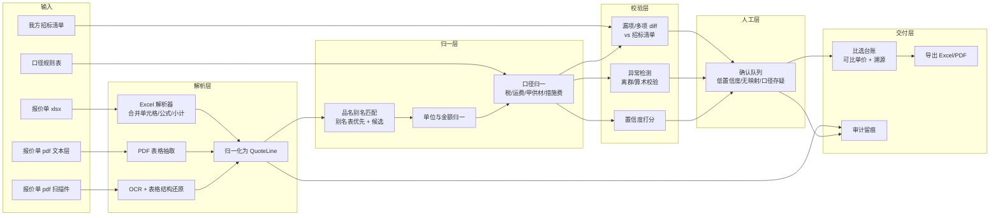

# 题 4 · 山南勘测 | 报价各说各话，工程分包怎么比？

| 项 | 内容 |
|----|------|
| **业务目标** | 分包比选报价归集比对与比选台账生成 |
| **组数** | 2 组 |
| **行业** | 工程勘察 / 勘测（工程服务分包） |
| **北极星指标** | **比选台账产出耗时**（含归集 + 比对 + 生成） |
| **角色配置** | Echo：商务/造价负责人 · Delta：解析 + 后端 |

> **一句话方案**：把各家格式各异的报价单，变成**一行一来源、一个数字都不含糊**的比选台账——口径统一、漏项现形、低置信度必须人工点头。

---

## 一、场景

### 1.1 业务现场

收到多家分包商的报价（Excel、PDF、扫描件、微信里发来的表格），商务/造价人员要在一两天内完成：

1. 把每家的报价**拆成统一格式的清单行**（项目、单位、数量、单价、合价）
2. 处理**口径差异**（含税/不含税、含不含运费、含不含甲供材、措施费、暂列金、品名写法不同）
3. 发现**漏项和多项**（有的报了，有的没报；有的把某项拆细了，有的合并了）
4. 算出**可比口径**的排序结果
5. 出一张**能存档、能追责**的比选台账，给领导看

### 1.2 为什么"各说各话"

| 表层现象 | 真实根因 | 对应解法方向 |
|---------|---------|-------------|
| 每家表结构都不一样 | 报价项清单没有统一模板 | 以**我方招标清单**为基准做映射，而不是让各家统一 |
| 同样东西名字不一样 | 品名别名（"镀锌钢管" / "DN50 镀锌管" / "热镀锌钢管 Φ50"） | 别名映射表 + 模糊匹配 + 人工确认 |
| 数量对不上 | 单位混用（吨/米/根/个）、计量口径不同 | 单位换算 + 口径标记，**不可换算的标红而非硬转** |
| 谁便宜看不出来 | 含税/不含税、含运费/不含运费、是否含甲供材不同 | 归一到**同一口径**再比 |
| 有人少报了活 | 漏项 | 与招标清单**交叉比对**，缺项显式列出 |
| 台账数字没人信 | 数字来源不可追溯，改过看不出 | 每个数字回链到原文件/页码/单元格 + 修改留痕 |
| 一家报 3 万项 | 金额大小错位（万/元混写、合并单元格） | 金额归一 + 异常检测 |

### 1.3 现有资产

| 资产 | 说明 |
|------|------|
| 各家报价原件 | Excel（多 sheet / 合并单元格 / 公式）、PDF（部分可复制文本，部分是扫描图） |
| 我方招标/工程量清单 | **比选的基准**，最重要的一份 |
| 历史比选台账 | 过去的成品 + 当时的评审结论 = **最好的评测集** |
| 分包商名录 | 报价项的历史别名可以积累成映射表 |
| 评审记录 | 谁批的、怎么定的，需要留痕 |

### 1.4 ⚠️ 待 Day1 现场确认

- **一次比选几家、几家报价单、总共多少行？**（决定解析与校验的规模）
- **我方招标清单是否稳定？**（这是基准，基准不稳整个方案就不稳）
- **PDF 报价单占比多少？是扫描件还是电子版？**（决定 OCR 权重）
- **口径规则由谁定？**（含税/运费/甲供材/措施费/暂列金的处理规则，必须商务负责人给）
- **评审流程**：比选台账给谁看？要不要签字？存档要求是什么？
- **历史台账可否拿到？**（用于回测"人工结论"作为基准）
- 有没有已知的"坑"案例（某次因口径算错吃亏）？（**这是最值钱的素材**）

---

## 二、项目

### 2.1 项目定义与交付物

**「分包报价归集与比选台账系统（Quote Ontology + 口径归一 + 台账生成）」**。

**交付物**：

1. **报价行解析层**：Excel / PDF（文本 & 扫描件）→ 统一报价行结构
2. **口径归一引擎**：品名别名、单位、税率、含税/运费/甲供材/措施费/暂列金 → 统一可比口径
3. **漏项/多项检测**：与招标清单交叉比对，输出差异清单
4. **比选台账生成**：可比单价排序 + 偏差提示 + **每个数字可溯源**（原文件/页/行/单元格 + 解析置信度）
5. **人工确认台**：低置信度行、无映射行、口径存疑行必须人工点头才能进台账
6. **留痕与导出**：原始件哈希、修改记录、评审意见归档；Excel/PDF 导出

### 2.2 范围

| 做 | 不做（明确砍掉） |
|----|------------------------|
| **1 类工程**（例如外业分包或某一专业分包）的报价项 | 不做全专业通用 |
| 解析 **3–5 家**报价单 | 不做批量几百家 |
| 固定口径规则（由商务给） | 不做自动推断口径（**推断口径 = 算错账 = 赔钱**） |
| 漏项检测 + 可比单价排序 | 不做自动定标、不做评标打分模型 |
| 人工确认台 | 不追求 100% 自动化（**本题自动化到 70% 即可，剩下 30% 给人**） |
| Excel/PDF 导出 | 不做与造价软件的直连 |

### 2.3 角色分工

| 角色 | 承担人 | 职责 |
|------|--------|------|
| **Echo** | 商务/造价负责人 | 定义口径规则与可比口径；确认哪些项可归一、哪些必须分开列；**最终签字人** |
| **Echo** | 造价工程师 | 提供历史台账与历史结论（评测基准）；给出"坑"案例 |
| **Delta** | 解析 + 后端 | 解析器、归一引擎、校验、台账生成、溯源 |
| **裁判** | 分管领导/商务经理 | Day3 当场看台账并判断"敢不敢签" |

### 2.4 成功标准

Day3：拿**一组真实报价单**，当场跑出比选台账，商务负责人核对后说"这个表我敢拿去开会"。

---

## 三、专项技术点

| # | 技术点 | 为什么必须做 | 落地要点 |
|---|--------|-------------|---------|
| 1 | **报价行 Ontology** | 没有统一结构，后面全是字符串处理 | `Quote`（报价单）→`QuoteLine`（项目名/规格/单位/数量/单价/合价/口径标记/来源定位/置信度）→`Subtotal`（小计/合计/暂列金/措施费） |
| 2 | **Excel 解析（比想象中难）** | 报价单大量是 Excel，且很脏 | 处理：多 sheet、合并单元格、公式（取**计算值**不取公式串）、隐藏行列、空行分隔、小计行识别、数字带单位/千分位/中文大写 |
| 3 | **PDF 文本层 vs 扫描件分层处理** | 两条技术路径，质量差一个量级 | 先判是否有文本层：有→直接抽表；无→**OCR + 表格结构还原**（有线框/无线框两种算法），并全程携带置信度 |
| 4 | **金额与数量归一** | 单位/量纲错位直接算错 | 单位换算表（吨↔kg、米↔mm、㎡↔m²）；千分位、中文大写金额、合并单元格金额下推；**无法确定的不转，标"待确认"** |
| 5 | **品名别名映射（别名表 + 模糊匹配）** | 同一东西不同叫法是常态 | 从历史比选积累的别名表优先；无别名时用**规格 + 单位 + 语义相似**给候选，人工选；**禁止模型直接拍板归一** |
| 6 | **口径归一（税率/运费/甲供材/措施费/暂列金）** | 不统一口径就没有"谁便宜" | 规则表由商务给；每条报价行打口径标记（是否含税/含运费/含甲供材）；归一计算**在代码里做，不在模型里做** |
| 7 | **可比单价（归一后）** | 总额不可比 | `可比单价 = 归一化总价 / 归一化数量`；提供多种口径视图（原始价 / 归一价 / 可比单价） |
| 8 | **漏项与多项检测** | 少报的项目是后期变更索赔的来源 | 与我方招标清单**双向 diff**：缺项、名称不匹配、数量偏差超阈值、同一项被拆成多行 |
| 9 | **置信度 + 人工确认工作流** | 本题的核心风险是"数字错了没人发现" | 每行带置信度；低于阈值 / 无别名 / 口径存疑 → 进确认队列；**未确认的行不得进入台账主表** |
| 10 | **数字溯源（源定位）** | 台账要能追责 | 每个数字记录 `源文件 → 页码/单元格 → 原文片段 → 解析置信度`；台账上可点开看原图 |
| 11 | **审计留痕与防篡改** | 评审过程要可追溯 | 原始件哈希、每次修改记 who/when/what、原表只读快照 |
| 12 | **异常检测（离群/逻辑冲突）** | 抓低级错误 | 单价离群、合计≠分项和、数量×单价≠合价、税率异常、同一项在不同家数量不一致 |
| 13 | **导出（Excel + PDF）** | 台账要能进流程 | 带溯源脚注的 Excel（带批注）+ 归档 PDF |
| 14 | **部署与数据安全** | 商业报价是敏感数据 | 内网部署；原文件不外传；模型调用走本地或专有通道 |

### 5.x（见第四章）—— 算术纪律

> **红线：所有求和、乘除、比值、税率换算，一律由确定性代码完成，LLM 只做"从非结构化文本里抽字段"。**
> 一旦让模型算钱，数字就不可信；而这个台账的每一个数字都要签字。

---

## 四、OKR

### O

> **让多份口径不同的分包报价，在两小时内变成一张可评审、可签字、可追溯的比选台账。**

| KR | 指标 | 基线 | 目标 | 怎么量 |
|----|------|------|------|--------|
| **KR1（北极星）** | 比选台账产出**耗时**（归集 + 比对 + 生成） | 2 人 × 1 天（`⚠️ Day1 实测确认`） | **≤ 1 人 × 2 小时** | 端到端计时，含人工确认环节 |
| KR2 | 报价行**归一准确率** | — | **≥ 95%**（抽 100 行人工核对，含数量、单价、金额） | 人工抽检表 |
| KR3 | **漏项/口径异常检出率** | — | **≥ 90%**（用历史 3 次比选做回测，真漏项能抓到） | 回测：把历史漏项灌回去，看抓不抓得到 |
| KR4 | 数字**可溯源率** | 0 | **100%**（台账每个数字能点回原文件位置） | 抽样 50 个数字逐一点开 |
| KR5 | 台账**一次签字通过率** | — | **≥ 70%**（商务负责人未要求修改数字的比例） | 评审记录 |
| KR6 | **越权自动确认数为 0**（护栏） | — | 低置信度行**未经人工确认不得进主表**，违规 0 例 | 审计日志检查 |
| KR7 | 口径处理**规则覆盖率** | 0 | 我方确定口径（税率/运费/甲供材/措施费/暂列金）**100% 有明确规则**，无"未定义口径"行 | 规则表 vs 实际数据交叉检查 |

> ⚠️ **KR6 是护栏**：本题最大的失败不是"不准"，而是"看着准但没人核对"。自动化率再高，人工确认这一步必须保留。

---

## 五、解决方案

### 5.1 总体架构

### 5.2 关键链路：一份报价单的一生

1. **入**：文件进来 → 判类型（xlsx / pdf-text / pdf-scan）→ 记录 SHA-256
2. **抽**：按类型走对应解析器 → 产出候选 `QuoteLine`（含**源定位**：sheet+单元格 / 页+行 / OCR bbox）
3. **归**：品名别名匹配 → 数量与金额单位归一 → 口径标记与归一计算（**代码算**）
4. **校**：
   - 与招标清单 diff → 缺项/多项/数量偏差
   - 算术校验：`数量 × 单价 ≈ 合价`？`分项和 ≈ 合计`？
   - 离群检测：同项单价显著偏离中位数
5. **信**：置信度打分（解析置信度 × 匹配置信度 × 口径明确性）→ 分三档
   - 高置信 → 直接进台账（标记"自动"）
   - 中低置信 → 进确认队列
   - 口径未定义 / 算术不平 → **强制人工**，且提示"请核实"
6. **出**：台账（原始价 / 归一价 / 可比单价三视图 + 溯源列 + 漏项清单 + 异常清单）→ 导出
7. **留**：所有原始件哈希、每行确认人/时间、每处修改留痕

### 5.3 关键取舍

| 取舍点 | 选择 | 放弃的 |
|--------|------|--------|
| 归一基准 | **我方招标清单**为基准做映射 | 要求各家按统一模板重报（现实里不可能） |
| 口径推断 | 只用**商务给定的规则表** | 模型"合理推断"口径（会算错账） |
| 算术 | 确定性代码 | LLM 心算（不可信） |
| 归一动作 | 自动给候选 + 人工确认 | 模型直接归一（错一次就失去信任） |
| 扫描件 | 走 OCR + 结构还原，**带置信度** | 假装 OCR 100% 准 |
| 自动化目标 | ~70% 自动化 + 30% 人工 | 追求 100% 无人化（本题不成立） |
| 输出 | 三视图台账（原始/归一/可比） | 只出一个"总价排行榜"（会误导） |

### 5.4 落地节奏

| 阶段 | 动作 | 交付物 |
|------|------|--------|
| **Day1 · 开题** | 跟商务做 2 小时访谈（拿到**口径规则表** + **招标清单** + **历史台账**）；取 3–5 家真实报价样本（含至少 1 份扫描件）；用历史 3 次比选搭回测集；跑通需求五问法 | 口径规则表 + 样本集 + 回测集 + 首轮路演稿 |
| **Day2 · 共解** | 解析器跑通（Excel / PDF 两条路 + 扫描件 OCR）；归一引擎 + 别名表；漏项 diff + 异常检测；确认队列 UI；台账生成 + 溯源 + 导出；**回测跑第一版** | 可跑原型 + 回测分数 + 1 份台账样本 |
| **Day3 · 出厂** | 用**真实新报价组**端到端跑一次；商务负责人当场逐行核（抽 20 行）并签字与否；演示"漏项被抓出来"的案例；审计日志检查 | 原型 + 台账样本 + 验证记录 |
| **后续 5 天节点** | 别名表自动积累、扫描件质量提升、历史台账全量结构化 | — |

### 5.5 评估与验证（结项证据）

| 证据 | 怎么产出 |
|------|---------|
| 真实卡顿 | 记录 2 次实际踩坑（如某家报价用合并单元格+公式、扫描件表格错行） |
| 团队 AI 模型 | 回测脚本：历史比选 → 归一准确率 / 漏项检出率 / 耗时三项指标 |
| 测试与验证记录 | 人工抽检表（20 行逐项对账）+ 故意灌入 5 条已知漏项/错价，验证能否抓到 |

### 5.6 风险与兜底

| 风险 | 影响 | 兜底 |
|------|------|------|
| **口径规则没拿到** | 归一无依据，台账不可用 | Day1 硬性要求：拿不到口径规则表，**不进入开发**，改为和商务一起把规则写出来（这是 Echo 的活，不是模型的活） |
| 扫描件 OCR 质量差 | 行错位、串行 | 置信度分流；低置信行强制人工；**台账里必须显示"自动/人工"两栏** |
| 别名映射错（把两个东西认成一个） | 排序错，比选错 | 候选 + 人工确认；别名表变更留痕；**不做静默归一** |
| 漏项检测误报太多 | 人工确认队列爆炸 | 先只对招标清单**主项**做 diff；噪声项单独归"待核对" |
| 有人要求"全自动出结果" | 事故 | 用 KR6 护栏 + 演示一次"自动归一错品名被抓出"的案例 |
| 商业数据外泄 | 合规 | 内网部署；原文件不出域；模型调用走本地/专有通道 |

---

## 六、可沉淀的通用件（碎石路 → 高速公路）

| 通用件 | 说明 |
|--------|------|
| **非结构化报价 → 统一行结构 + 溯源** | 任何"多份格式不一致的附件要横向比"的场景通用（比价、比资、比排期） |
| **口径归一引擎（规则表驱动）** | 规则表与行业无关，可复用到分包、采购、外协 |
| **基准清单 diff（漏项检测）** | 通用"应有 vs 实有"校验器 |
| **低置信度人工确认工作流** | 任何"自动结果可能出错且要签字"的场景通用 |
| **数字溯源 + 审计留痕** | 合规审计通用件 |
