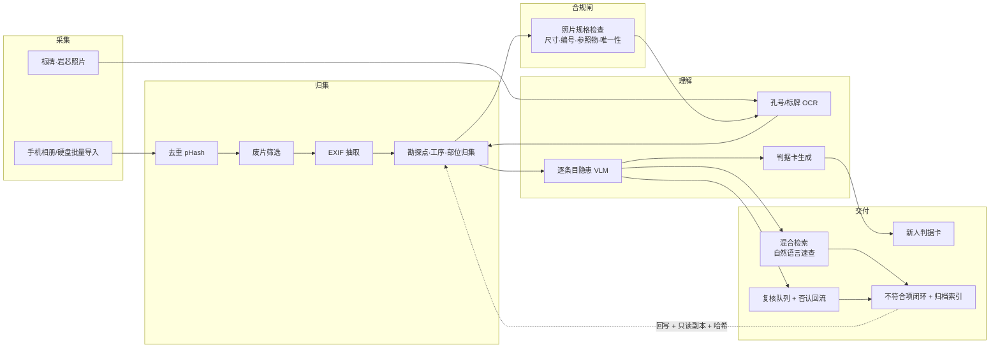

# 题 05 · 山南勘测 | 上百张现场照片，隐患藏在哪一张？

| 项 | 内容 |
|----|------|
| **业务目标** | 项目现场资料照片归档、风险源与不符合项速查（含文字识别） |
| **组数** | 1 组 |
| **行业** | 工程建设（**岩土工程勘察外业**） |
| **北极星指标** | **隐患线索召回率**（人工标注评测集上的召回） |
| **护栏指标** | 隐患**精确率**不低于 70%（只报召回会被误判为成功） |
| **Echo / Delta** | Echo：安全员 / 质量员 · Delta：CV/多模态 + 后端 |

---

## 〇、企业背景与选题校准

### 需求细节（官方口径，原图照抄）

来源：GPS 2026 FDE 智能人才工厂 · 命题方需求详情页 · 2026-10-23

> **业务目标**：项目现场资料照片归档、风险源与不符合项速查（含文字识别）
>
> **业务问题**
> 1. 现场照片多，**工序、部位、问题**难检索
> 2. **孔号、标牌、风险线索**，都要逐张翻找
> 3. **新人难以快速识别潜在隐患**
>
> **揭榜名额**：1 组

画面里是一台**地质钻机在作业**，浮出的照片卡带三种标注：**橙框圈住标牌「ZK-03」**、**虚线圈出一处风险线索**、**橙色三角表示隐患标记**。

> ⚠️ 这三行**就是命题方给的 L2 线索**，不是我的推测。下面 L2 的拆法与它逐条对齐。

### 企业背景与事实基线

| 事实 | 来源 | 等级 |
|------|------|------|
| 2003 年成立，浦东金桥自贸区，员工 260–370 余人；持自然资源部测绘甲级（工程测量/海洋测绘/界线与不动产测绘）、住建部工程勘察甲级（岩土工程/工程测量/水文地质）、上海市地基基础检测评估甲级等 6–7 项甲级资质 | 公司官网 shsnkc.com；百度百科 | 3（仅供参考） |
| 主营：工程勘察、工程监测、土工实验室、工程测绘、工程质量检测、工程物探、岩土工程设计与咨询、地基基础施工、房屋检测、环境评估修复、水土保持咨询 | 公司官网 | 3（仅供参考） |
| 上海市经信委"质量标杆"案例：创新提出 **AI（All In，全维度嵌入）工作法**——高层/生产部门/项目部分工嵌入政府、设计院、施工、运管单位，构建地下空间三维数据信息库，勘测成果与更新工程方案**反演、反敷**。成效：项目优良率 75%→90%，总工期减少 40%+，节约投资 1.2 亿+，用户满意度 95%+ | 上海市经济和信息化委员会 2022-10-20 | 1 |
| 设 BIM 应用研究中心、研发中心、数字化交互应用平台；与同济大学、上海师范大学建产教融合/产学研基地 | 公司官网 | 3（仅供参考） |
| 2026-10-18 荣获 2026 地理信息科技进步奖一等奖 | 公司官网新闻 | 3（仅供参考） |
| 党总支书记、常务副总经理顾小双为国家一级造价工程师、上海市政府采购评审专家 | 公司官网专家页 | 3（仅供参考） |
| **地质勘查行业的安全判定口径在自然资源条线**：依据《地质勘探安全规程》《地质勘查和测绘行业安全生产重点检查事项指引（试行）》《四川省地质勘查行业重大事故隐患判定指南》等，重大隐患含：未取得安全生产许可证、未建立双重预防机制；**项目驻地/工棚/营地的危险性评估**；**钻探机台用电未实现"一机一闸一漏电"**；**未编制有限空间作业等高危作业安全专篇**（进入岩洞、老隆、竖井、探井未做通风/照明/排危/有害气体检测）；**危险化学品未分区分类储存或混放混存**；森林草原防火期擅自野外用火等 | 自贡市人民政府办公室公开的《自然资源领域重大事故隐患判定标准、重点检查事项（地质勘查、测绘、林草、金属非金属露天矿山）》 | 1 |
| **测绘行业外业重点检查事项**含：外业前未做安全培训；连日阴雨/道路湿滑/陡坡出行；雷电天气未停止作业；**道路内作业未设置明显安全警示标识**；交叉作业防护不当、基坑监测与边坡测量人员**未佩戴安全绳**；**手机无信号区单人或单车承担任务**、**首次参与野外作业人员未与有经验人员结队同行**；**未按要求佩戴安全帽、穿戴反光背心**，水上作业未穿救生衣；外业人员未配通讯工具与定位装置、未每日报送安全情况；**有限空间作业未防范有毒气体中毒/可燃气体爆炸/触电**；无人机未履行审批、起飞前未安全检查；**外业数据未做备份存储、硬盘未注意防震/防水/防尘** | 同上 | 1 |
| **勘察原始资料的归档与照片规格已有同类标准写死**（示例为深圳市地方标准，非上海适用）：岩土工程勘察原始资料应包括勘察纲要、任务书、工程地质测绘、周边环境调查、**钻探槽（洞）并探**、各种原位测试、物探、室内试验和**照片**等原始记录，**在勘察报告提交后应及时归档**；**勘探点、测试点和观测点均应编号**，同一工程场地中的编号不得重复；**应对岩芯进行照像留存，岩芯照片应有钻孔编号、标尺和其他参照物**，数码照片未经剪辑尺寸不宜低于 2500×2000 像素、打印质量不低于 300dpi；电子文档**数值严禁修改**，编辑仅限于格式编辑 | SJG 36-2017《深圳市岩土工程勘察报告数字化规范》（标准库页面） | 3（仅供参考·**非上海适用口径**） |
| **政府侧 AI 落地已在发生**：重庆住建领域首批 12 个 AI 应用典型案例，含"整合文字、视频、表单等多模态数据至 AI 大模型识别施工现场风险点""基于视觉大模型的数字孪生智能体" | 重庆市住房和城乡建设委员会 | 1 |
| **智慧工地已被省级全面推进**：省级住建主管部门 2024-02 发文全面推进房屋市政工程建设项目智慧工地建设和应用 | 宁夏回族自治区住房和城乡建设厅 | 1 |

**校准（这决定方案怎么写）**：

1. **⚠️ 纠正一处硬伤：隐患判定口径不该锚《房屋市政工程生产安全重大事故隐患判定标准》。**
   那是**房建市政**口径，而山南是**岩土工程勘察单位**——它不做房建施工，它做**钻探外业**。
   正确的锚是**自然资源条线**：《地质勘探安全规程》+《地质勘查和测绘行业安全生产重点检查事项指引（试行）》+ 各地《地质勘查行业重大事故隐患判定指南》。
   照片里能直接看出来的隐患项也因此换了：**安全帽/反光背心、道路安全警示标识、有限空间作业防护、钻探机台"一机一闸一漏电"、营地工棚与危险化学品分类存放、交叉作业与安全绳、水上作业救生衣**——**这些才是照片判得出的**，而"基坑临边防护"在本题语境下并不是主角。
2. **山南已经在做 AI 工作法**（上海市经信委"质量标杆"案例：AI = All In，全维度嵌入，已建地下空间三维数据信息库，勘测成果可"反演、反敷"）。→ 本题不是"引入 AI"，而是**把已有的 AI 能力从生产/技术环节接到安全与资料管理环节**。而"反演、反敷"这条路径**天然需要一份结构化的历史影像底座**——这正是本方案在山南的长期价值。
3. **"孔号"不是标签，是合规项。** 勘探点/测试点/观测点**应当编号且同一场地不得重复**（同类标准已明写）。所以"孔号 OCR"不是锦上添花的检索功能，而是**归档合规的前置条件**——照片里没有可读的孔号，这张照片在归档链上就是孤儿。
4. **照片的规格有明文判据。** 岩芯照片须带**钻孔编号 + 标尺 + 参照物**，未剪辑尺寸不低于 2500×2000 像素。这让"照片合不合规"从主观判断变成**可机械检查**的一条闸。
5. **"新人难以识别潜在隐患"是一条独立的产品诉求，不只是"给安全员更好用"。** 它对应的是行业检查事项里"首次参与野外作业人员未与有经验人员结队同行"这一条——**新人识别不了 = 带教成本高 + 现场风险高**。所以交付物里必须有**给新人的判据与依据**，而不只是给专家的检索框。
6. **红线：不拿公开 PPE 数据集冒充现场场景，也不引用任何未经权威独立测评的准确率数字。** 未检索到"VLM 现场隐患识别准确率"的权威独立测评，因此本方案所有召回率/精确率都是**我们设定的验收目标（非业界实测）**，基线必须 Day1 用甲方真实照片自建标注集实测。
7. ⚠️ **待 Day1 现场确认**：照片量级与形态、**甲方现行安全检查表与适用标准条目**（上海口径）、隐蔽工程验收留证要求、是否已有智慧工地/移动端可对接、照片合规与保存期限、外业是否允许带手机拍摄（涉密工程？）、使用场景（现场用还是事后查）、**"工序/部位"在山南的确切分类字典**。

---

## 一、场景（L1 业务现场）

地质钻探外业：机台就位、钻孔、起钻、取样、护壁、封孔——每个孔位、每个回次、每张岩芯照片都是**成果的原始证据**。

**今天的现场**：

- 一次进场几百上千张照片：机台全景、钻具、泥浆、返砂、岩芯、标牌、孔口、作业人员
- **照片没有对象**：文件名是 `IMG_2037.jpg`，时间/GPS 躺在 EXIF 里，谁拍了哪孔、哪道工序、哪个部位，查不出来
- **孔号查不了**：标牌上写着 `ZK-03`，但它在像素里——想按孔号找照片，只能翻
- **风险线索靠老手**：哪个回次土样变色、哪段岩芯有裂隙、哪张图里护壁没到位——**看得出的人能看出，看不出的人永远看不出**
- **交上去就散**：照片躺在个人手机与共享盘，报告提交后要归档时，得从几百个相册里拼

> 行业还有一条硬约束：**外业数据未做备份存储、或存储介质未注意防震/防水/防尘，存在数据损坏风险**——照片丢一次，原始证据就没了。

---

## 二、三层拆解树

### L1 业务问题

> **上百张现场照片，隐患藏在哪一张？**

### L2 子问题（4 条能力缺口，与官方三行业务问题逐条对齐）

| # | L2 子问题（缺口） | 对应官方口径 | 根因 | 为何值得做 |
|---|------------------|------------|------|-----------|
| **L2-1** | **照片没有对象链，工序/部位/问题三个维度落不进照片** | 业务问题 ① | 没有"项目 → 勘探点 → 工序 → 照片"的对象链；EXIF 只在本地文件里；文件名无语义 | 照片只有挂到对象上，才谈得上"按工序/部位/问题找"；也是山南"成果反演、反敷"所需影像底座的起点 |
| **L2-2** | **孔号、标牌、风险线索只能逐张翻找** | 业务问题 ② | 钻孔编号、标牌、岩芯照片上的参照物文字全在像素里，没有被抽成可检索字段 | 题面点名"含文字识别"；而孔号按规范**应当编号且不得重复**——它不是标签，是归档链的主键 |
| **L2-3** | **隐患判定没有权威口径，新人接不上** | 业务问题 ③ | 判定条目没被拆成可逐条判断的清单，模型只能自由发挥；而**"会看"的知识在老手脑子里**，没落成可交接的判据 | 正确的锚在自然资源条线（地质勘查/测绘）；**不自造分类**，且必须产出**新人可用的判据与依据**，而不只是专家的检索框 |
| **L2-4** | **风险源与不符合项没有对象链，归档与整改闭环是断的** | 业务目标"归档 + 不符合项速查" | 发现 → 整改通知 → 复查 靠微信群和文件夹；同一处隐患重复上报也查不出来；报告提交后归档靠人工拼 | 直接对应业务目标两条；也是创优工程资料归档与审计举证的底子 |

> 另有一条横贯性缺口（写进 L3 机制而非单列 L2）：**没有"人确认"的环节**——误报一旦直接变成正式安全记录或整改通知就是安全事故；且否认样本没有回流，模型越用越差。

### L3 机制（每个 L2 对应 2–3 条，全部标同族复用）

| 对应 L2 | L3 机制 | 怎么落地 | 同族复用（举一反三） |
|---------|---------|----------|----------------------|
| L2-1 | **照片资产化管线（去重 → 废片 → EXIF → 归集）** | pHash 汉明距离去重并保留最清晰一张；Laplacian 方差 + 亮度分布筛废片（归"待清理"，**不直接删**）；EXIF 抽时间 / GPS / 设备 | 与行业无关：巡检、仓储、零售、工地质检、文物普查通用 |
| L2-1 | **项目—勘探点—工序对象链（Ontology 三步法）** | Objects（Project → Site → Borehole/ExplorationPoint → Process → Photo → Shot）→ Links（照片 ↔ 勘探点 ↔ 工序 ↔ 隐患类别 ↔ 记录）→ Actions+Write-back（挂载 / 标记 / 整改回写） | 通用"影像资产对象化"模型：设备履历影像、检测批次影像、案件现场照 |
| L2-1 | **勘探点编号主数据 + 唯一性校验** | 勘探点/测试点/观测点统一编号模式与主数据；**同一场地内重复编号直接告警**（按同类标准"编号不得重复"） | 通用"编号唯一性"做法：设备位号、批次号、单据号、车辆牌号 |
| L2-2 | **孔号 / 标牌 / 岩芯照片 OCR 管线** | 文字检测 + 识别；透视与反光预处理；输出**文本 + bbox + 置信度**；对孔号做**格式校验 + 与点位台账映射**，映射不到挂"待归集" | 设备铭牌、资产标签、集装箱铅封、仓储货位编号通用 |
| L2-2 | **照片合规前置检查（可机械判定）** | 按归档口径逐条核：① 像素尺寸 ≥ 2500×2000 且未剪辑；② 是否带**钻孔编号**；③ 是否带**标尺或参照物**；④ 编号是否在点位台账里。不合规 → **进不了归档链**，只能回现场补拍 | 任何"原始证据/影像归档"场景：试验影像、检测影像、验收影像 |
| L2-2 | **OCR 文本入索引 + 混合检索** | OCR 文本、隐患标签、时间、项目 / 勘探点 / 工序全部同索引；向量召回与结构化过滤可叠加 | 通用"把图里的字变成可检索字段"：票据、图纸、公示栏 |
| L2-3 | **按判定条目逐类提问的 VLM 范式** | 依据**甲方现行安全检查表 + 自然资源领域判定条目**，**一条判定标准一次专项提问**（"这张图里钻探机台配电是否实现一机一闸一漏电？""作业人员是否按要求佩戴安全帽并穿戴反光背心？""道路内作业是否设置了明显安全警示标识？"），输出 JSON {条目号, 是否存在, 置信度, 描述, bbox} | 任何"有既定检查项体系"的场景：EHS 检查、ISO 内审、设备点检、监理旁站 |
| L2-3 | **新人判据卡（把老手的"看"变成可交接的规则）** | 每条判定条目配：① 判据（一句话，说清"什么算隐患"）；② **看图要点**（该看画面哪个位置）；③ 依据出处（条目号 + 原文）；④ 1–2 张正例/反例图。**新人按卡片自查，老手按卡片复核** | 通用"隐性经验显性化"：老师傅工艺判据、老中医经验方、质检眼力、带徒教材 |
| L2-3 | **风险分级映射表 + 评测集（分条目出指标）** | 隐患类别 → 风险等级 → 整改要求，**分级口径来自甲方既有制度，不由模型定级**；用甲方真实照片人工标注建集，**按条目分别出召回 / 精确率**与混淆样本图 | 所有"小样本视觉任务"的通用评测范式 |
| L2-4 | **不符合项对象链与闭环台账** | Photo → DetectedHazard → Nonconformity → Rectification → RecheckPhoto；每步带责任人、期限、状态 | 质量 / 安全 / 合规类问题闭环通用 |
| L2-4 | **前后对照视图 + 归档台账导出** | 同一不符合项的隐患照与复查照并排（部位 / 时间 / 说明）；导出安全台账与**归档索引**（编号、类别、等级、责任人、期限、状态、照片索引） | 复查比对、索赔取证、创优工程资料归档通用 |
| L2-4 | **外业数据备份与介质防护提醒** | 归档链自带"原始件只读副本 + 校验哈希 + 异地/云备份位"，导出时提示"硬盘未做防震/防水/防尘"这条行业风险 | 通用"原始数据保全"：测绘原始数据、试验原始数据、影像原始文件 |
| 横贯 | **人工复核队列 + 否认样本回流** | 置信度分档；确认 / 否认；**否认样本回流**成 few-shot 与评测集；**不自动开整改通知** | 任何 CV 落地都要用的置信度管理范式 |
| 横贯 | **引用白名单与范围声明** | 模型只能引用**甲方检查表与适用判定条目**；**不得引用公开通用经验库或公开数据集冒充现场依据**；对外输出必须写明所依据的条目号 | 审计与合规场景的通用"来源可追"约束 |

> **L3 数量核对**：L2-1 → 3 条，L2-2 → 3 条，L2-3 → 3 条，L2-4 → 3 条，横贯 → 2 条。**L3 是 14 条机制，不是 14 个 L2。** L2 保持 4 条不变，这是深度控制。

---

## 三、项目定义与范围

**「现场照片智能归档与隐患速查系统」**。

| 依据 | 内容 |
|------|------|
| 甲方安全检查表 / 适用判定条目 | 隐患类别从这来，模型只能按它判 |
| 勘探点编号台账 | 孔号的主数据与唯一性校验基准 |
| 归档口径（含照片规格） | 照片合规前置检查的判据 |

| 做 | 不做（明确砍掉） |
|----|------------------------|
| **1 个项目**的真实照片 | 不做全部历史项目 |
| **5–7 类可视觉判定的隐患条目**（锚定甲方检查表 + 自然资源条线） | 不做全类别安全检测；不做不可视觉化的隐患 |
| 孔号 / 标牌 / 岩芯照片 **OCR + 入索引** | 不做手写记录全文结构化（可留二期） |
| **照片合规前置检查**（尺寸 / 编号 / 参照物 / 编号唯一性） | 不做无网环境下的全量离线推理 |
| 自然语言速查（文字 + 标签 + 元数据混合） | 不做"以图搜图"的向量检索（本题不必要） |
| **新人判据卡** | 不做完整的安全培训体系（判据卡是它的最小可用形态） |
| 不符合项闭环的**最小链路** + 归档索引导出 | 不做完整的质量安全管理系统 |

**Echo / Delta 分工**

| 角色 | 承担人 | 职责 | 不可替代性 |
|------|--------|------|-----------|
| **Echo** | 安全员 / 质量员 | 提供甲方现行安全检查表与判定条目；**标注 100–200 张真实照片**（评测集来源）；判定误报/漏报 | 什么算隐患、什么等级，只有他能定 |
| **Echo** | 资深外业人员 / 带教师傅 | 提供"老手怎么看"的判据与正反例 | **新人判据卡的原料只能来自他** |
| **Echo** | 资料员 / 项目负责人 | 确认"工序 / 部位 / 勘探点"分类字典与归档口径 | 归档链路谁签字，只有他知道 |
| **Delta** | CV/多模态 + 后端 | 去重管线、隐患检测、OCR、合规检查、索引、检索、闭环台账 | — |

**成功标准（Day3）**：安全员用**一句自然语言**（如"找出所有机台未戴反光背心的照片"）在 10 秒内拿到候选，并**当场判定命中/误报**；**一名新人**（现场那位）拿着判据卡，能独立说出"这张为什么算隐患、依据哪一条"。

---

## 四、专项技术点（三层技术栈）

| L1 技术域 | L2 组件 | L3 实现要点 |
|-----------|---------|-----------|
| **数据接入** | 批量导入 | 手机相册 / 硬盘 / 相机直传；保留来源批次；断点续传 |
| | EXIF 抽取 | 时间 + GPS + 设备型号；缺失时用导入批次 + 文件名兜底 |
| **归集** | 去重 | pHash 汉明距离；保留最清晰一张；**去重要可解释**（告诉用户"删了 N 张相似"） |
| | 废片筛选 | Laplacian 方差（模糊度）+ 亮度分布；命中归"待清理"，**不直接删** |
| **对象层** | 勘探点主数据 | 勘探点/测试点/观测点统一编号；**同场地重复编号告警**；与台账双向映射 |
| | 工序—部位分类字典 | 由甲方给字典，不由模型归纳；照片只允许从字典里选 |
| | 照片对象链 | Project → Site → Borehole → Process → Photo → Shot；Links 提前固化 |
| **合规检查** | 照片规格闸 | 像素尺寸 ≥ 2500×2000 且未剪辑；是否带钻孔编号；是否带标尺/参照物；编号是否在台账内。**不合格回现场补拍，不进归档链** |
| **理解层** | 孔号/标牌 OCR | 文字检测 + 识别；透视/反光预处理；输出文本 + bbox + 置信度；孔号做格式校验 |
| | 逐条目隐患 VLM | **一条判定标准一次专项提问**；输出 JSON {条目号, 是否存在, 置信度, 描述, bbox}；**不得一次问"有没有问题"** |
| | 新人判据卡生成 | 由判定条目 + 老手口述 + 正反例图生成；**人工确认后入库**，不由模型独立生成 |
| **检索层** | 混合检索 | 向量召回 + 结构化过滤（项目 / 勘探点 / 工序 / 条目 / 时间）叠加；命中回跳原图 |
| **闭环层** | 不符合项对象链 | Photo → DetectedHazard → Nonconformity → Rectification → RecheckPhoto |
| | 前后对照 | 隐患照与复查照并排；附整改说明与时间 |
| **保全** | 原始件只读 + 校验哈希 | 归档件只读副本 + 哈希；备份位与介质防护提醒 |
| **工程化** | 部署与降级 | Docker Compose；离线 Plan B（退化为"编号 OCR + 全文检索"，无 VLM 也能演示） |

---

## 五、OKR

### O

> **让上百张现场照片在几秒内变成可检索的隐患线索，让安全整改与归档从"翻相册"变成"搜一句话"，并让新人第一次接得上。**

| KR | 指标 | 基线 | 目标 | 怎么量 |
|----|------|------|------|--------|
| **KR1（北极星）** | **隐患线索召回率** | 0 | **≥ 80%**（在 ≥ 200 张甲方真实照片上，按条目分别统计） | 评测集跑分脚本，随代码入库 |
| KR2 | 隐患**精确率** | 0 | **≥ 70%**（同评测集） | 同上；**与 KR1 成对看**，只看召回会误判为成功 |
| KR3 | 照片**自动归集归档率** | 0 | **≥ 95%**（抽 100 张，正确落到项目/勘探点/工序，无需人工改名） | 人工抽检 |
| KR4 | 自然语言速查**响应时间** | 人工翻找（分钟~小时级） | **≤ 10 秒**返回候选 Top-20 | 端到端计时 |
| KR5 | **孔号识别准确率**（格式校验通过 + 台账可映射） | 0 | **≥ 90%**（抽样 100 张） | 抽检 |
| KR6 | **照片合规前置检查**覆盖 | 0 | **≥ 95%** 的归档照片被自动核过 4 项规格 | 台账统计 |
| KR7 | 误报率 | — | **≤ 15%**（进入人工复核队列的比例） | 确认队列统计 |
| KR8 | **新人判据卡**可用性 | 0 | **≥ 3 类隐患**配齐判据卡；**≥ 1 名新人**用它独立说对 1 条依据 | 现场演示 + 记录 |
| **KR9（护栏）** | **误报直接生成正式安全记录的数量** | — | **= 0**（未经人工确认不得进主表、不得自动开整改通知） | 审计日志检查 |

> **为什么必须有 KR9**：这套系统最阴险的失败是"误报变成一条正式安全记录"——那会变成对某人的安全指控，而它来自一台没被确认过的机器。召回率再高，KR9 破了就是失败。

---

## 六、解决方案与架构

### 关键链路：一张照片的一生

1. **进**：手机相册 / 硬盘批量导入，记录来源批次
2. **洗**：pHash 去重（保留最清晰）→ 模糊/过曝筛到"待清理" → 抽 EXIF
3. **挂**：时间 + GPS + 工序台账 → 落到 `项目 / 勘探点 / 工序`；挂不上的进"待归集"池
4. **卡**：**合规闸**逐条核——尺寸够不够、有没有孔号、有没有标尺参照物、编号在不在台账里。不合规的**不进归档链**，回现场补拍
5. **读**：OCR 出孔号与标牌文字 → 校验 + 映射台账
6. **判**：按判定条目**逐类**问 VLM（一条标准一次提问）→ JSON {条目号, 是否存在, 置信度, 描述, bbox}
7. **教**：把"老手怎么看"写成判据卡（判据 + 看图要点 + 依据出处 + 正反例），人工确认后入库
8. **审**：中低置信进复核队列（确认/否认），否认样本回流
9. **查**：向量召回 + 结构化过滤叠加，返回候选图
10. **闭**：确认的隐患 → 不符合项 → 整改 → 复查照 → 前后对照 → 归档索引导出（只读副本 + 哈希）

### 关键取舍

| 取舍点 | 选择 | 放弃的 |
|--------|------|--------|
| 检测方式 | **按判定条目逐类判断** | 一次性问"有没有隐患"（不可控、无法归因） |
| 判定依据 | **甲方检查表 + 自然资源条线条目**，逐条引用 | 引用公开通用经验库冒充现场依据（审计无效） |
| 训练数据 | 甲方**真实照片** few-shot/微调 | 公开 PPE 数据集直接用（场景不匹配） |
| 照片合规 | **机器前置检查**，不合格回现场补拍 | 事后人工抽检（补拍成本更高，但照片一次性到位） |
| 孔号识别 | 映射不到台账 → **挂"待归集"，不硬塞** | 模型猜一个编号（会造假证据） |
| 检索 | 混合检索（向量 + 结构化过滤） | 纯向量（查不出"某勘探点某工序"这类精确条件） |
| 误报 | 承认会误报，建复核队列与回流 | 追求零误报（做不到，会导致全盘弃用） |
| 自动动作 | **不自动开整改通知** | 自动发通知（误报直接变成安全记录事故） |
| 新人视角 | **判据卡**（判据+看图要点+依据+正反例） | 只做给专家的检索框（官方业务问题第③条落空） |

---

## 七、举一反三：本方案一并覆盖的同族问题

> 每条都满足：同数据形态 + 同痛点 + 不换业务知识即可复用。

| # | 同族问题 | 复用的 L3 机制 | 复用后长什么样 |
|---|---------|---------------|--------------|
| 1 | **勘察成果举证**（钻孔原始记录、探井、原位测试、试验记录的照片与影像） | 照片资产化管线 + 勘探点编号主数据 + 合规前置检查 | 报告附件按勘探点/工序自动成册，孔号可点开对应影像 |
| 2 | **外业数据保全**（外业数据未备份、硬盘未防震/防水/防尘） | 原始件只读副本 + 校验哈希 + 备份位提醒 | 归档即备份，采集端提示介质防护 |
| 3 | **有限空间作业专项**（进入岩洞/老隆/竖井/探井未做通风、照明、排危、有害气体检测） | 逐条目 VLM + 判定条目引用白名单 | 探井现场照片能被"是否具备有限空间作业条件"这一条命中 |
| 4 | **外业安全培训台账**（培训计划、培训记录、"新招员工或临时聘用人员培训不够"） | 新人判据卡 + 归档台账导出 | 培训签到与判据卡版本一起归档，可追溯"当时教的是哪版" |
| 5 | **无人机外业**（未履行审批、起飞前未安全检查） | 照片资产化 + EXIF | 无人机照片带时间/GPS 自动归集进项目，审批状态可挂 |
| 6 | **基坑监测与边坡测量的作业安全**（监测人员未佩戴安全绳、交叉作业防护不当） | 逐条目 VLM（安全绳/交叉作业/警示标识条目） | 监测外业照片也能被同一套条目命中，同一模型服务另一条业务线 |

> **一句话**：这不只是"照片里的隐患识别"。它同时是**勘察成果归档台账、外业数据保全清单、有限空间作业检查助手、安全培训台账**——四条线共用一套对象模型与闭环。

---

## 八、风险兜底与 Day1 必问

### 风险与兜底

| 风险 | 影响 | 兜底 |
|------|------|------|
| **用错了判定标准**（拿房建市政的口径判勘察外业） | 结论无效，评审直接打回 | 本方案已把口径纠正到自然资源条线；**上海适用的判定条目 Day1 必须由甲方给出**，未给出前不产正式结论 |
| 甲方检查表拿不到 | 隐患判定无依据，模型自由发挥 | Day1 硬性要求；拿不到就退回"编号 OCR + 合规检查 + 检索"，**只做不判**（有价值的部分先交付） |
| 真实照片太少/太单一 | 泛化差 | 标注集不足 → 退回"人机协作检索"：模型只做初筛 + 标签，结论仍靠人；**不要硬撑一个低准确率的检测器** |
| 误报率高，安全员失去信任 | 项目停摆 | 先只对**高置信 + 明确条目**出结论，其余只做检索不报警；逐周扩类 |
| 照片涉密/涉人 | 合规 | 按项目分权；人脸车牌打码；原图不外传；**外业是否允许拍摄要 Day1 问清** |
| 现场无网/传不动 | 采集断流 | 支持 U 盘/局域网批量导入；导入断点续传 |
| EXIF 被相机/传输抹掉 | 自动归集失效 | 兜底：导入批次 + 文件时间 + 内容相似度聚类；孔号 OCR 作为第二重锚点 |
| 孔号识别错 | 证据链挂错点，性质严重 | 孔号必须**同时通过格式校验与台账映射**才落库；映射不到挂"待归集"，**不硬塞** |
| 新人拿判据卡仍判错 | 官方业务问题第③条落空 | 判据卡配正反例图；Day3 让**真人新人**试一遍，判错就改卡不改模型 |

### Day1 现场必问

1. **甲方现行安全检查表**是哪一份？里面的隐患条目有哪些？哪些是**照片能看出来的**？
2. **判定依据以哪份标准为准**（上海口径）？要不要同时引用自然资源条线的判定标准？
3. "**工序**"和"**部位**"在山南的确切分类字典是什么？（外业工序 vs 报告章节，两套字典对不上是最大的坑）
4. **勘探点编号规则**是什么？ZK-03 的 ZK 是什么前缀约定？测试点、观测点怎么编号？
5. 照片的**归档口径**是什么？岩芯照片要带编号+标尺+参照物这条，**山南是否也这么要求**？像素尺寸有没有内部标准？
6. 照片**能不能拍**？有没有涉密工程、外业拍摄禁令、无人机使用审批？
7. **谁用**：安全员现场用还是质量部事后查？新人是指刚入职的外业人员还是实习生？**判据卡给谁看**？
8. 现有系统：有没有移动端（钉钉/企业微信/OA）能承接上报？有没有已经在用的智慧工地平台？
9. 内网部署条件：有没有推理算力？能不能装 Docker？**照片能不能出内网**（决定 OCR 与 VLM 走本地还是专有通道）？
10. **"反演、反敷"这条 AI 工作法路径，需要的历史影像底座长什么样**？——这一问决定本方案在山南的长期价值边界。

> 备选方向（若第 1、2 题答不上来）：把题 05 收缩为"**勘探点编号 OCR + 照片合规前置检查 + 孔号速查**"的更小切口——这三条**不依赖判定条目**，先证明闭环有效，再谈隐患识别。
