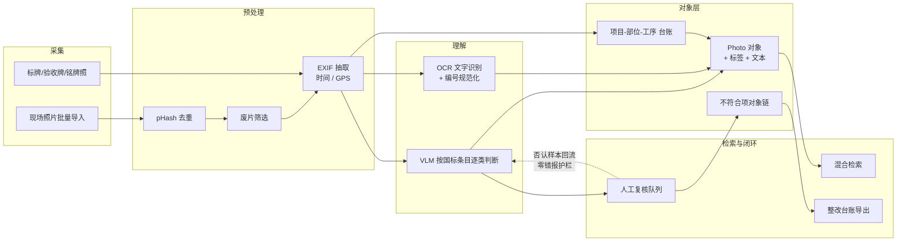

# 题 05 · 山南勘测 | 上百张现场照片，隐患藏在哪一张？

| 项 | 内容 |
|----|------|
| **业务目标** | 项目现场资料照片归档、风险源与不符合项速查（含文字识别） |
| **组数** | 1 组 |
| 行业 | 工程建设（岩土/勘测现场资料管理与安全质量） |
| **北极星指标** | **隐患线索召回率**（自建标注评测集上的分条目召回） |
| **护栏指标** | **未经人工确认即进入正式安全记录 / 整改通知的条数 = 0** |
| **Echo / Delta** | Echo：安全员 / 质量员 · Delta：CV/多模态 + 后端 |

> **一句话方案**：把上百张躺着没人翻的现场照片，变成"能按国标隐患条目和照片里的工程编号秒查"的资产——顺带把标牌、铭牌、钻孔号变成可检索的结构化字段。

---

## 〇、企业背景与选题校准

| 事实 | 来源 | 等级 |
|------|------|------|
| 2003 年成立，浦东金桥自贸区，员工 260–370 余人；持自然资源部测绘甲级（工程测量/海洋测绘/界线与不动产测绘）、住建部工程勘察甲级（岩土工程/工程测量/水文地质）、上海市地基基础检测评估甲级等 6–7 项甲级资质 | 公司官网 shsnkc.com；百度百科 | 3（仅供参考） |
| 主营：工程勘察、工程监测、土工实验室、工程测绘、工程质量检测、工程物探、岩土工程设计与咨询、地基基础施工、房屋检测、环境评估修复、水土保持咨询 | 公司官网 | 3（仅供参考） |
| 上海市经信委"质量标杆"案例：创新提出 **AI（All In，全维度嵌入）工作法**——高层/生产部门/项目部分工嵌入政府、设计院、施工、运管单位，构建地下空间三维数据信息库，勘测成果与更新工程方案**反演、反敷**。成效：项目优良率 75%→90%，总工期减少 40%+，节约投资 1.2 亿+，用户满意度 95%+ | 上海市经济和信息化委员会 2022-10-20 | 1 |
| 设 BIM 应用研究中心、研发中心、数字化交互应用平台；与同济大学、上海师范大学建产教融合/产学研基地 | 公司官网 | 3（仅供参考） |
| 2026-10-18 荣获 2026 地理信息科技进步奖一等奖 | 公司官网新闻 | 3（仅供参考） |
| 党总支书记、常务副总经理顾小双为国家一级造价工程师、上海市政府采购评审专家 | 公司官网专家页 | 3（仅供参考） |
| **隐患判定的国标口径**：《房屋市政工程生产安全重大事故隐患判定标准（2022 版）》建质规〔2022〕2 号 | 政府网转发住建部通知 https://www.ynmh.gov.cn/cjj/21781.news.detail.dhtml?news_id=439167 | 1 |
| **政府侧 AI 落地已在发生**：重庆住建领域首批 12 个 AI 应用典型案例，含"整合文字、视频、表单等多模态数据至 AI 大模型识别施工现场风险点""基于视觉大模型的数字孪生智能体" | 重庆市住房和城乡建设委员会 https://zfcxjw.cq.gov.cn/zwxx_166/zwyw/202509/t20250908_14985999.html | 1 |
| **智慧工地已被省级全面推进**：省级住建主管部门 2024-02 发文全面推进房屋市政工程建设项目智慧工地建设和应用 | 宁夏回族自治区住房和城乡建设厅 https://jst.nx.gov.cn/zwgk/zcwjk/gzwj/202402/t20240202_4448427.html | 1 |

**校准（这决定方案怎么写）**：

1. **山南已经在做 AI 工作法**（上海市经信委"质量标杆"案例：AI = All In，全维度嵌入，已建地下空间三维数据信息库，勘测成果可"反演、反敷"）。→ 本题不是"引入 AI"，而是**把已有的 AI 能力从生产/技术环节接到安全与资料管理环节**。更关键的是：**"反演、反敷"这条路径天然需要一份结构化的历史影像底座**——这正是本方案在山南的长期价值所在。
2. **隐患类别必须锚定国标，不要自造分类。** 《房屋市政工程生产安全重大事故隐患判定标准（2022 版）》建质规〔2022〕2 号 就是现行判定口径。模型的判断依据只能来自**这份国标 + 甲方现行安全检查表**；自造一套分类，产出的台账在评审时是无效的。
3. **别把它写成"这件事还没人做"。** 智慧工地已被省级住建主管部门全面推进（2024-02 发文），重庆住建已发布首批 12 个 AI 应用典型案例，明确包含"整合文字、视频、表单等多模态数据至 AI 大模型识别施工现场风险点"。→ **本题的命题不是"能不能做"，而是"照片这一路怎么接进去"，以及"如何在不误报的前提下落地"。**
4. **红线：不拿公开 PPE 数据集冒充现场场景，也不引用任何未经权威独立测评的准确率数字。** 未检索到"VLM 现场隐患识别准确率"的权威独立测评，因此本方案所有召回率/精确率都是**我们设定的验收目标（非业界实测）**，基线必须 Day1 用甲方真实照片自建标注集实测。
5. ⚠️ 照片未提供：照片量级与形态、甲方现行安全检查表与国标条目的关系、隐蔽工程验收留证要求、是否已有智慧工地平台可对接、照片合规与保存期限、使用场景（现场用还是事后查）。**全部留到 Day1 现场确认**。

---

## 一、场景（L1 业务现场）

每次进现场都是几百张照片：施工进度、设备状态、隐蔽工程、标识牌、验收牌、问题点……

**今天的痛点：**

1. **找不着**：文件名是 `IMG_2037.jpg`，手机相册按时间排，翻到某类问题要几百张往后拖
2. **看不懂**：照片里的标牌写着"3 号井段 已验收 2026-08-11"，想按文字查完全没门
3. **查不出隐患**：安全员要确认"基坑临边防护有没有缺失""有限空间有没有违规进入""管线开挖有没有标识"，只能一张张肉眼过
4. **整不闭**：发现了问题，做成整改通知、拍照复查、前后对照，全靠微信群和文件夹
5. **存不住、用不上**：照片散在个人手机、微信群、共享盘，项目一结束就找不到；勘测企业的现场照片里全是**工程编号**——钻孔编号、标高点号、管位牌、样品编号、仪器铭牌与校准标签——它们现在只以像素存在，**既查不了，也进不了成果台账**

**关键事实（来自公开信息）**：山南同时做工程勘察、工程监测、工程质量检测、工程物探与土工实验室 → **一份现场照片要同时服务两条线**：安全线（风险源、不符合项）与成果线（隐蔽工程验收、检测取样、争议举证）。只服务其中一条，就是浪费一半。

---

## 二、三层拆解树

### L1 业务问题

> **上百张现场照片，隐患藏在哪一张？**

### L2 子问题（4 条能力缺口）

| # | L2 子问题（缺口） | 根因 | 为何值得做 |
|---|------------------|------|-----------|
| **L2-1** | **照片只是文件，没有对象** | 没有"项目 → 部位 → 工序 → 照片"的对象链；EXIF 只躺在本地文件里，导入后无法归集；文件名无语义 | 照片只有挂到对象上，才谈得上"按项目 / 部位 / 工序找"；这也是山南"成果反演、反敷"所需影像底座的起点 |
| **L2-2** | **照片里的文字与工程编号查不了** | 标牌、验收牌、仪器铭牌、钻孔编号、标高点号、管位牌、样品编号全在像素里，没有被抽成可检索字段 | 题面明确点名"含文字识别"；对勘测企业来说这些编号是**成果索引**，不只是标签 |
| **L2-3** | **风险源与不符合项没有对象链** | 发现 → 整改通知 → 复查 靠微信群和文件夹，闭环断；同一处隐患重复上报也查不出来 | 直接对应业务目标里的"不符合项速查"；也是创优工程资料归档与审计举证的底子 |
| **L2-4** | **隐患类别与风险分级没有权威口径** | 国标判定标准与甲方检查表没有被拆成可逐条判定的条目，模型只能自由发挥，结论既不可用也不可追责 | 《房屋市政工程生产安全重大事故隐患判定标准（2022 版）》已给出判定口径；**不自造分类**，模型只按既定条目判 |

> 另有一条横贯性缺口（写进 L3 机制而非单列 L2）：**没有"人确认"的环节**——误报一旦直接变成正式安全记录或整改通知就是安全事故；且否认样本没有回流，模型越用越差。

### L3 机制（每个 L2 对应 2–3 条，全部标同族复用）

| 对应 L2 | L3 机制 | 怎么落地 | 同族复用（举一反三） |
|---------|---------|----------|----------------------|
| L2-1 | **照片资产化管线（去重 → 废片 → EXIF → 归集）** | pHash 汉明距离去重并保留最清晰一张；Laplacian 方差 + 亮度分布筛废片（归"待清理"，**不直接删**）；EXIF 抽时间 / GPS / 设备 | 与行业无关：巡检、仓储、零售、工地质检、文物普查通用 |
| L2-1 | **项目—部位—工序对象链（Ontology 三步法）** | Objects（Project → Section/Part → Process → Photo → Shot）→ Links（照片 ↔ 部位 ↔ 工序 ↔ 隐患类别）→ Actions+Write-back（挂载 / 标记 / 整改回写） | 通用"影像资产对象化"模型：设备履历影像、检测批次影像、案件现场照 |
| L2-1 | **自动命名与元数据侧写** | 归集后按规范重命名，并把部位 / 工序 / 时间写回 EXIF；**照片脱离本平台也能被检索**；侧写失败有降级路径 | 通用"文件即数据"做法：报告、图纸、录音的元数据治理 |
| L2-2 | **标牌 / 铭牌 / 验收牌 OCR 管线** | 文字检测 + 识别；对透视与反光做预处理；输出**文本 + bbox + 置信度**；对关键字段（编号、日期）做格式校验 | 设备铭牌、资产标签、集装箱铅封、仓储货位编号通用 |
| L2-2 | **工程编号规范化与主数据映射** | 钻孔编号、标高点号、管位牌、样品编号 → 统一编号模式 + 正则校验 + 与点位 / 样品台账映射；映射不到则挂"待归集" | 设备位号、批次号、单据号、车辆牌号的通用做法 |
| L2-2 | **OCR 文本入索引 + 混合检索** | OCR 文本、隐患标签、时间、项目 / 部位全部同索引；向量召回与结构化过滤可叠加 | 通用"把图里的字变成可检索字段"：票据、图纸、公示栏 |
| L2-3 | **不符合项对象链与闭环台账** | Photo → DetectedHazard → Nonconformity → Rectification → RecheckPhoto；每步带责任人、期限、状态 | 质量 / 安全 / 合规类问题闭环通用 |
| L2-3 | **前后对照视图与整改台账导出** | 同一不符合项的隐患照与复查照并排（部位 / 时间 / 说明）；导出安全台账（编号、类别、等级、责任人、期限、状态、照片索引） | 复查比对、索赔取证、创优工程资料归档通用 |
| L2-4 | **按国标条目逐类判断的 VLM 提问范式** | 依据《房屋市政工程生产安全重大事故隐患判定标准（2022 版）》判定条目 + 甲方现行安全检查表，**一条判定标准一次专项提问**（"这张图里基坑临边防护是否连续完整且符合该条判定要求？"），输出 JSON {条目号, 是否存在, 置信度, 描述, bbox} | 任何"有既定检查项体系"的场景：EHS 检查、ISO 内审、设备点检、监理旁站 |
| L2-4 | **风险分级映射表** | 隐患类别 → 风险等级 → 整改要求；分级口径来自甲方既有制度与国标，**不由模型定级** | 通用"分类 → 等级 → 处置动作"映射：缺陷分级、投诉分级、缺陷优先级 |
| L2-4 | **评测集与分条目指标** | 用甲方真实照片人工标注建集；**按条目分别出召回 / 精确率**与混淆样本图；检索命中率与检测指标分开看 | 所有"小样本视觉任务"的通用评测范式 |
| 横贯 | **人工复核队列 + 否认样本回流** | 置信度分档；确认 / 否认；**否认样本回流**成 few-shot 与评测集；**不自动开整改通知** | 任何 CV 落地都要用的置信度管理范式 |
| 横贯 | **引用白名单与范围声明** | 模型只能引用国标判定条目与甲方台账；**不得引用公开通用经验库或公开数据集冒充现场依据**；对外输出必须写明所依据的条目号 | 审计与合规场景的通用"来源可追"约束 |

> **L3 数量核对**：L2-1 → 3 条，L2-2 → 3 条，L2-3 → 2 条，L2-4 → 3 条，横贯 → 2 条。**L3 是 13 条机制，不是 13 个 L2。** L2 保持 4 条不变，这是深度控制。

---

## 三、项目定义与范围

**「现场照片智能归档与隐患速查系统（Photo Ontology + 国标条目化隐患速查）」**——给安全员与质量员用的资料副驾。

**输入**：现场照片批量（手机相册 / U 盘 / 局域网）· 甲方安全检查表与国标判定条目 · 项目-部位-工序台账 · 历史整改记录
**输出**：自动归档（项目 / 部位 / 工序 / 日期）· 按判定条目的隐患候选（类型 / 位置 / 等级 / 依据条目 / 置信度）· 照片文字与工程编号结构化字段 · 自然语言速查 · 不符合项闭环台账

| 做 | 不做（Day2 明确砍掉） |
|----|------------------------|
| **1 个项目**的真实照片（几百张） | 不做全部历史项目 |
| 以**国标判定条目 + 甲方检查表**为准，先做 **5 条**判定条目 | 不做全类别安全检测，**不自造分类体系** |
| 标牌 / 铭牌 / 验收牌 / 工程编号**文字识别 + 入索引** | 不做手写单据的完整结构化（可留作二期） |
| 自然语言检索（文字 + 标签 + 元数据混合） | 不做"以图搜图"的向量检索（本题不必要） |
| 不符合项闭环的**最小链路** | 不做完整的质量安全管理系统 |
| 自动归档 + 速查 + 闭环 | 不做移动端原生 App（Web 即可） |

**Echo / Delta 分工**

| 角色 | 承担人 | 职责 | 不可替代性 |
|------|--------|------|-----------|
| Echo | 安全员 / 质量员 | 提供安全检查表并确认与国标条目的关系；**标注 100–200 张真实照片**（评测集来源）；判定误报 / 漏报 | 现场什么样只有他知道；判定口径必须由他确认 |
| Echo | 安全总监 | 确认风险分级口径与整改闭环流程 | 分级口径是制度，不是技术判断 |
| Delta | CV/多模态 + 后端 | 去重管线、隐患检测、OCR、索引、检索、闭环台账 | — |
| 共同 | 项目资料员 | 确认"部位 / 工序"台账口径与归档规则 | — |

> ⚠️ **本题最大的失败模式**：拿公开数据集（比如 PPE 检测）训一个通用模型，演示得很流畅，但**甲方现场照片根本不是那个场景**——工地上没有干净背景、没有标准站位。必须用自己的真实照片。

**成功标准（Day3）**：安全员用**一句自然语言**（如"找出所有基坑临边防护缺失的照片"）在 10 秒内拿到候选，并**当场判定其中 3 张确实有问题、2 张是误报**（误报被识别出来本身就算成功）。
**数据缺位时**：假数据比没数据好——先用手工标注的 50 张真实照片 + 少量模拟照片把链路跑通，**绝不拿公开 PPE 数据集冒充现场场景**。**后续 5 天节点**：标注扩量、判定条目增补、采集端按部位提示拍摄（第二轮）、与既有智慧工地平台做接口对齐。

---

## 四、专项技术点（三层技术栈）

| L1 技术域 | L2 组件 | L3 实现要点 |
|-----------|---------|-----------|
| **数据接入** | 照片批量导入 | 手机相册 / U 盘 / 局域网；导入批次 ID；断点续传；重复导入幂等 |
| | EXIF 抽取 | 时间 + GPS + 设备；EXIF 被抹除时按导入批次 + 文件时间兜底 |
| **预处理** | pHash 去重 | 汉明距离阈值；保留最清晰一张；**去重要可解释**（告知"删了 N 张相似"） |
| | 废片筛选 | Laplacian 方差（模糊度）+ 亮度分布；命中归"待清理"，不直接删 |
| **结构化** | Photo 抽取与打标 | 部位 / 工序 / 日期 / 标签；人工可纠正；纠正结果回流 |
| | 标牌 OCR + 工程编号规范化 | 检测 + 识别；透视 / 反光预处理；**文本 + bbox + 置信度**；钻孔编号 / 标高点号 / 管位牌 / 样品编号 → 正则 + 主数据映射，映射不到挂"待归集" |
| **本体层** | 照片与部位 Ontology | Project→Section/Part→Process→Photo→Shot；Links 提前固化，不做查询时 JOIN |
| | 不符合项对象链 | Photo→Hazard→Nonconformity→Rectification→RecheckPhoto |
| **推理层** | 按国标条目逐类判断 | 依据判定条目逐条问 VLM；输出 JSON {条目号, 是否存在, 置信度, 描述, bbox} |
| | 风险分级映射 | 类别 → 等级 → 整改要求；来自甲方制度与国标，**不由模型定级** |
| | 引用白名单与范围声明 | 只引国标条目与甲方台账；**不得引用公开数据集或通用经验库充数** |
| **检索层** | 混合检索 | 向量召回 + 结构化过滤（项目 / 部位 / 工序 / 日期 / 隐患类型）**必须可叠加** |
| | OCR 文本入索引 | 文本与标签同索引，支持"带'已验收'标牌的"这类查法 |
| **闭环层** | 人工复核队列 + 否认回流 | 确认 / 否认；否认样本成 few-shot 与评测集；**不自动开整改通知** |
| | 前后对照视图 + 台账导出 | 隐患照与复查照并排；导出安全台账（编号、类别、等级、责任人、期限、状态、照片索引） |
| **工程化** | 评测流水线 | 按条目出召回 / 精确率 + 混淆样本图；随代码入库；**基线 Day1 自建标注集实测** |

---

## 五、OKR

### O

> **让上百张现场照片在几秒内变成可检索的隐患线索，让安全整改从"翻相册"变成"搜一句话"。**

| KR | 指标 | 基线 | 目标 | 怎么量 |
|----|------|------|------|--------|
| **KR1（北极星）** | **隐患线索召回率**（自建标注评测集，按判定条目分层统计） | Day1 实测（需甲方真实照片自建标注集） | **≥ 80%**（**我们设定的验收目标，非业界实测**） | 评测脚本随代码入库 |
| KR2 | 隐患识别**精确率** | Day1 实测 | **≥ 70%**（**我们设定的验收目标，非业界实测**） | 同上；与 KR1 必须成对看 |
| KR3 | 照片**自动归集归档率** | 0 | **≥ 95%**（抽 100 张，正确落到项目 / 部位 / 日期，无需人工改名） | 人工抽检 |
| KR4 | 自然语言速查**响应时间** | 人工翻找（分钟~小时级） | **≤ 10 秒**返回候选 Top-20 | 端到端计时 |
| KR5 | 误报率（进入人工复核队列的比例） | — | **≤ 15%** | 确认队列统计 |
| KR6 | OCR 关键字段准确率（编号 / 日期类） | — | **≥ 85%**（抽样 100 个） | 抽检 |
| **KR7（护栏）** | **未经人工确认即进入正式安全记录 / 整改通知的条数** | 0 | **= 0** | 复核队列操作日志 + 正式台账反查 |

> ⚠️ **KR1 与 KR2 是我们设定的验收目标，不是行业实测值**：未检索到"VLM 现场隐患识别准确率"的权威独立测评，**本文档不引用任何未经权威独立测评的准确率数字**。基线必须 Day1 用甲方真实照片自建标注集实测；达不到就按 L3 的降级路径走（人机协作检索，不硬撑检测器）。
> **为什么 KR1 与 KR2 必须成对看**：只报召回 80% 而不报精确率，是典型的"看起来很行、实际没法用"。
> **为什么必须有 KR7**：误报直接变成正式安全记录或整改通知，既是安全事故也是信任崩塌。**宁可少报，不可错报。**

---

## 六、解决方案与架构

### 关键链路：一张照片的一生

1. **入**：手机相册批量导入 / 项目资料员上传 → 记录来源批次与哈希
2. **洗**：pHash 去重（保留最清晰）→ 模糊 / 过曝筛到"待清理" → 抽 EXIF
3. **挂**：EXIF 时间 + GPS → 匹配项目台账，落到 `项目/部位/工序/日期`；匹配不到的进"待归集"池
4. **判**：按国标判定条目 + 甲方检查表**逐条**问 VLM → 输出 JSON：`{条目号, 是否存在, 置信度, 描述, bbox}`
5. **读**：OCR 出标牌 / 铭牌 / 验收牌文字 → 工程编号规范化与主数据映射 → 关键字段格式校验
6. **审**：置信度分档 → 高置信直接入库并标记；中低置信进**复核队列**（确认 / 否认，否认样本回流）
7. **查**：向量召回 + 结构化过滤（项目 / 部位 / 工序 / 日期 / 隐患类型）叠加，返回候选图
8. **闭**：确认的隐患 → 生成不符合项 → 派整改 → 上传复查照 → 前后对照视图 + 台账导出

### 关键取舍

| 取舍点 | 选择 | 放弃的 |
|--------|------|--------|
| 检测方式 | **按国标判定条目逐条判断** | 一次性问"有没有隐患"（不可控、无法归责） |
| 分类来源 | **国标判定条目 + 甲方现行检查表** | 自造一套分类（评审时无效） |
| 训练数据 | 甲方**真实照片** few-shot / 微调 | 公开 PPE 数据集直接用（场景不匹配，且**不得冒充**） |
| 引用范围 | 只引国标条目与甲方台账 | 引用通用安全经验库充数（没有依据） |
| 检索 | 混合检索（向量 + 结构化过滤） | 纯向量（查不出"某项目某日期"这类精确条件） |
| OCR 范围 | 标牌 / 铭牌 / 验收牌 / 工程编号 | 手写单据全解析（成本高、收益低） |
| 误报 | 承认会误报，建复核队列与回流 | 追求零误报（做不到，会导致全盘弃用） |
| 自动动作 | **不自动开整改通知** | 自动发通知（误报直接变成安全记录事故） |
| 性能 | 离线批量处理 + 索引 | 实时流式（本题无实时需求） |

### 可沉淀的通用件（碎石路 → 高速公路）

| 通用件 | 说明 |
|--------|------|
| **照片资产化管线（去重 → EXIF → 归集 → 打标 → 索引）** | 与行业无关，巡检、仓储、零售、工地质检通用 |
| **"按既定条目逐条判断"的 VLM 提问范式** | 比"一次问有没有问题"稳定得多，可复用于任何检查项体系（EHS / ISO 内审 / 点检） |
| **工程编号规范化与主数据映射** | 钻孔号 / 点号 / 管位牌 / 样品号的通用做法，可迁移到设备位号、批次号 |
| **自然语言 + 结构化过滤的混合检索 + 复核队列否认回流 + 对象化不符合项闭环** | 通用资产检索范式；任何 CV 落地的置信度管理范式；质量/安全/合规问题闭环通用 |

---

## 七、举一反三：本方案一并覆盖的同族问题

> 每条都满足：同数据形态 + 同痛点 + 不换业务知识即可复用。

| # | 同族问题 | 复用的 L3 机制 | 复用后长什么样 |
|---|---------|---------------|--------------|
| 1 | **探测成果举证（岩土 / 物探 / 检测成果归档）** | 照片资产化管线 + 照片与部位 Ontology | 钻孔号、点号、管位牌、样品编号从照片与台账**同源建档**，成果可反查原始影像、拍摄时间与位置 |
| 2 | **隐蔽工程验收留证 + 创优工程资料归档 + 内部质量检查（三体系）取证** | 不符合项对象链 + 前后对照视图 | 验收牌照与隐蔽前后照片自动配对，形成可归档证据链；内部检查与创优归档直接复用同一套索引 |
| 3 | **工期、变更与费用争议举证** | EXIF 抽取 + 数字级溯源 + 审计留痕 | 现场影像成为第三方证据：时间、部位、状态三者可查，争议时能还原现场 |
| 4 | **投标业绩材料自动成册** | 混合检索 + 照片与部位 Ontology | 按项目 / 部位 / 工序 / 时间筛出可用实景照片与铭牌，自动生成业绩册与工法素材 |
| 5 | **深基坑、有限空间与管线开挖作业安全巡检** | 按国标条目逐类判断 + 风险分级映射 | 把基坑临边、有限空间、管线开挖的判定条目逐条判、人在回路；错报代价极高，因此强制复核 |
| 6 | **设备持证与校准标签的到期预警** | 标牌 OCR 管线 + 工程编号规范化 | 照片里的仪器铭牌 / 校准标签 → 编号与有效期字段 → 到期提醒与设备台账自动更新 |

> **一句话**：这不只是"照片检索器"。它同时是**隐患速查工具、成果举证底座、创优资料归档件、投标业绩册**——四条线共用一套对象与复核闭环。
> **对山南的长期意义**：山南"AI（All In）工作法"里的**勘测成果反演、反敷**需要结构化的历史影像底座——这套照片资产化管线正是那个底座的生产线。

---

## 八、风险兜底与 Day1 必问

### 风险与兜底

| 风险 | 影响 | 兜底 |
|------|------|------|
| **安全检查表 / 国标条目拿不到，或甲方不认我们的分类** | 检测无依据，结论不可用 | Day1 硬性要求：以《房屋市政工程生产安全重大事故隐患判定标准（2022 版）》建质规〔2022〕2 号的判定条目为主要来源；拿不到就只用通用条目，但**必须明确标注是通用类、不是甲方标准** |
| **拿公开 PPE 数据集冒充现场场景** | 演示流畅但甲方照片完全不是那个场景，一上线就废 | 只用甲方真实照片；训练与评测均在自建标注集上做；文档与界面**不引用任何未经权威独立测评的准确率数字** |
| 真实照片太少 / 场景单一 | 泛化差，达不到召回目标 | 标注集不足 → 退回"人机协作检索"：模型只做初筛 + 标签，结论仍靠人；**不硬撑一个低准确率的检测器** |
| 误报率高，安全员失去信任 | 项目停摆 | 先只对**高置信 + 明确条目**出结论，其余只做检索不报警；逐周扩条目；KR7 兜底 |
| 照片涉密 / 涉人 | 合规 | 按项目分权；人脸车牌按需打码；原图不外传；保存期限按甲方制度 |
| 现场无网 / 传不动 | 采集断流 | 支持 U 盘 / 局域网批量导入；导入过程断点续传 |
| EXIF 被相机或传输抹掉 | 自动归集失效 | 兜底：按导入批次 + 文件时间 + 内容相似度聚类；**归集准确率抽检（KR3）兜底** |
| 甲方已有智慧工地平台，本方案重复造轮子 | 重复建设 | Day1 问清是否已建；已建则做**接口对齐 + 照片侧补齐**，不另起系统 |

### Day1 现场必问

1. **甲方现行安全检查表有哪几类隐患？**与《房屋市政工程生产安全重大事故隐患判定标准（2022 版）》是什么关系（直接沿用 / 各自补充）？
2. 照片量级与形态：一次进场多少张？单张多大？竖屏？废片 / 模糊占比多少？
3. **谁用、怎么用**：安全员现场用，还是质量部事后查？**使用场景决定检索设计**
4. 项目—部位—工序台账现在有没有？口径是什么？谁维护？
5. 需不需要识别哪些具体文字类型（钻孔编号、标高点号、管位牌、样品编号、仪器铭牌与校准标签、验收牌）？
6. 归档的合规要求：照片存原图吗？保留多久？涉密工程怎么处理？是否要进创优工程资料归档？
7. **是否已有智慧工地平台或三方数字化系统可对接？**（决定是"做原型"还是"做集成"）
8. 内网部署条件：有没有推理算力？能不能装 Docker？模型调用走哪条合规通道？
9. 历史整改记录（照片 ↔ 问题的配对）能否拿到？——**这是评测集的现成来源**

> 备选方向（若第 7 题答案是"已有平台"）：把题 5 收缩为"**给现有智慧工地平台补一路照片侧能力：工程编号 OCR + 按国标条目的隐患速查**"，以接口对齐方式落地，不另起系统。
