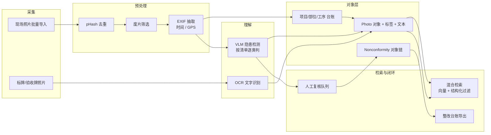

# 题 5 · 山南勘测 | 上百张现场照片，隐患藏在哪一张？

| 项 | 内容 |
|----|------|
| **业务目标** | 项目现场资料照片归档、风险源与不符合项速查（含文字识别） |
| **组数** | 1 组 |
| **行业** | 工程建设（现场安全与资料管理） |
| **北极星指标** | **隐患线索召回率**（人工标注评测集上的召回） |
| **角色配置** | Echo：安全员 / 质量员 · Delta：CV/多模态 + 后端 |

> **一句话方案**：把上百张躺着没人翻的现场照片，变成"能按隐患类别和文字内容秒查"的安全资产——顺带把照片里的标牌、铭牌文字变成可检索的结构化字段。

---

## 一、场景

### 1.1 业务现场

每次进现场都是几百张照片：施工进度、设备状态、隐蔽工程、标识牌、验收牌、问题点……

**今天的痛点：**

1. **找不着**：文件名是 `IMG_2037.jpg`，手机相册按时间排，翻到某类问题要几百张往后拖
2. **看不懂**：照片里的标牌写着"3 号井段 已验收 2026-08-11"，想按文字查完全没门
3. **查不出隐患**：安全员要确认"临边防护有没有缺失""安全帽有没有戴""消防器材有没有过期"，只能一张张肉眼过
4. **整不闭**：发现了问题，做成整改通知、拍照复查、前后对照，全靠微信群和文件夹
5. **存不住**：照片散在个人手机、微信群、共享盘，项目一结束就找不到

### 1.2 为什么"隐患藏在哪一张"

| 表层现象 | 真实根因 | 对应解法方向 |
|---------|---------|-------------|
| 翻不到 | 没有去重、没有分类、命名无语义 | 感知哈希去重 + 自动打标 + 元数据归集 |
| 隐患找不出 | 照片只被"看"，没有被"检查" | 按安全检查项做 VLM 隐患识别 |
| 标牌文字查不了 | 文字只在像素里 | OCR 抽取 → 结构化入索引 |
| 整改闭环断 | 照片与"不符合项"对象没有绑定 | 照片 → 不符合项 → 整改 → 复查的对象链 |
| 同一批照片反复拍 | 无拍摄计划与场景约束 | 采集端按部位/工序提示拍摄（**这是第二轮的事**） |
| 手机拍完就丢 | 没有统一入口 | 批量导入 + 自动归集到项目/部位/时间 |

### 1.3 现有资产

| 资产 | 说明 |
|------|------|
| 现场照片库 | 主要资产，量最大、价值最高 |
| 安全检查表 / 隐患排查清单 | **最重要的结构化输入**——隐患类别从哪来？就从这里来 |
| 项目与部位台账 | 楼栋/区段/工序/部位，用来挂照片 |
| EXIF | 时间 + GPS（**归集的主线索**） |
| 历史整改记录 | 照片 ↔ 问题的历史配对样本 = 评测集 |
| 标牌/铭牌 | 照片中常见文字来源 |

### 1.4 ⚠️ 待 Day1 现场确认

- **照片量级与形态**：一次进场多少张？单张多大？是否竖屏？有多少是废片/模糊？
- **隐患清单**：现行的安全检查表有哪几类隐患？（**这个清单是命门**，模型只能按它判）
- **多少比例是扫描件/复印件**（如纸质验收单拍照）？
- **需不需要识别具体文字类型**（项目名、编号、日期、责任人、设备铭牌）？
- **归档的合规要求**：照片要不要存原图？保留多久？涉密工程怎么处理？
- **谁用**：安全员现场用，还是质量部事后查？**使用场景决定检索设计**
- 有没有现成的管理平台可以对接，还是自建最小版？

---

## 二、项目

### 2.1 项目定义与交付物

**「现场照片智能归档与隐患速查系统」**。

**交付物**：

1. **自动归档**：去重、筛选废片、按 EXIF（时间/GPS）+ 项目台账自动归集到项目/部位/工序/日期
2. **隐患识别**：按安全检查项分类检出隐患（类型 / 位置 / 风险等级 / 整改建议 / 置信度），输出**可核对的框选**
3. **文字识别**：标牌、铭牌、验收牌文字 → 结构化字段（文本 + 位置 + 置信度）
4. **自然语言速查**："找出所有临边没有防护栏的照片""2026-08 之后 3 号井段带'已验收'标牌的"
5. **不符合项闭环**：照片 → 隐患 → 不符合项 → 整改通知 → 复查照片（前后对照可追溯）

### 2.2 范围

| 做 | 不做（明确砍掉） |
|----|------------------------|
| **1 个项目**的真实照片（几百张） | 不做全部历史项目 |
| **5 类高频隐患**（按安全检查表） | 不做全类别安全检测 |
| 标牌/铭牌**文字识别 + 入索引** | 不做手写单据的完整结构化（可留作二期） |
| 自然语言检索（文字 + 标签 + 元数据混合） | 不做"以图搜图"的向量检索（本题不必要） |
| 不符合项闭环的**最小链路** | 不做完整的质量安全管理系统 |
| 自动归档 + 速查 + 闭环 | 不做移动端原生 App（Web 即可） |

### 2.3 角色分工

| 角色 | 承担人 | 职责 |
|------|--------|------|
| **Echo** | 安全员 / 质量员 | 提供安全检查表（隐患类别）；**标注 100–200 张真实照片**（这是评测集来源）；判定误报/漏报 |
| **Echo** | 安全总监 | 确认风险分级口径与整改闭环流程 |
| **Delta** | CV/多模态 + 后端 | 去重管线、隐患检测、OCR、索引、检索、闭环台账 |
| **共同** | 项目资料员 | 确认"部位/工序"台账口径与归档规则 |

> ⚠️ **本题最大的失败模式**：拿公开数据集（比如 PPE 检测）训一个通用模型，然后演示得很流畅，但**甲方现场照片的场景根本不是那个场景**——工地上没有干净背景、没有标准站位。必须用自己的真实照片。

### 2.4 成功标准

Day3：安全员用**一句自然语言**（如"找出所有临边防护缺失的照片"）在 10 秒内拿到候选，并**当场判定其中 3 张确实有问题、2 张是误报**（误报被识别出来本身就算成功）。

---

## 三、专项技术点

| # | 技术点 | 为什么必须做 | 落地要点 |
|---|--------|-------------|---------|
| 1 | **感知哈希去重（pHash / dHash）** | 同一场景连拍几十张，去重直接减半 | 汉明距离阈值去重；保留最清晰一张；**去重要可解释**（告诉用户"删了 N 张相似"） |
| 2 | **废片筛选（模糊/过曝/黑屏）** | 现场照片里废片占比不低 | Laplacian 方差（模糊度）+ 亮度分布；命中自动归入"待清理"，不直接删 |
| 3 | **EXIF 抽取（时间/GPS/设备）** | 归集的主线索 | 时间 + GPS → 匹配项目台账里的部位/区段；时间排序；GPS 聚类到"同一机位" |
| 4 | **VLM 隐患识别（按清单逐类判）** | 本题的技术核心 | **不要一次问"有没有问题"**，要按隐患类别逐个问（"这张图里临边防护栏杆是否连续完整？"）；输出结构化 JSON + 置信度 + 可选 bbox |
| 5 | **Few-shot / 真实照片微调** | 公开数据集与工地场景差距大 | 用甲方真实照片做 20–50 张标注 few-shot；或 LoRA 微调小模型 |
| 6 | **OCR（标牌 / 铭牌 / 验收牌）** | 题面明确要求"含文字识别" | 文字检测 + 识别；对透视/反光做预处理；**输出文本 + bbox + 置信度**；对关键字段（编号、日期）做格式校验 |
| 7 | **文本入库与检索** | 让照片"能被文字找到" | OCR 文本、隐患描述、时间、项目/部位全部入索引；支持"文本 + 标签 + 时间范围 + 部位"混合过滤 |
| 8 | **混合检索（向量 + 结构化过滤）** | 兼顾"像不像"和"是不是" | 向量召回相似/隐患相关照片；结构化过滤（项目、日期、部位、隐患类型）**必须能叠加** |
| 9 | **对象化挂载（Ontology）** | 照片不能只是一堆文件 | `Project→Section/Part→Process→Photo`；`Photo→DetectedHazard→Nonconformity→Rectification→RecheckPhoto` |
| 10 | **误报控制与反馈回流** | VLM 在工地误报率高 | 阈值调优 + 人工确认队列（确认/否认）+ **否认样本回流**做 few-shot 与评测集；置信度分档（高/中/低） |
| 11 | **对照视图（前/后）** | 整改闭环要看得见 | 同一不符合项的隐患照与复查照并排，附整改说明与时间 |
| 12 | **评审留痕与导出** | 安全台账要归档 | 导出整改台账（含照片索引、编号、责任人、期限、状态） |
| 13 | **隐私与安全** | 现场照片含人员与图纸 | 人脸/车牌可按需打码；权限按项目分级；原图保留策略明确 |

---

## 四、OKR

### O

> **让上百张现场照片在几秒内变成可检索的隐患线索，让安全整改从"翻相册"变成"搜一句话"。**

| KR | 指标 | 基线 | 目标 | 怎么量 |
|----|------|------|------|--------|
| **KR1（北极星）** | **隐患线索召回率** | 0 | **≥ 80%**（在 ≥ 200 张人工标注真实照片上，按隐患类别分别统计） | 评测集跑分脚本入库 |
| KR2 | 隐患识别**准确率**（精确率） | 0 | **≥ 70%**（同评测集） | 同上；与 KR1 同时看，**只看召回会误判为成功** |
| KR3 | 照片**自动归集归档率** | 0 | **≥ 95%**（抽 100 张，正确落到项目/部位/日期，无需人工改名） | 人工抽检 |
| KR4 | 自然语言速查**响应时间** | 人工翻找（分钟~小时级） | **≤ 10 秒**返回候选 Top-20 | 端到端计时 |
| KR5 | 误报率 | — | **≤ 15%**（进入人工复核队列的比例） | 确认队列统计 |
| KR6 | OCR 关键字段准确率 | — | **≥ 85%**（编号/日期类字段，抽样 100 个） | 抽检 |
| KR7 | **闭环跑通率**（护栏） | 0 | **≥ 1 个项目**跑完"隐患→不符合项→整改→复查"全链路，且复查照可追溯 | 现场走查 |
| KR8 | **去重后存储占用下降** | — | **≥ 30%**（相对原始素材） | 统计 |

> ⚠️ **KR1 与 KR2 必须成对看**：只报召回 80% 而不报精确率，是典型的"看起来很行、实际没法用"。

---

## 五、解决方案

### 5.1 总体架构

### 5.2 关键链路：一张照片的一生

1. **入**：手机相册批量导入 / 项目资料员上传 → 记录来源批次
2. **洗**：pHash 去重（保留最清晰）→ 模糊/过曝筛到"待清理" → 抽 EXIF
3. **挂**：EXIF 时间 + GPS → 匹配项目台账，落到 `项目/部位/工序/日期`；匹配不到的进"待归集"池
4. **判**：按安全检查表**逐类**问 VLM（每类一个专项问题）→ 输出 JSON：`{类别, 是否存在, 置信度, 描述, bbox}`
5. **读**：OCR 出标牌/铭牌文字 → 关键字段做格式校验（日期/编号）
6. **审**：置信度分档 → 高置信直接入库并标记；中低置信进**复核队列**（确认/否认，否认样本回流）
7. **查**：向量召回 + 结构化过滤（项目/部位/日期/隐患类别）叠加，返回候选图
8. **闭**：确认的隐患 → 生成不符合项 → 派整改 → 上传复查照 → 前后对照视图 + 台账导出

### 5.3 关键取舍

| 取舍点 | 选择 | 放弃的 |
|--------|------|--------|
| 检测方式 | **按隐患类别逐类判断** | 一次性问"有没有隐患"（不可控、无法归因） |
| 训练数据 | 甲方**真实照片** few-shot/微调 | 公开 PPE 数据集直接用（场景不匹配） |
| 检索 | 混合检索（向量 + 结构化过滤） | 纯向量（查不出"某项目某日期"这类精确条件） |
| OCR 范围 | 标牌/铭牌/验收牌 | 手写单据全解析（成本高、收益低） |
| 误报 | 承认会误报，建立复核队列与回流 | 追求零误报（做不到，会导致全盘弃用） |
| 自动动作 | **不自动开整改通知** | 自动发通知（误报直接变成安全记录事故） |
| 性能 | 离线批量处理 + 索引 | 实时流式（本题无实时需求） |

### 5.4 落地节奏

| 阶段 | 动作 | 交付物 |
|------|------|--------|
| **Day1 · 开题** | 拿**安全检查表**（隐患类别）+ 1 个项目的真实照片（300+ 张，含标牌）；安全员标注 100–200 张（至少覆盖 5 类隐患）；确认部位台账口径；跑通需求五问法 | 隐患类别清单 + 标注集 + 样本照片 + 首轮路演稿 |
| **Day2 · 共解** | 去重 + EXIF + 自动归集跑通；VLM 逐类检测（few-shot 迭代）；OCR 入索引；混合检索可用；复核队列 UI；**评测脚本跑第一版基线** | 可跑原型 + 评测分数 + 检索演示 |
| **Day3 · 出厂** | 安全员用**真实句子**速查（3 条）；当场判定命中/误报；跑通 1 条"隐患→不符合项→整改→复查"；测响应时间与归档抽检 | 原型 + 评测报告 + 闭环样本 + 验证记录 |
| **后续 5 天节点** | 标注扩量、分类增补、采集端拍摄引导（按部位提示） | — |

### 5.5 评估与验证（结项证据）

| 证据 | 怎么产出 |
|------|---------|
| 真实卡顿 | 记录 VLM 在真实工地照片上的失败样本（暗光、反光、远景小目标） |
| 团队 AI 模型 | 评测脚本：按类别出召回/精确率 + 混淆样本图 |
| 测试与验证记录 | 安全员逐张判定表 + 复核队列操作记录 + 响应时间计时 |

### 5.6 风险与兜底

| 风险 | 影响 | 兜底 |
|------|------|------|
| **安全检查表拿不到** | 检测无类别可依，模型自由发挥 | Day1 硬性要求；拿不到就用通用 5 类（但要**明确标注是通用类，不是甲方标准**） |
| 真实照片太少/太单一 | 泛化差 | 标注集不足 → 退回"人机协作检索"：模型只做初筛 + 标签，结论仍靠人；**不要硬撑一个低准确率的检测器** |
| 误报率高，安全员失去信任 | 项目停摆 | 先只对**高置信 + 明确类别**出结论，其余只做检索不报警；逐周扩类 |
| 照片涉密/涉人 | 合规 | 按项目分权；人脸车牌打码；原图不外传 |
| 现场无网/传不动 | 采集断流 | 支持 U 盘/局域网批量导入；导入过程断点续传 |
| EXIF 被相机/传输抹掉 | 自动归集失效 | 兜底：按导入批次 + 文件时间 + 内容相似度聚类；**归集准确率抽检 KR3 兜底** |

---

## 六、可沉淀的通用件（碎石路 → 高速公路）

| 通用件 | 说明 |
|--------|------|
| **照片资产化管线（去重 → EXIF → 归集 → 打标 → 索引）** | 与行业无关，巡检、仓储、零售、工地质检通用 |
| **"按清单逐类判断"的 VLM 提示范式** | 比"一次问有没有问题"稳定得多，可复用于任何检查项体系 |
| **自然语言 + 结构化过滤的混合检索** | 通用资产检索范式 |
| **低置信复核队列 + 否认样本回流** | 任何 CV 落地都要用的置信度管理范式 |
| **对象化的不符合项闭环** | 质量/安全/合规类问题闭环通用 |
