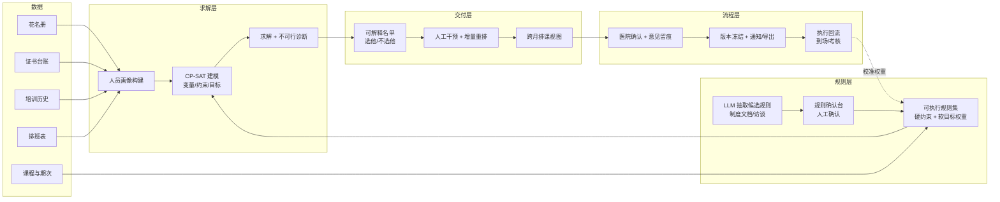

# 题 6 · 广源人力 | 上千名护士，这次培训到底该安排谁？

| 项 | 内容 |
|----|------|
| **业务目标** | 护理培训智能管理：分层抽选、名单确认与跨月排课 |
| **组数** | 1 组 |
| **行业** | 卫健服务（护理人力服务 / 医院培训管理） |
| **北极星指标** | **排课出单耗时**（含名单生成 + 跨月排课） |
| **角色配置** | Echo：人力运营 / 培训主管 · Delta：求解器 + 后端 |

> **一句话方案**：把"上千人 × 多医院 × 多约束 × 还要公平"的人工拉名单，变成**规则保证合法、算法保证最优、人工可解释可微调**的可确认名单。

---

## 一、场景

### 1.1 业务现场

客户医院（可能多家）要排护理培训：入职培训、专科培训、复训、考核。培训是上岗的前置条件——没完成/证书过期就上不了岗。

**要同时满足的约束：**

| 约束类型 | 具体 |
|---------|------|
| **硬约束（不能违反）** | 证书在有效期内（急救/专科/院感）、先修课程已完成、岗位/职称匹配、名额上限、班次冲突、同一医院配额 |
| **软目标（要优化）** | 覆盖率（该训的人尽量都排上）、公平（不能总是同一批人）、轮转（距上次培训时间越久越优先）、多样性（避免一个科室扎堆） |
| **流程约束** | 医院要确认名单（不是运营单方面定）、多医院要分别确认、跨月排课要看讲师/教室/场地、名额不满则不满 |

**现在的做法**：Excel 拉数据 → 人工筛选（VLOOKUP 找证书有效期）→ 人工排班避冲突 → 排不满就再手工调整 → 医院提出换人 → 再改。**改三轮，还常漏人**。

### 1.2 为什么"该安排谁"难

| 表层现象 | 真实根因 | 对应解法方向 |
|---------|---------|-------------|
| 漏人 | 靠人记 + Excel 筛选，"该训"没训全 | 规则引擎完整枚举"应训人员全集" |
| 排不满 / 排错班 | 约束没写出来，靠人脑 | 显式建模 + 求解器 |
| 医院要换人 | 名单不可解释，双方看不到依据 | 每条选派给理由 + 可人工干预后重排 |
| 名单反复改 | 改一处就崩一处 | 求解器**可重排**：锁定人工决定，其余自动重算 |
| 培训到场率低 | 排了但没去，无反馈闭环 | 执行数据回流，校准下一轮偏好 |
| 跨月排不开 | 只看单月，资源冲突月底爆发 | 跨月资源模型（讲师/场地/时段） |

### 1.3 现有资产

| 资产 | 说明 |
|------|------|
| 护士花名册 | 姓名、职称、学历、岗位、所属医院/科室、班次 |
| 证书台账 | 各类证书名称、发证日期、有效期、编号 |
| 培训历史 | 上过什么课、什么时候、考核成绩、学时 |
| 排班表 | 日常班次（决定可用时段） |
| 课程与期次 | 课程名、学分、先修要求、容量、讲师、地点 |
| 医院侧确认记录 | 谁能拍板要换人 |

### 1.4 ⚠️ 待 Day1 现场确认

- **规模**：护士总人数？涉及几家医院/多少科室？每月期次与容量？
- **"应训"的判定规则由谁定**？（入职未训？证书将过期？年度复训？）**这条规则就是整个系统的地基**
- **硬约束的完整清单**（HR / 医院 / 卫健口径可能不同）
- 排班的最小间隔（两场培训之间要不要间隔几天？上夜班后能不能上课？）
- 跨月约束：讲师、场地、每期容量是否共享？
- 医院确认流程：谁确认、多久回复、能不能改、改了怎么回写？
- 名单最终以什么形式交付（导出 Excel？推给医院？进系统？）
- 有没有历史排课记录与最终到场率？（**用于回测与校准**）

---

## 二、项目

### 2.1 项目定义与交付物

**「护理培训智能排课系统（资格规则引擎 + 约束求解 + 可解释名单）」**。

**交付物**：

1. **人员资质画像**：护士的证书、学时、培训历史、可用时段聚合成的"可培训画像"
2. **资格规则引擎**：显式化的硬约束（可读、可改、可审计）
3. **抽选求解器**：在硬约束下优化软目标，输出名单 + 得分 + 理由
4. **可解释名单**：每条选派显示"命中哪些规则""为什么是他""为什么不是他"
5. **人工干预 + 重排**：锁定/替换/排除后，求解器只重算其余部分
6. **跨月排课**：把多期次的容量、讲师、场地、时段一起排，输出月历视图
7. **确认流**：初稿 → 医院确认（含意见留痕）→ 冻结版本 → 通知/导出
8. **执行回流**：实际到场与考核结果回写，调整下一轮偏好

### 2.2 范围

| 做 | 不做（明确砍掉） |
|----|------------------------|
| **抽选 + 名单确认**（本题核心） | 不做完整课表引擎（讲师/场地的跨月优化只做简化版） |
| **一个月的排课** | 不做全年排课 |
| 硬约束**完整实现** | 不做软目标的精细权重调优（先跑通再调） |
| 名单可解释 + 人工干预重排 | 不做自动替代的"全自动排课黑箱" |
| Excel 导出 + 确认意见记录 | 不做与医院 HIS/教务系统的直连（`⚠️ Day1 确认`） |
| 执行回流（哪怕是手工回填表） | 不做复杂 BI |

### 2.3 角色分工

| 角色 | 承担人 | 职责 |
|------|--------|------|
| **Echo** | 人力运营 / 培训主管 | 定义"应训"规则与硬约束；给容量与跨月约束；**最终确认名单** |
| **Echo** | 医院侧培训负责人 | 确认名单、提换人意见；验证约束口径是否符合院规 |
| **Delta** | 求解器 + 后端 | 规则引擎、求解、画像、解释层、确认流 |
| **共同** | 教务/排课人员 | 确认期次、讲师、场地与时段约束 |

> ⚠️ **本题是六题里最容易被"AI 味"毁掉的一题**：最省事的做法是"用 LLM 直接推荐名单"——但这既不可靠（违反硬约束且不保证）也不可解释（医院不认）。
> **正解是：LLM 只用来把规则/约束从文档和口述里抽取成结构化约束；真正出名单的是求解器。** 这个区别必须在路演上讲清楚。

### 2.4 成功标准

Day3：运营用**真实花名册**跑出 30 天名单，**硬约束零违反**，并当场换掉 2 个人后重排成功（证明可干预 + 可重排）。

---

## 三、专项技术点

| # | 技术点 | 为什么必须做 | 落地要点 |
|---|--------|-------------|---------|
| 1 | **人员与培训本体（Objects）** | 约束要挂在明确对象上 | `Nurse`(职称/岗位/班次/证书/学时/历史)、`Hospital`/`Department`、`Course`(先修/学分/有效期)、`Session`(期次/容量/讲师/地点/时段)、`Assignment` |
| 2 | **资格规则引擎（硬约束）** | 规则必须可见、可改、可审计 | 规则用配置表达（可读 DSL 或表格）：证书有效期、先修、职称/岗位匹配、班次冲突、医院配额、容量；**规则与求解解耦** |
| 3 | **约束建模：为什么用求解器而不是 LLM** | 硬约束零违反是底线，LLM 无法保证 | 建模为 **CP-SAT（OR-Tools）**：变量 = 人×期次是否分配；约束 = 资格/容量/班次；目标 = 最大化加权得分（覆盖率 + 公平 + 轮转 + 多样性） |
| 4 | **规则抽取：LLM 的正确用法** | 规则散在制度文件和口述里 | LLM 从制度文档/访谈记录中**抽取候选规则 → 结构化 → 人工确认**；**LLM 不参与出名单** |
| 5 | **软目标打分函数** | 决定名单质量 | `score = w1·应训覆盖 + w2·距上次培训时长 + w3·科室分散度 + w4·历史到场率 + w5·学习连续性`；权重可调、可解释 |
| 6 | **公平性度量** | "公平"必须可判定，不能靠感觉 | 跨医院/科室分布的极差与基尼；"距上次培训最久者优先"命中率；输出对比表 |
| 7 | **可解释性（为什么是他 / 为什么不是他）** | 医院要改人，必须有据 | 逐条输出：命中的硬规则、软目标得分分解、竞争者与差距；**"未入选"的也给出原因**（"证书 10 月到期，不在本次范围"） |
| 8 | **人工干预 + 增量重排** | 名单必须可改，改后不能崩 | 锁定（locked）/ 替换 / 排除 → 求解器带固定解重算其余 |
| 9 | **跨月排课（简化版）** | 单月排不满会滚到下月爆雷 | 把 N 期次的容量与时段做成资源池；跨月冲突检测（同一时段同一讲师/场地）；跨月**轮转优先**（上期已训者降权） |
| 10 | **确认流与版本冻结** | 名单是正式依据 | 初稿 → 医院确认（意见与修改留痕）→ 冻结版本（不可变快照）→ 通知/导出；冻结后改动必须新版本 |
| 11 | **执行回流与校准** | 排了没来 = 排错 | 到场与考核结果回写 → 更新历史到场率权重 → 下一轮名单更准 |
| 12 | **输出与对接** | 要能落到实际流程 | Excel 导出（含理由列，可隐藏）、通知模板、必要的接口 |
| 13 | **数据隐私** | 护士个人信息敏感 | 最小化字段、访问分级、导出留痕；不把个人绩效数据混进公开视图 |

---

## 四、OKR

### O

> **把"上千名护士该派谁去培训"从两天的人工拉扯，变成两小时出一份规则合法、算法公平、逐条可解释、可由医院确认并微调的名单。**

| KR | 指标 | 基线 | 目标 | 怎么量 |
|----|------|------|------|--------|
| **KR1（北极星）** | 出名单**耗时**（数据准备 → 名单 + 排课） | 2 人 × 1 天（`⚠️ Day1 实测确认`） | **≤ 2 小时** | 端到端计时 |
| KR2 | **硬约束违反数** | 人工方案偶尔漏 | **= 0**（逐条断言：证书/先修/班次/容量/配额） | 求解后自动断言 + 人工复核 |
| KR3 | **应训覆盖率**（本期被安排人数 / 应训人数） | 人工基线 | **≥ 基线 + 20%**（相对提升） | 与人工方案同口径对比 |
| KR4 | **公平性**（跨医院/科室分布极差 + 最久未训优先命中率） | 人工方案基线 | **不劣于人工方案** | 对比表 |
| KR5 | 名单**可解释率** | 0 | **100%**（每条选派有理由；未入选也有原因） | 抽查 30 条 |
| KR6 | 人工**改单率** | — | **≤ 20%**（医院主动换人的比例） | 确认流记录 |
| KR7 | **人工干预重排成功率**（护栏） | — | 换人/锁定后重排 **100% 成功**，且**不违反硬约束** | 现场演示 2 次干预 |
| KR8 | 跨月冲突数 | — | **= 0**（讲师/场地/时段冲突） | 跨月校验脚本 |

> ⚠️ **KR2 与 KR7 是底线**：名单里出现一个证书过期的护士，医院就会整个退回。**"零违反"比"排得最优"更重要**。

---

## 五、解决方案

### 5.1 总体架构

### 5.2 关键链路：一次排课的一生

1. **取**：拉花名册 + 证书 + 培训历史 + 排班 + 期次，做字段映射与清洗
2. **定规则**：LLM 从制度文档/访谈记录抽取候选规则 → **人工确认台**逐条确认 → 生成可执行规则集
3. **建画像**：每名护士算出「应训？可训哪些课？可用时段？距上次培训多久？历史到场率？」
4. **解**：CP-SAT 求解：
   - 变量 `x[i][s]` = 护士 i 是否上期次 s
   - 硬约束：资格（证书/先修/岗位）、容量、班次冲突、医院配额、不可行则输出**冲突诊断**（谁为什么排不下）
   - 目标：最大化加权得分（覆盖 + 公平 + 轮转 + 多样性 + 到场率）
5. **解（第二把）**：可解释层为每条选派生成理由，为未入选者生成原因
6. **人工**：医院提出换人/排除 → 写入锁定解 → 求解器带固定解重算其余（KR7）
7. **跨月**：多期次资源池统一排，跨月冲突检测；上期已训者降权
8. **确认**：医院会签 → 冻结版本（不可变）→ 导出/通知
9. **回流**：实际到场与考核结果回写，更新到场率权重 → 下一轮更准

### 5.3 关键取舍

| 取舍点 | 选择 | 放弃的 |
|--------|------|--------|
| 出名单的引擎 | **CP-SAT 求解器** | LLM 直接推荐（不可靠、不可解释、医院不认） |
| LLM 的角色 | 只做**规则抽取**与理由生成 | 让 LLM 参与决策 |
| 规则载体 | 可读可编辑的配置/DSL | 硬编码在求解器里（业务改不动 = 部署一次就废） |
| 目标函数 | 可调权重 + **可解释分解** | 黑箱打分 |
| 优化程度 | 先保证**可行**，再在可行解里优化 | 一上来就追求最优（可能不可行 = 出不了名单） |
| 不可行时 | 输出**冲突诊断**（缺什么、谁卡住） | 随便给一份名单（会被打回） |
| 自动改单 | 需人工确认才冻结 | 自动替换（医院不接受） |
| 跨月 | 简化版（资源池 + 冲突检测） | 完整多目标排课优化 |

### 5.4 落地节奏

| 阶段 | 动作 | 交付物 |
|------|------|--------|
| **Day1 · 开题** | 跟运营做 2 小时访谈，**拿到"应训"判定规则与硬约束清单**；拿花名册样本（脱敏）+ 证书台账 + 排班表 + 期次表；用历史排课做回测基准；跑通需求五问法 | 规则清单 + 样本数据 + 回测基准 + 首轮路演稿 |
| **Day2 · 共解** | 规则抽取 + 确认台；画像构建；CP-SAT 建模 + 求解 + 不可行诊断；可解释层；人工干预重排；跨月视图；Excel 导出 | 可跑原型 + 一次真实排课结果 + 硬约束断言脚本 |
| **Day3 · 出厂** | 用**真实花名册**跑 30 天名单；运营当场换 2 人重排；医院代表确认名单并提意见；硬约束零违反断言演示 | 原型 + 名单样本 + 验证记录 |
| **后续 5 天节点** | 权重调优（对照历史到场率）、跨月资源优化、确认流与通知对接 | — |

### 5.5 评估与验证（结项证据）

| 证据 | 怎么产出 |
|------|---------|
| 真实卡顿 | 记录 2 次实际卡点（如"应训"规则口径与医院不一致、班次数据缺失） |
| 团队 AI 模型 | 回测脚本：历史人工名单 vs 系统名单的覆盖率/公平性对比 + 耗时对比 |
| 测试与验证记录 | 硬约束自动断言报告 + 人工干预重排演示记录 + 医院确认意见表 |

### 5.6 风险与兜底

| 风险 | 影响 | 兜底 |
|------|------|------|
| **"应训"规则拿不到/口径打架** | 名单基底错了 | Day1 硬性要求；运营与医院当场对齐一份**可执行规则清单**；规则以配置形式落地，便于后续改 |
| 排班数据不全或滞后 | 时段冲突算不准 | 用"保守时段"假设（宁可少排不误排）；缺失标记出来让运营补 |
| 容量不足导致排不下 | 求解不可行 | 求解器输出**不可行诊断**：缺多少容量、卡在哪些约束；据此建议加期次或放宽配额 |
| 求解不可行 | 出不了名单 | 先放宽软目标求可行解；再逐步加严；**任何时候都要能给出"为什么排不下"** |
| 医院不认机器选的名单 | 确认流卡住 | 可解释层 + 允许替换 + 权重可调；让医院参与权重设定 |
| 隐私 | 个人信息外泄 | 字段最小化、访问分级、导出留痕；对外视图不含绩效 |
| 排了没来 | 效果不达预期 | 执行回流 + 到场率权重；把"历史到场率低"的人排到次优先 |

---

## 六、可沉淀的通用件（碎石路 → 高速公路）

| 通用件 | 说明 |
|--------|------|
| **资格规则引擎（配置化）** | 任何"必须满足某些条件才能参加"的场景通用（排班、审计、准入、认证） |
| **CP-SAT 约束求解范式** | 从"AI 拍脑袋推荐"升级为"算法保证正确"的通用范式 |
| **LLM 只做规则抽取的分工** | 规则型业务落地的通用职责边界 |
| **可解释名单 + 人工干预重排** | 任何需要人拍板又不想全手工的分配场景通用 |
| **执行回流校准权重** | 任何"分配了但不一定执行"的运营闭环通用 |
