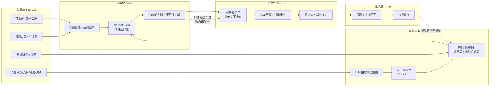

# 题 06 · 广源人力 | 上千名护士，这次培训到底该安排谁？

| 项 | 内容 |
|----|------|
| **业务目标** | 护理培训智能管理：分层抽选、名单确认与跨月排课 |
| **组数** | 1 组 |
| **行业** | 卫健服务（护理人力派遣 / 医院培训与评价管理） |
| **北极星指标** | **本期应训覆盖率**（被安排人数 / 应训人数） |
| **护栏指标** | **硬约束违反数 = 0** |
| **Echo / Delta** | Echo：人力运营 / 培训主管（主导）· Delta：求解器 + 后端 |

---

## 〇、企业背景与选题校准

| 事实 | 来源 | 等级 |
|------|------|------|
| 2003 年成立，由上海市卫生人才交流服务中心与《卫生资源》杂志社共同出资，定位"政府批准的卫生行业人才中介、派遣、培训及咨询机构" | 招聘公告页（etest8 一类页面）https://www.etest8.cn/ylws/shanghai/tongzhi/4360463.html | 4（仅作佐证） |
| 2021 年起卫才中心成为唯一股东，**国有背景**；注册资本 200 万；总部上海黄浦区成都北路 600 号 | 百科（引自国家企业信用信息公示系统）；顺企网 | 1 / 3 |
| 主营：人才派遣、人事外包、岗位外包、管理咨询、**培训评价**、专才招聘 | 公司官网 shgyhr.com；百科 | 3（仅供参考） |
| **据公开报道**：与 **155 家医院和医疗机构**合作，**劳务派遣人员超 2.2 万人** | 高校访企拓岗报道（湖南教育发布 / 中工网转载） | 3（仅供参考）；**⚠️ 口径待 Day1 现场确认** |
| 2025 年参保人数 22341 人，营业收入 33.65 亿元 | 百科（引自公开披露） | 3（仅供参考） |
| **2026-02-09 经上海市黄浦区人社局同意，备案为本区企业职业技能等级评价机构** | 上海市黄浦区人民政府 | 1 |
| 上海职业技能等级认定的官方机制 = **评价机构备案 + 目录清单 + 有效期评估（期满不再延续）** | 上海市人社局公告 https://rsj.sh.gov.cn/tbmts_17501/20231020/t0035_1418981.html ；备案评估公示 https://rsj.sh.gov.cn/tgsgg_17341/20260728/t0035_1442765.html | 1 |
| 《**新入职护士培训大纲（试行）**》2016 年国家卫生计生委办公厅印发，主要适用**三级综合医院**，其余参照执行 | 国家卫生计生委办公厅 2016 | 1 |
| 已有第三方产品：好医生医学教育中心「护士培训综合管理系统」 | https://www.cmechina.net/product_gl_05.jsp | 3（仅供参考） |

**校准（这决定方案怎么写）**：

1. **"上千名护士"是低估。** 据公开报道，实际派遣 2.2 万+、合作医院 155 家。**方案按"多院区、万级人群、跨月排课"设计**，不按单医院几十人设计。⚠️ 该口径来自报道而非官方披露，Day1 以内部花名册实测为准。
2. **"护理培训"是它的正式资质业务，不是附属动作。** 上海职业技能等级认定本身就是"**备案 + 目录 + 有效期评估（期满不再延续）**"的官方机制，公司 2026-02 刚获本区备案 → **证书有效期是有官方机制支撑的硬约束，名单错了是要出事的**。合规、留痕、可审计的门槛远高于民企。
3. **"分层"不是修辞，是刚需。** 《新入职护士培训大纲（试行）》主要适用三级综合医院、其余参照执行；而广源服务的医院口径并不统一（三级综合 vs 二级 vs 民营）→ **同一套清单不能直接套全部机构**。这正是业务目标里"**分层抽选**"中"分层"的真实含义：规则要按机构分类分层适用，名单要按层抽。
4. **真空白不是"没有信息化"。** 已有第三方产品（护士培训综合管理系统），2026 年公司也在采购"数字员工服务平台建设项目""AI 交互真人数字人"（3 级，仅供参考）→ 真空白是 **"资格判定 + 跨机构排课 + 可解释名单"** 这三件事没被同一个系统串起来。**本方案定位为接进现有数字化盘子里的一个模块**，不另起炉灶。
5. ⚠️ **照片未提供**：单次培训的参训规模、涉及医院数、期次与容量、"应训"判定规则在公司口径与医院口径的差异、现用系统（花名册与排课在哪个系统里）、历史排课与到场数据。**全部留到 Day1 现场确认。**

---

## 一、场景（L1 业务现场）

客户医院（可能多家）要排护理培训：入职培训、专科培训、复训、考核。**培训是上岗的前置条件——没完成、证书过期就上不了岗。**

**要同时满足的约束**：

| 约束类型 | 具体 |
|---------|------|
| **硬约束（不能违反）** | 证书在有效期内（急救 / 专科 / 院感，含人社技能等级认定证书）、先修课程已完成、岗位 / 职称匹配、名额上限、班次冲突、同一医院配额 |
| **软目标（要优化）** | 覆盖率（该训的人尽量都排上）、公平（不能总是同一批人、不能总偏向某类机构）、轮转（距上次培训时间越久越优先）、多样性（避免一个科室扎堆） |
| **流程约束** | 医院要确认名单（不是运营单方面定）、多医院要分别确认、跨月排课要看讲师 / 教室 / 场地、名额不满则不满 |

**现在的做法**：Excel 拉数据 → 人工筛选（VLOOKUP 找证书有效期）→ 人工排班避冲突 → 排不满再手工调整 → 医院提出换人 → 再改。**改三轮，还常漏人。**

**关键数字与口径**：据公开报道服务 155 家医院、派遣 2.2 万+；2025 年参保 22341 人（3 级，仅供参考）；2026-02 成为本区企业职业技能等级评价机构（1 级）。→ **规模是万级与多院区级，排课是跨月级的**，所以"人工 Excel + 改三轮"必然崩。

**数据在哪**：

| 资产 | 现状 | 缺什么 |
|------|------|--------|
| 护士花名册 | 姓名 / 职称 / 学历 / 岗位 / 医院 / 科室 / 班次 | 字段口径各院不一，缺跨机构统一 ID |
| 证书台账与培训历史 | 名称 / 发证日 / 有效期 / 编号；上过什么课 / 何时 / 成绩 / 学时 | 与课程先修、与人社目录的关系未结构化；与"距上次培训"口径未统一 |
| 排班表 | 日常班次 | 时段粒度粗，夜班与休息规则靠人记 |
| 课程与期次 | 课程 / 学分 / 先修 / 容量 / 讲师 / 地点 | 跨月资源池没建模 |
| 医院确认记录 | 谁拍板 | 无版本、无留痕 |
| 制度文件与访谈 | 人社目录、卫健口径、大纲、院内规定 | **没有变成机器可执行的规则** |

---

## 二、三层拆解树

### L1 业务问题

> **上千名护士，这次培训到底该安排谁？**

### L2 子问题（5 条能力缺口）

| # | L2 子问题（缺口） | 根因 | 为何值得做 |
|---|------------------|------|-----------|
| **L2-1** | **"谁该训"没有可执行、且可分层的判定口径** | 规则来自三类互不相同的权威来源——人社局职业技能等级认定目录（证书种类与有效期）、卫健口径、《新入职护士培训大纲（试行）》（主要适用三级综合医院）；而服务的医院口径不统一（三级综合 / 二级 / 民营），**同一套清单不能直接套全部机构**；这些规则还散在制度文件与口述里，各院 Excel 各写各的 | 这是整个系统的地基，也是"**分层抽选**"里"分层"的真实含义。基底错，后面覆盖率再高也是错的名单；医院第一个质疑的一定是"这个人为什么该训" |
| **L2-2** | **硬约束只存在于人的判断里，机器给不出零违反保证** | 证书有效期、先修、岗位职称匹配、班次冲突、名额、医院配额、排班滞后，全部靠翻表和记忆；改一轮名单崩一轮 | 名单里出现一个证书过期的人，医院会**整个退回**。本题的商业价值不在"更快"，在"**绝对不出错**" |
| **L2-3** | **名单不可解释、不可干预** | 选派说不出"为什么是他"，未入选说不出"为什么不是他"；医院一句"换人"就得从头重排 | 直接对应业务目标里的"**名单确认**"——没有解释与可干预接口，医院不会签这个名单 |
| **L2-4** | **跨月资源冲突与分层公平不在同一个模型里** | 只看单月，讲师 / 场地 / 时段冲突月底爆发；同一批人反复被排；三级综合与民营医院的公平与容量口径也不同 | 直接对应业务目标里的"**跨月排课**"；单月排得下不等于这个季度排得下 |
| **L2-5** | **名单没有正式依据的版本与留痕，执行效果也不回流** | 名单是给医院与卫健看的正式依据，现在只是一份 Excel；谁在何时基于哪版规则改的、依据是什么事后说不清；排了没来的数据也回不来 | 国有背景 + 评价机构备案身份，决定留痕与可审计是硬门槛；确认后若被推翻、责任不清，流程会卡死 |

### L3 机制（每个 L2 对应 2–3 条，全部标同族复用）

| 对应 L2 | L3 机制 | 怎么落地 | 同族复用（举一反三） |
|---------|---------|----------|----------------------|
| L2-1 | **官方口径锚定 + 机构分类分层规则集** | 规则分三层锚定：人社技能等级目录（证书种类/有效期）→ 卫健口径 → 《新入职护士培训大纲（试行）》；再按机构分类（三级综合 / 二级 / 民营）切成"**通用层 + 机构层**"，机构层只写差异 | 任何"同一制度、不同主体适用口径不同"的场景：不同规模企业的内控要求、医院等级分层诊疗、政务事项分层受理 |
| L2-1 | **LLM 规则抽取 + 人工确认台** | LLM 从制度文件、卫健口径与访谈记录中抽取**候选规则 + 出处片段** → 逐条由运营 / 医院确认；**LLM 只抽规则，不出名单** | 规则散在文件与口述里的场景：质检判定标准、准入审核条件、报销规则、审计取样口径 |
| L2-1 | **应训全集枚举 + 缺口清单** | 按分层口径**独立枚举"应训人员全集"**，逐个给出落选原因；额外输出"应训但谁都没排上"的缺口清单 | 需求预测、排班缺岗盘点、合规检查覆盖率盘点、补贴资格人群摸底 |
| L2-2 | **可执行规则集（配置化 DSL）** | 规则用可读表格 / DSL 表达，带版本、生效日期、来源出处、owner；硬约束与软目标权重分离；**业务改规则不发版** | 排班准入、审计取样规则、资质审核、授信评分卡、安全作业许可 |
| L2-2 | **CP-SAT 约束建模（零违反 + 不可行诊断）** | 变量 = 人 × 期次是否分配；硬约束 = 证书有效期 / 先修 / 岗位职称 / 班次 / 容量 / 医院配额；目标 = 最大化加权得分；**LLM 不参与决策**；不可行时输出缺多少容量、卡在哪条约束、放开哪条能解 | 排班、车辆调度、产能分配、值班编排、机房与设备资源分配 |
| L2-2 | **硬约束断言器（独立复核）** | 求解器之外再写一个**只读断言器**，逐条断言已排名单的合法性；任何一条违反即**拒绝出名单**，断言结果随名单留档 | 任何"错了就要退回"的交付物：结算单、放行单、资质名单、合规报送 |
| L2-3 | **可解释层（选他 / 不选他）** | 每条选派输出：命中的硬规则、软目标得分分解、竞争者与差距；**未入选者输出落选原因**（证书将过期 / 不在本次范围 / 名额已满） | 招生录取解释、授信审批理由、招聘推荐说明、供应商入围理由 |
| L2-3 | **人工干预 + 增量重排** | 锁定 / 替换 / 排除写入固定解，求解器带固定解重算其余部分；干预动作本身留痕 | 排班改单、产能临时调整、售后改派、审批退回改件 |
| L2-4 | **跨月资源池 + 轮转降权** | 期次容量 / 讲师 / 场地 / 时段做成资源池，跨月统一排并检测冲突；上期已训者降权，保证轮转 | 会议排期、设备维保排程、多班次轮岗、跨期项目排产 |
| L2-4 | **分层公平性度量** | 按机构类别 / 医院 / 科室 / 职称分层输出名额与实际落位对照：分布极差、最久未训优先命中率、每层配额达成率 | 配额分配评审、资源分配公平性公示、指标下达与对账 |
| L2-5 | **确认流 + 版本冻结 + 操作留痕** | 初稿 → 医院确认（意见与修改留痕）→ 冻结为**不可变快照**（规则版本 + 求解结果 + 解释全绑定）→ 通知 / 导出；改动必须新版本 | 审计取证、版本化报表、对外承诺文件、评标结果归档 |
| L2-5 | **执行回流与到场率校准** | 实际到场与考核结果回写，更新到场率权重 → 下一轮名单更准 | 任何"分配了但不一定执行"的运营闭环：派单、维保工单、驻场服务 |

> **L3 数量核对**：L2-1 → 3 条，L2-2 → 3 条，L2-3 → 2 条，L2-4 → 2 条，L2-5 → 2 条 = **12 条机制，不是 12 个 L2**。L2 保持 5 条不变（这是深度控制的上限，不再加）。

---

## 三、项目定义与范围

**「护理培训智能排课系统（资格规则引擎 + 约束求解 + 可解释名单）」**——把"上千人 × 多医院 × 多约束 × 还要公平"的人工拉扯，变成规则保证合法、算法保证公平、人工可解释可微调的名单。

**输入**：花名册 + 证书台账 + 培训历史 + 排班表 + 课程与期次 + 规则集
**输出**：分层名单（选他 / 不选他皆有理由）· 冲突诊断 · 跨月视图 · 冻结版本与确认留痕

| 做 | 不做（Day2 明确砍掉） |
|----|------------------------|
| **分层抽选 + 名单确认**（本题核心） | 不做完整课表引擎（讲师 / 场地的跨月优化只做简化版） |
| **一个季度（3 个月）跨月排课** | 不做全年排课 |
| 硬约束**完整实现** + 独立断言器 | 不做软目标的精细权重调优（先跑通再调） |
| 名单可解释 + 人工干预重排 | 不做"全自动排课黑箱" |
| Excel 导出 + 确认意见与版本留痕 + 执行回流（哪怕是手工回填表） | 不做与医院 HIS / 教务系统的直连（`⚠️ Day1 确认`）；不做复杂 BI，**不新建平台**，按现有数字员工服务平台的接口预留 |

**Echo / Delta 分工**

| 角色 | 承担人 | 职责 | 不可替代性 |
|------|--------|------|-----------|
| **Echo（主导）** | 人力运营 / 培训主管 | 定义"应训"口径与硬约束、给容量与跨月约束、**最终确认名单** | 口径与优先级只有业务方能定 |
| **Echo（医院侧）** | 医院培训负责人 | 确认名单、提换人意见、验证约束口径是否符合院规 | 院规与实际排班只有院方知道 |
| **Echo（共同）** | 教务 / 排课人员 | 确认期次、讲师、场地与时段约束 | 资源约束只有排课方掌握 |
| **Delta** | 求解器 + 后端 | 规则引擎、画像、CP-SAT 建模与求解、解释层、断言器、确认流 | — |

> ⚠️ **本题是六题里最容易被"AI 味"毁掉的一题**：最省事的做法是"用 LLM 直接推荐名单"——但这既**不可靠**（保证不了证书有效期这类硬约束）也**不可解释**（医院不认）。
> **正解：LLM 只负责把人社目录 / 卫健口径 / 大纲 / 制度文件里的规则抽取成结构化约束；真正出名单的是 CP-SAT 求解器。** 这个分工必须在路演上讲清楚。

**成功标准（Day3）**：运营用**真实花名册**跑出 30 天名单，**硬约束零违反（断言器通过）**，并当场换掉 2 个人后重排成功（证明可干预 + 可重排）。

---

## 四、专项技术点（三层技术栈）

| L1 技术域 | L2 组件 | L3 实现要点 |
|-----------|---------|-----------|
| **数据接入** | 人员主数据接入 | 花名册 / 证书台账 / 培训历史 / 排班表字段映射；**先接脱敏样本**；不追求全量字段 |
| | 期次资源与口径语料接入 | 课程、先修、学分、容量、讲师、场地、时段（跨月资源池在此成型）；人社目录 / 卫健口径 / 大纲 / 院内制度 PDF 与访谈转写 → 规则候选语料 |
| **本体层** | 培训本体 Ontology | Objects：`Nurse / Hospital / HospitalClass / Department / Certificate / Course / Session / Instructor / Venue / Assignment / TrainingRecord`；Links 固化（人→证书→有效期→课程先修→期次→班次）；**Actions + Write-back**：确认写回、到场回写、冻结版本；Rule 带 `source`（哪份口径 / 哪次访谈）、`version`、`effective_from`、`owner`、适用机构类别 |
| **规则层** | LLM 规则抽取 | 从制度文件与访谈中抽候选规则 + 出处片段；**输出结构化候选，不直接生效** |
| | 规则确认台 | 运营 / 医院逐条确认或修改，确认人 + 时间留痕；确认后才进入可执行规则集 |
| | 可执行规则集 | 表格 / DSL 表达；硬约束与软目标权重分离；分层规则按机构类别挂载 |
| **画像层** | 人员画像与应训全集 | 应训？可训哪些课？可用时段？距上次培训时长？历史到场率？证书余量天数；按分层口径枚举全集 + 每个未入选者落选原因 + 缺口清单（应训但未排上） |
| **求解层** | CP-SAT 建模与增量重排 | 变量 `x[人,期次]`；约束 = 资格 / 先修 / 岗位职称 / 班次 / 容量 / 医院配额；目标 = 加权得分；带固定解（锁定 / 替换 / 排除）重算其余，干预记录写入 |
| | 不可行诊断 | 缺多少容量、卡在哪条约束、哪些人被卡住、放开哪条能解 |
| | 硬约束断言器 | **独立于求解器**的只读复核器，逐条断言；不通过 = 拒绝出名单，结果随名单留档 |
| **解释层** | 选派 / 落选解释 | 命中规则、得分分解、竞争者差距；落选原因分类输出 |
| | 公平性度量 | 跨机构类别 / 医院 / 科室分布极差、最久未训优先命中率、每层配额达成率 |
| **交付层** | 名单视图与跨月视图 | 一屏：应训人数 / 已排 / 未排缺口 / 冲突提示 / 公平度对照 / 规则版本；月历视图 + 资源占用 + 冲突高亮 |
| | 确认流 | 初稿 → 医院确认（意见留痕）→ 冻结（不可变快照）→ 通知 / 导出 |
| | 导出与对接 | Excel（含理由列，可隐藏）+ 通知模板；**按现有数字员工服务平台的接口预留，不另起系统** |
| **回流层** | 执行回流 | 到场 / 考核回写；更新到场率权重 |
| **工程化** | 隐私、权限与部署 | 字段最小化、访问分级、导出留痕；个人绩效数据不进公开视图；内网部署，离线 Plan B（无 LLM 时靠结构化规则表 + 规则引擎照常出名单） |

---

## 五、OKR

### O

> **把"上千名护士该派谁去培训"从两天的人工拉扯，变成两小时出一份规则合法、分层公平、逐条可解释、可由医院确认并微调的名单。**

| KR | 指标 | 基线 | 目标 | 怎么量 |
|----|------|------|------|--------|
| **KR1（北极星）** | **本期应训覆盖率**（被安排人数 / 应训人数，按分层口径） | Day1 实测（人工方案同口径） | **≥ 基线 + 20 个百分点** | 名单人数 ÷ 应训全集人数（全集由同一枚举器产出） |
| KR2 | 出名单 + 排课端到端耗时（数据准备 → 名单可交付） | Day1 实测（预估 2 人 × 1 天） | **≤ 2 小时** | 端到端计时 |
| **KR3 | 公平性（跨机构类别 / 医院 / 科室分布极差 + 最久未训优先命中率） | 人工方案基线 | **不劣于人工方案** | 与人工方案同口径对比表 |
| KR4 | 名单**可解释率**（选派有理由、落选有原因） | 0 | **100%** | 抽查 30 条 + 系统计数 |
| KR5 | 医院**主动改单率** | — | **≤ 20%** | 确认流记录 |
| KR6 | 人工干预重排成功率 | — | **100%**，且**不违反硬约束** | 现场演示 2 次干预 |
| **KR7（护栏）** | **硬约束违反数**（证书有效期 / 先修 / 岗位职称 / 班次 / 容量 / 配额） | 人工方案偶有漏 | **= 0**（零违反） | 独立断言器报告 + 人工复核 |

> ⚠️ **KR7 是底线**：名单里出现一个证书过期的人，医院会整个退回；考虑到公司是本区备案的评价机构、证书有效期有官方认定机制支撑，**"零违反"比"排得最优"重要一个量级**。
> ⚠️ **KR1 与 KR7 是一对**：覆盖率是北极星，但只有在零违反的前提下才算成绩；覆盖率上去而违反数不为 0 = 失败，不是进步。

---

## 六、解决方案与架构

### 关键链路：一次排课的一生

1. **取**：拉花名册 + 证书 + 培训历史 + 排班 + 期次，做字段映射与清洗；**拿不到真数据就用假数据先把链路跑通**
2. **定口径**：按机构类别分层挂规则（人社目录 / 卫健口径 / 新入职护士培训大纲），LLM 抽取候选规则 → **人工确认台逐条确认** → 生成可执行规则集
3. **建画像 + 枚举全集**：每名护士算出「应训？可训哪些课？可用时段？距上次培训多久？历史到场率？证书余量多少天？」；再按分层口径算出**应训人员全集与缺口清单**（与求解分离，保证不漏人）
4. **解 + 验**：CP-SAT 求解——变量 `x[i][s]`、硬约束（证书 / 先修 / 岗位 / 班次 / 容量 / 配额）、目标（覆盖 + 公平 + 轮转 + 到场率）；不可行则输出**冲突诊断**；再由独立断言器逐条复核，**不通过就不出名单**
5. **解（第二把）**：为每条选派生成理由，为每个未入选者生成落选原因
6. **人工**：医院提出换人 / 排除 → 写入固定解 → 带固定解重排其余（KR6）
7. **跨月**：多期次资源池统一排 + 冲突检测；上期已训者降权保证轮转
8. **确认 + 回流**：医院会签 → 冻结版本（不可变）→ 导出 / 通知；实际到场与考核结果回写，更新到场率权重 → 下一轮更准

### 关键取舍

| 取舍点 | 选择 | 放弃的 |
|--------|------|--------|
| 出名单的引擎与 LLM 的角色 | **CP-SAT 求解器出名单**；LLM 只做规则抽取与理由润色 | LLM 直接推荐或参与决策（不可靠、不可解释、医院不认） |
| 规则来源与分层方式 | **人社目录 + 卫健口径 + 培训大纲**锚到出处；通用层 + 机构分类层（差异写规则表，不改代码） | 凭经验写规则（不可审计、会漂移）；一套清单套全部医院 |
| 规则载体 | 可读可编辑的配置 / DSL | 硬编码在求解器里（业务改不动 = 部署一次就废） |
| 目标函数与优化程度 | 可调权重 + **可解释分解**；先保证**可行**，再在可行解里优化 | 黑箱打分；一上来追求最优（可能不可行 = 出不了名单） |
| 不可行时 | 输出**冲突诊断** | 随便给一份名单（会被打回） |
| 自动改单 | 需人工确认才冻结 | 自动替换（医院不接受） |
| 系统边界 | 作为现有数字化平台的**一个模块**交付 | 另起炉灶建新平台（与在招的数字员工平台重复） |
| 跨月 | 简化版（资源池 + 冲突检测） | 完整多目标排课优化 |

### 落地节奏（Day1–Day3 + 5 天节点）

| 阶段 | 动作 | 交付物 |
|------|------|--------|
| **Day1 · 开题** | 与运营 + 医院做 2 小时访谈，**拿到分层口径与硬约束清单**；取人社目录 / 大纲 / 院内制度作规则语料；拿脱敏花名册样本 + 证书台账 + 排班 + 期次；用历史排课做回测基准；跑通需求五问法 | 分层规则清单 + 样本数据 + 回测基准 + 首轮路演稿 |
| **Day2 · 共解** | 规则抽取 + 确认台；画像与应训全集；CP-SAT 建模 + 求解 + 诊断；独立断言器；可解释层；人工干预重排；跨月视图；Excel 导出 | 可跑原型 + 一次真实排课结果 + 硬约束断言脚本 |
| **Day3 · 出厂** | 用**真实花名册**跑 30 天名单；运营当场换 2 人重排；医院代表确认名单并提意见；断言器零违反演示 | 原型 + 名单样本 + 验证记录 |
| **后续 5 天节点** | 权重调优（对照历史到场率）、跨月资源优化、确认流与既有平台接口对接 | — |

---

## 七、举一反三：本方案一并覆盖的同族问题

> 每条都满足：同数据形态 + 同痛点 + 不换业务知识即可复用。

| # | 同族问题 | 复用的 L3 机制 | 复用后长什么样 |
|---|---------|---------------|--------------|
| 1 | **医院招聘的岗位—资质匹配推荐**（护理岗 / 护工岗谁能上哪个班、持什么证） | CP-SAT 约束建模 + 可解释层 | 输出"这个人可上哪些班、依据是哪条规则"，岗位方自己解释得清 |
| 2 | **多院区培训名额分配与覆盖率盘点**（各医院分多少、谁没排上） | 应训全集枚举 + 分层公平性度量 | 每家医院的应训 / 已排 / 缺口一屏可见，配额争议当场对账 |
| 3 | **技能等级认定的考评员排期与考点评审**（公司已备案评价机构，这是正式业务） | 跨月资源池 + 分层公平性度量 | 考评员与考场按月排满并检测冲突；跨机构分布可审计 |
| 4 | **政府补贴 / 资格申报的名单筛查与报送留痕**（"符合条件人群"→名单→报送） | LLM 规则抽取 + 应训全集枚举 + 确认流版本冻结 | 口径来自官方文件并可溯源，报送版本不可变可举证 |
| 5 | **劳务派遣岗位的续聘 / 转正名额分配**（多约束 + 公平 + 解释 + 确认） | 硬约束断言器 + 可解释层 + 确认流 | 名额分配逐条给理由与竞争者差距，结果带冻结版本与留痕 |
| 6 | **城市公交司机排班与调休**（同样是"人 × 班次 × 硬约束"，规则表驱动即可换业务） | 可执行规则集 DSL + CP-SAT 建模 + 断言器 | 换一张规则表即成一套排班；工时与资质冲突由断言器兜底 |

> **一句话**：这不只是"排课工具"。它同时是**资格规则引擎、分层公平性度量、正式依据的版本留痕、培训评价体系的数据底座**——四条线共用一套规则集与可解释求解（**碎石路 → 高速公路**：换行业只换数据与规则表，方法不动）。

---

## 八、风险兜底与 Day1 必问

### 风险与兜底

| 风险 | 影响 | 兜底 |
|------|------|------|
| **做成"LLM 直接推荐名单"** | 既不可靠也不可解释，医院不认 → 本题最大失败 | 分工写死：LLM 只抽规则；名单只由 CP-SAT 产出；独立断言器零违反才放行 |
| **"应训"口径拿不到 / 公司口径与医院口径打架** | 名单基底错了 | Day1 硬性要求：运营与医院当场对齐一份**按机构分类分层的可执行规则清单**；规则以配置形式落地，便于后续改 |
| **分层规则被简化成"一套清单套全部"** | 三级综合与民营医院口径不同，名单会被退回 | 通用层只放全国/市级统一口径（证书有效期、大纲主干），差异一律进机构层；断言器按机构类别分别校验 |
| 排班数据不全或滞后、容量不足 / 跨月资源冲突导致不可行 | 时段冲突算不准；出不了名单 | 用"保守时段"假设（宁可少排不误排），缺失显式标出让运营补；不可行诊断：缺多少容量、卡在哪条约束、放开哪条能解，据此建议加期次或放宽配额 |
| 求解不可行 | 名单发不出去 | 先放宽软目标求可行解，再逐步加严；**任何时候都要能回答"为什么排不下"** |
| 医院不认机器选的名单 | 确认流卡住 | 可解释层 + 允许替换 + 权重可调；让医院参与权重与分层口径设定 |
| 隐私 / 个人信息外泄 | 合规事故 | 字段最小化、访问分级、导出留痕；对外视图不含个人绩效 |
| 排了没来 | 效果不达预期 | 执行回流 + 到场率权重；历史到场率低者排到次优先 |

### Day1 现场必问

1. **规模与口径**：护士总人数？涉及几家医院、几家三级综合？每月期次与容量？（据公开报道为 155 家医院 / 2.2 万人，`⚠️` 以内部数据为准）
2. **"应训"的判定规则由谁定？**（人社目录里的哪些证书 / 哪些课程 / 判定周期）**公司口径与医院口径一致吗？哪些机构按三级综合、哪些参照执行？**
3. **硬约束完整清单**：证书有效期、先修、岗位职称、班次、名额、医院配额——HR / 医院 / 卫健口径是否一致？
4. 排班的最小间隔（两场培训之间要不要间隔几天？上夜班后能不能上课？）
5. 跨月约束：讲师、场地、每期容量是否共享？跨月是否有总量上限？
6. 医院确认流程：谁确认、多久回复、能改哪些、改了怎么回写？
7. 名单最终以什么形式交付（导出 Excel？推给医院？进哪个系统？）
8. **现用系统**：花名册、证书台账、排课分别在哪个系统里？2026 年在招的"数字员工服务平台"进度如何？**本方案能不能直接做成它的一个模块？**
9. 有没有历史排课记录与最终到场率？（**用于回测与权重校准**）

> 备选方向（若第 2、8 题答案是否定的）：把题 6 收缩为"**单一机构类别（如仅三级综合医院）+ 单一课程线（如新入职培训）**"的更小切口——用一份最清晰的分层规则把资格判定与跨月排课跑通，再扩机构类别与课程线。
